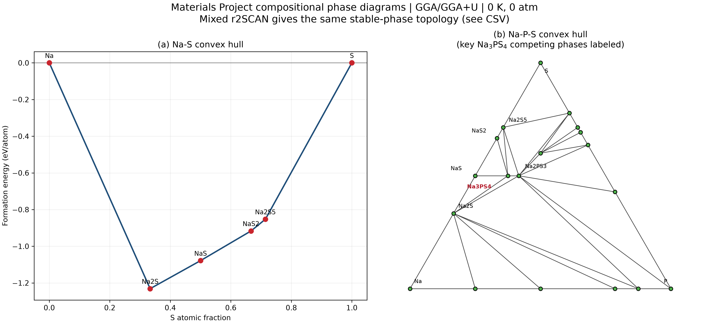
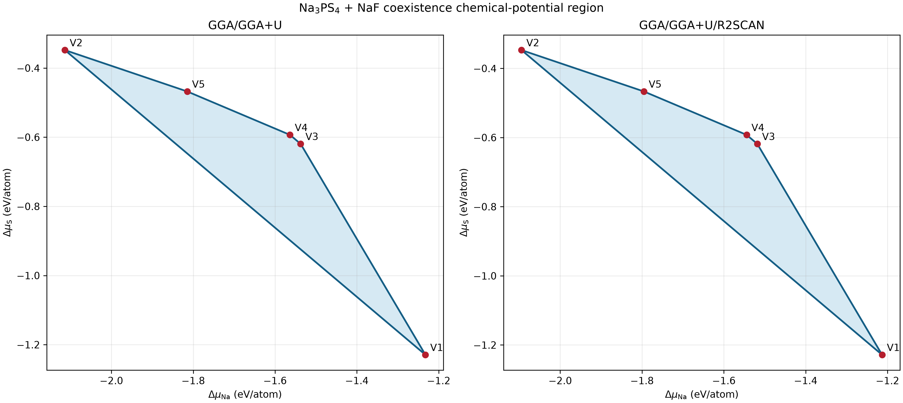
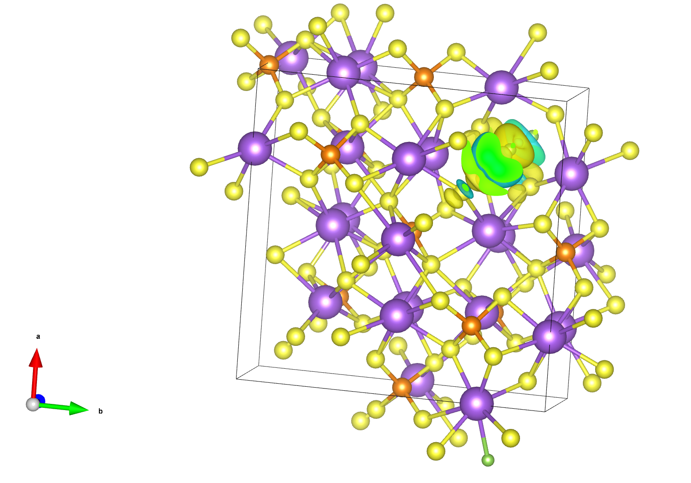

需要分析的结构是$\rm Na_3PS_{3.85}F_{0.15}$哈mm有点奇怪，异价掺杂但却没有空位。

依然使用`xtalkit`工具箱，获取mp-28782结构，这是$\rm Na_6P_2S_8$，最终需要扩胞到$\rm Na_{60}P_{20}S_{80}$，然后掺杂，变为$\rm Na_{60}P_{20}S_{77}F_3$，也即最终的结构。

运行:
```bash
uv run xtalkit shry prepare mp-28782.cif \
  --out Na3PS3.85F0.15_ready.cif \
  --set-occupancy "S3:S77/80F3/80" \
  --parent-spacegroup 114 \
  --target-formula Na60P20S77F3 \
  --scaling-matrix \
     2  1  0 \
    -1  2  0 \
     0  0  2
```

然后检查manifest:
```bash
python -m json.tool Na3PS3.85F0.15_ready.cif.manifest.json
```

确认信息无误后执行:
```bash
uv run xtalkit shry count \
  Na3PS3.85F0.15_ready.cif \
  --scaling-matrix \
     2  1  0 \
    -1  2  0 \
     0  0  2 \
  --symprec 0.01 \
  --angle-tolerance 5 \
  --atol 1e-5 \
  --out F015_count.json
```

然后再次确认:
```bash
python -m json.tool F015_count.json
```

无误后开始计数:
```bash
uv run xtalkit shry enum \
  Na3PS3.85F0.15_ready.cif \
  --scaling-matrix \
     2  1  0 \
    -1  2  0 \
     0  0  2 \
  --symprec 0.01 \
  --angle-tolerance 5 \
  --atol 1e-5 \
  --expect-count 2054 \
  --target-formula Na60P20S77F3 \
  --write-cif \
  --write-poscar \
  --out F015_SHRY
```


最初，我想的是枚举扩胞，POSCAR结构是$\rm Na_{60}P_{20}S_{77}F_3$。师兄用的结构是$\rm Na_{23}P_8S_31F$。


在Phys. Chem. Chem. Phys., 2018, 20, 20525这份文献中，作者将迁移活化能细分:
$$
E_{\rm activation}\approx E_{\rm binding}+E_{\rm migration}
$$
$\rm Na_3PS_4$掺杂体系中存在这$V^{'}_{\rm Na}-X^{*}_{\rm S}$缺陷对，前者的结合能可看做Na空位逃逸掺杂缺陷所需的能量，后者迁移能即为自由钠空位(钠离子)迁移所需要的能量。结合能可用孤立缺陷对方法求解:
$$
E_{\rm binding}=\sum E_{\rm isolate}-\sum E_{\rm defect~pair}
$$
此外，DFT计算指出，0K部分固态电解质并不算稳定:
$$
\rm Na_{47}P_{16}S_{63}X \longrightarrow P_2S_5 +Na_2S+NaX
$$
反应吉布斯自由能略微大于0，类似的情况也出现在LGPS、$\rm Na_{10}SnP_2S_{12}$上，比如LGPS:0.025eV/atom，$\rm Na_{10}SnP_2S_{12}$:0.007eV/atom，但这种吉布斯自由能变上升会在高温下因熵效应而得到补偿。

另一篇涉及热力学、相图的非常不错的文献是J Mater Sci (2022) 57:10475–10498。文献给出形成能定义:
$$
\Delta E_f=E-\sum_i^Nn_i\mu_i
$$
$\Delta E_f$来源于internal energies，只反应化学键合能差，不包含熵效应，因此这个"能"指热力学能近似而非吉布斯自由能。

不过在0K下，对于凝聚相系统，$G\approx U$


本次计算所涉及的材料包括:

| 符号          | 组成                         | `ENERGY(SIGMA->0)` (EV) | 来源                                               |
| ----------- | -------------------------- | ----------------------- | ------------------------------------------------ |
| A           | Na24P8S32                  | -263.49702674           | `我的数据/2_缺陷形成能/A_Na24P8S32/static/OUTCAR`         |
| B           | Na24P8S31F                 | -262.83937078           | `我的数据/2_缺陷形成能/B_Na24P8S31F/static/OUTCAR`        |
| C1          | Na23P8S32                  | -259.52048395           | `我的数据/2_缺陷形成能/C1_Na23P8S32_type1/static/OUTCAR`  |
| C2          | Na23P8S32                  | -259.56210801           | `我的数据/2_缺陷形成能/C2_Na23P8S32_type2/static/OUTCAR`  |
| D(vac2,最稳定) | Na23P8S31F                 | -260.80904463           | `我的数据/2_缺陷形成能/D_Na23P8S31F1/static/OUTCAR`或者基准数据 |
| Na cell     | bcc Na, 2 Na/晶胞(mp-127)    | -2.62163986             | `我的数据/1_参考态/Na_mp127/static/OUTCAR`              |
| Na cell     | hexagnol Na,2 Na(mp-10172) | -2.60109480             |                                                  |
| S cell      | 32 S/晶胞                    | -131.81475327           | `我的数据/1_参考态/S_mp77_定容/static/OUTCAR`             |
| F2 cell     | 2 F/晶胞                     | -3.60772515             | `我的数据/1_参考态/F2/static/OUTCAR`                    |
|             |                            |                         |                                                  |
F掺杂形成能:
- 考虑空位: -260.80904463-131.81475327/32 +3.60772515* 0.5+259.56210801=-3.552813284687545
- ==不考虑空位==: -262.83937078-131.81475327/32 +3.60772515* 0.5+263.49702674=-1.6576925046875317
不考虑空位的计算公式如下:

$$
\Delta E_f(X_{\rm S}^{*})=E(\rm Na_{24}P_8S_{31}F)+\mu_{\rm S}-(E(\rm Na_{24}P_8S_{32})+\mu_{\rm F})
$$


Na空位形成能:
- 考虑F:$\Delta E_f=\rm E(Na_{23}P_8S_{31}F)+\mu_{Na}-E(Na_{24}P_8S_{31}F)$ 
	- -260.80904463-2.62163986/2+262.83937078=0.719506220000028
- 不考虑F:$\Delta E_f=\rm E(Na_{23}P_8S_{32})+\mu_{Na}-E(Na_{24}P_8S_{32})$
	- -259.56210801-2.62163986/2+263.49702674=2.62409880000007

均相差甚远呢。计算相图，考虑$\Delta \mu <0$的情况，那么以D1、mp-127为例，空位形成能上下界为:
$$
E_f^{V1}=E_{def}-E_{bulk}+E_{\rm Na}^{\rm own}-1.232434=-0.5034559799999436
$$

$$
E_f^{V2}=E_{def}-E_{bulk}+E_{\rm Na}^{\rm own}-2.113711=-1.3847329799999435
$$
化学势被定义为偏摩尔吉布斯自由能:
$$
\mu=(\dfrac{\partial G}{\partial N})_{T,P}
$$
超额化学势定义为体系化学势与参考态化学势的差值:
$$
\Delta \mu_A = \mu_A - \mu_A^{0}
$$
对于$\rm Na_3PS_4+NaF$的体系，收到以下约束:
$$
\begin{cases}
3\mu_{\rm Na}+\mu_{\rm P}+4\mu_{\rm S}=G_{\rm Na_3PS_4}\\
\mu_{\rm Na}+\mu_{\rm F}=G_{\rm NaF}
\end{cases}
$$
自由度减少为2，在恒温恒压下可画出二维图像，以$\Delta \mu_{\rm}, \Delta \mu_{\rm F}$为例:


每一个竞争相都会给出一个不允许析出的不等式，比如:
$$
2\Delta\mu_{\mathrm{Na}} + \Delta\mu_{S} \leq \Delta E_f(\mathrm{Na_2S})
$$
假设横轴$x=\Delta \mu_{\rm Na}$，纵轴为$y=\Delta \mu_{\rm S}$。所以它的边界为:
$$
y=\Delta E_f(\rm{Na_2S})-2x
$$

边界是一条直线，其他竞争相也同理，最终画出来是:


可看到，在热力学相稳定性的约束下，$-1.23~\rm eV/atom \le \Delta \mu_{\rm Na} \le -2.11~ \rm eV/atom$。

完整的绝对化学势$\mu_A$数据如下:

| 顶点  | 另外两个共存相                                | $\mu_{\mathrm{Na}}$ | $\mu_{\mathrm{P}}$ | $\mu_{\mathrm{S}}$ | $\mu_{\mathrm{S}}$ |
| --- | -------------------------------------- | ------------------- | ------------------ | ------------------ | ------------------ |
| V1  | $\mathrm{Na_2PS_3} + \mathrm{Na_2S}$   | -2.554960           | -5.820945          | -5.365783          | -6.556072          |
| V2  | $\mathrm{Na_2PS_3} + \mathrm{Na_2S_5}$ | -3.436237           | -6.702222          | -4.484506          | -5.674795          |
| V3  | $\mathrm{NaS} + \mathrm{Na_2S}$        | -2.859963           | -7.345959          | -4.755777          | -6.251069          |
| V4  | $\mathrm{NaS} + \mathrm{NaS_2}$        | -2.886042           | -7.372039          | -4.729698          | -6.224990          |
| V5  | $\mathrm{NaS_2} + \mathrm{Na_2S_5}$    | -3.137182           | -7.120898          | -4.604128          | -5.973849          |
绝对化学势$\rm \mu_A=\mu_A^0+\Delta \mu _{A}$，在相图计算过程中并未涉及到DFT计算，未计算参考态能量，所以直接代入绝对化学势是不妥当的。

超额化学势$\Delta \mu_A$的数据如下:

| 顶点  | $\Delta\mu_{\mathrm{Na}}$ | $\Delta\mu_{\mathrm{P}}$ | $\Delta\mu_{\mathrm{S}}$ | $\Delta\mu_{\mathrm{F}}$ |
| --- | ------------------------: | -----------------------: | -----------------------: | -----------------------: |
| V1  |                 -1.232434 |                -0.407643 |                -1.229333 |                -4.641494 |
| V2  |                 -2.113711 |                -1.288920 |                -0.348056 |                -3.760217 |
| V3  |                 -1.537437 |                -1.932657 |                -0.619327 |                -4.336491 |
| V4  |                 -1.563517 |                -1.958736 |                -0.593248 |                -4.310412 |
| V5  |                 -1.814657 |                -1.707596 |                -0.467678 |                -4.059272 |

这种方法相比能量/原子数来获得化学势的方法更精确一些，但依然是忽略了零点振动能等能量的近似。


过渡态使用NEB方法计算，初和末image为两个含有空位的$\rm Na_{23}P_8S_{32}$，最终未掺杂的结构能垒为0.6222 eV


看看AIM电荷，这其实是第一次计算吧。以$\rm Na_{24}P_8S_{32}$为例，首先完成几何优化，在单点计算时加上参数`LAECHG = .TRUE.`。这个参数第一次接触，默认关闭，若开启，VASP会显式地重建并写入所有电子(全电子密度)的电荷密度到文件，包括芯电子密度、原初原子价密度(计算开始时，根据孤立原子的价电子密度叠起来的一个参考密度)、自洽价密度，分别对应AECCAR0, AECCAR1, and AECCAR2(SCF 收敛以后，经过 PAW all-electron reconstruction 的价电子密度)这几个文件。从定义上看`AECCAR2`和`CHGCAR`有些类似。在离原子核较远处，`CHGCAR`和`AECCAR2`所代表的电子密度比较接近，但是非常靠近原子核时，PAW 会把难处理的、疯狂振荡的真实价电子波函数换成比较光滑的 pseudo wavefunction，而 `AECCAR2` 进行了 AE reconstruction，重新恢复了核附近真实价电子密度的一些剧烈结构

然后使用VTST中的Perl脚本:
```bash
chgsum.pl AECCAR0 AECCAR2
```
运行后生成`CHGCAR_sum`，它将芯电子密度和PAW重构后的价电子密度叠加。

接着运行`bader`这个二进制文件:
```bash
bader CHGCAR -ref CHGCAR_sum
```
程序会利用`CHGCAR_sum`，根据AIM理论划分AIM原子盆。

如果直接使用平滑后的电子密度`CHGCAR`来划分原子盆，那么某些原子的核附近电子密度结构可能会被赝势“削平”。

AIM盆的边界满足:
$$
\nabla \rho \cdot\mathbf{n(r)}=0
$$
盆边界确定以后，程序然后对该盆里的电子密度积分可得到盆里的电子数:
$$
N_A=\int_{\Omega_A}\rho(\mathbf{r})d {\mathbf r}
$$
程序最终输出`ACF.dat`、`BCF.dat`、`AVF.dat`。大多数情况下看`ACF.dat`即可，里面记录的是每个原子在AIM盆中的电荷数。比如$\rm Na_{24}P_8S_{32}$:
```cmder
λ cat ACF.dat
    #         X           Y           Z       CHARGE      MIN DIST   ATOMIC VOL
 --------------------------------------------------------------------------------
    1    0.000000    3.504683    2.994809    6.151045     1.032568    10.206855
    2    0.000000   10.514048    2.994809    6.151045     1.032568    10.206855
    3    3.504683    0.000000    4.147234    6.151045     1.032568    10.206855
    4   10.514048    0.000000    4.147234    6.151045     1.032568    10.206855
    5    3.504683    7.009366    0.576213    6.151045     1.032568    10.206855
```
第一个原子盆对应Na，AIM盆体积为10.2068$\rm Å^3$，由于Na使用的PAW势为Na_pv，因此有7个价电子，AIM盆中有6.15个电子。AIM电荷定义为:
$$
q_A=Z_{\rm VAL}-N_{A}^{\rm Bader}
$$
盆中的电子数少于价电子数，很明显Na带7−6.151045=+0849个原子电荷。最终统计数据如下:

| 元素  | 原子数 | Bader 电荷平均值 | 价电子数 |   AIM 电荷平均值 |           总 AIM 电荷 |
| --- | --: | ----------: | ---: | ----------: | -----------------: |
| Na  |  24 |    6.148305 |    7 | $+0.851695$ |       $+20.440688$ |
| P   |   8 |    3.806308 |    5 | $+1.193692$ |        $+9.549536$ |
| S   |  32 |    6.937194 |    6 | $-0.937194$ |       $-29.990208$ |
| 合计  |  64 |           — |    — |           — | $\approx 0.000000$ |

$\rm Na_{23}P_8S_{31}F$的数据如下:

| 原子编号 | 元素  | 与 F 距离 (Å) | Bader 电荷 | 价电子数 | AIM 电荷    |
| ---- | --- | ---------- | -------- | ---- | --------- |
| 31   | P   | 1.673      | 3.372201 | 5    | +1.627799 |
| 15   | Na  | 2.673      | 6.140133 | 7    | +0.859867 |
| 14   | Na  | 2.837      | 6.144617 | 7    | +0.855383 |
| 62   | S   | 2.951      | 6.848421 | 6    | −0.848421 |
| 33   | S   | 3.699      | 6.904765 | 6    | −0.904765 |
| 51   | S   | 3.853      | 6.941452 | 6    | −0.941452 |
| 2    | Na  | 3.981      | 6.146287 | 7    | 0.853713  |
| 4    | Na  | 4.171      | 6.147733 | 7    | +0.852267 |
| 63   | F   | 0          | 7.818446 | 7    | −0.818446 |


至此，Bader分析实际上已经完成了。然后使用`vaspkit`的508功能生成`bader.pqr`，之后就可以载入VMD中着色了，

```
mol scaleminmax 0 0 -1.2 0.95

color scale method BWR
color scale midpoint 0.55814

package require colorscalebar
::ColorScaleBar::color_scale_bar 0.8 0.05 0 1 -1.2 0.95 6
```
不过着色之后其实也不算直观😂

至于电子密度差，Δρ = ρ(AB) − ρ(A) − ρ(B)，AB 是整体，A、B 是拆出来的两个片段（片段冻结在 AB 几何、不弛豫）。即关键在于三套计算必须可直接逐网格点相减，使用同一个晶胞、同一个坐标系、同一套FFT网格(NGXF、NGXY、NGXZ)。

DFT计算结束后，运行vaspkit，选择314，做电荷差分，根据提示依次输入AB体系， 片段A和片段B的CHGCAR文件所在的位置，就可以得到CHGDIFF.vasp文件。CHGDIFF.vasp在VESTA中打开，可以得到图像了。


设置完boundary和原子显示后:


沿用vesta默认设置，黄色部分代表电子密度差>0，表示该空间位置相对于“F + host 两个孤立片段的电子密度简单叠加”出现了电子积累，而青色的部分电子密度差<0，表示电子耗尽。


VASP使用平面波基组，如想研究s、p、d、f等LACO局域原子轨道波函数，需要使用`LOBSTER`，把 VASP 的平面波波函数投影回一套局域原子轨道基组，然后构造类似紧束缚/局域轨道表象下的 Hamiltonian population。类似于:
$$
\text{COHP}_{ij}(E)\sim H_{ij}\times \text{DOS}_{ij}(E)
$$
它把DOS里的电子态拆分成键合程度。传统COHP的符号约定是大于零反键，小于零成键。许多文献往往会计算-COHP，这样成键时-COHP就>0。

将COHP 从低能积分到某个能量(通常是Fermi能级):

$$
\text{ICOHP}_{ij}(E_F)=\int_{-\infty}^{E_F}\text{COHP}_{ij}(E) dE
$$

- `COHPCAR.lobster`：能量分辨的 COHP 曲线，拿来画图。
- `ICOHPLIST.lobster`：每一对键的积分 COHP 数值，直接读表。
- `COOPCAR.lobster` / `ICOOPLIST.lobster`：COOP，基于 overlap population 的成键分析。
- `COBICAR.lobster` / `ICOBILIST.lobster`：COBI，偏 bond-order/bond-index 的描述。
- `DOSCAR.lobster`：LOBSTER 投影后的 DOS/PDOS。
- `CHARGE.lobster`：Mulliken/Löwdin 类原子电荷。
- `GROSSPOP.lobster`：gross orbital population。
- `projectionData.lobster`：轨道投影本身的大文件。
- `lobsterout`：非常重要，里面要检查 projection quality，特别是 charge spilling。

涉及到的概念非常多，方法学的文献没怎么阅读😂经验也不多、理解也还不算深入，就简单记录一下吧。


在分组动力学模拟后处理的时候。

一个快离子导体的载流子扩散，α通常不是从头到尾都等于，大概会经历:

ballistic→vibration/caging→hopping diffusion

下图是nps的α-t图，我真是一上来就没绷住😢，这噪声也太大了。


载入VMD中unwrap观察轨迹可以看到钠离子确实是在迁移的，xyz方向的MSD曲线线性倒也还行。目前推测可能是mlipx的问题，后续想办法修一修。

就取100-300ps吧，使用kinisi模块进行分析。
平均示踪扩散系数为$D_{\rm tr} = 5.309\times 10^{-10} \rm m^2/s$，95%置信度下的示踪扩散系数区间为$[1.438 \times 10^{-10}, 9.335\times 10^{-10}] \rm m^2/s$

掺入F的体系的α-t图倒是好多了:

MSD图表明两个体系进入扩散的区间具有明显的差异，这种差异来源于两个体系的动力学性质不同。
掺杂体系使用50-220ps进行kinisi拟合计算。
平均示踪系数为$D=1.391\times 10^{-9} \rm m^2/s$，95%置信度下的示踪扩散系数区间为$[9.302\times 10^{-10}, 1.839\times 10^{-9} \rm m^2/s]$，扩散明显增强。
