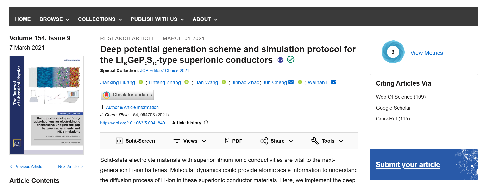

这是一篇 J. Chem. Phys. 上的计算文章，引用量比较高，研究的是固态电解质里的离子扩散。要说明它为什么值得读，得先看扩散系数有多难算。

最直接的办法是 AIMD，物理上干净，几乎不依赖经验拟合，但它太贵：几十皮秒的时间尺度、几百个原子的体系，基本就是它的上限。而要拿到精确的扩散系数，得在**纳秒**尺度上看离子跑动，室温下更不必想。所以常见的做法是绕一下路：先在高温（600–1200 K）下跑 100–400 ps，假设一条单一的阿伦尼乌斯关系贯穿整个温度区间，再从高温一路外推到工作条件（–40 °C 到 80 °C）下的离子电导率。假设阿伦尼乌斯关系处处成立，等于假设扩散机制不随温度改变。这样做有两个隐患：只要阿伦尼乌斯关系在某个温度区间失效，整个预测就失去了立足点；而且 AIMD 在室温下应用于固态电解质材料时，往往会**显著高估**扩散系数，并不是"算慢了这么一点"的问题。

更彻底的出路是直接在室温下模拟扩散本身。这需要更大的体系和更长的轨迹来保证收敛，也就需要用机器学习势来描述势能面对原子坐标的多体、非线性依赖。但训练数据从哪来？最直接的来源还是 AIMD。原文在这里引了一句话，说得比转述更清楚：

> However, this procedure is computationally demanding, and the generated snapshots are highly correlated, **reducing the quality** of the training data

AIMD 轨迹里相邻的快照高度相关，真正独立的信息并不多。因此大多数基于机器学习的模型开发都夹杂着大量试错，可靠性也因此受到质疑。作者的回应是把试错变成可量化的自动迭代，这就是 DP-GEN 并发学习框架。

下面是跟着这篇文章复现的记录。严格说，这是一次没有完成的复现：原文给出的细节有限，不少生成参数只能靠猜；训练推进到第二阶段（超胞模型）时显存不足，16 GB 的卡撑不住，只好停在那里。不过停下的只是训练这一条线。跑模拟的间隙里，我补了不少后处理、统计和可视化方面的课，笔记记了一路，就是文章的后半部分。前一半是照着别人的文章走，后一半更像是自己摸索出来的学习记录。复现算不上成功，这些笔记多少还是有些用处的。

## DP-GEN 并发学习——失败😢

作者用的框架是 DP-GEN，深势科技参与开发，应该和 DeepMD 项目有些渊源。

它的迭代逻辑不复杂，三步反复：用高精度单点 DFT 给构型"打标签"；用整个数据集同时训练一组四个结构相同（相同网络层数和节点数）、随机种子不同的 DP 模型；让这四个刚训练好的模型去跑 MD，跑的过程中实时计算每个时刻构型的 $\sigma^{\max}_f$。力的最大偏差定义为

$$
\sigma_f^{\max} = \max_i \sqrt{\left\langle \left\| f_i - \langle f_i \rangle \right\|^2 \right\rangle},
$$

它被用来回答一个很朴素的问题：当前这个构型，对模型来说是"已知领域"还是"未知领域"。筛选机制分三档：$\sigma^{\max}_f < 0.12\ \rm eV/Å$，四个模型达成共识，预测可靠；$0.12 < \sigma^{\max}_f < 0.25\ \rm eV/Å$，模型之间有分歧，说明这个构型落进了"未知领域"，选为候选（Candidate），送回第一步给 DFT 打标签；$\sigma^{\max}_f > 0.25\ \rm eV/Å$，模型完全失控，轨迹可能已经跑飞，直接丢弃。一轮一轮下去，训练集越来越充实，直到新构型中候选的比例低于某个阈值，迭代自动停止。

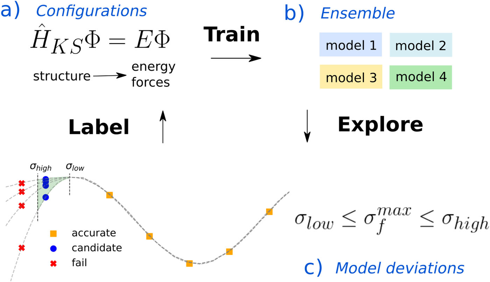

启动迭代需要一个初始数据集：从 DFT 弛豫后的结构出发，通过微扰生成几百个初始构型。LGPS 的原始结构从 Materials Project 获取（ID: `mp-696138`），用 VASP 6.6.0 做变胞优化，优化后晶胞参数为：

```
a =  8.64965 Å      α = 91.3519°
b =  8.81431 Å      β = 90.5405°
c = 13.04186 Å      γ = 90.2858°
V = 993.9863 Å^3
```

安装 DP-GEN 只有一行：

```bash
uv pip install dpgen
```

原文并没有给出生成这 590 个构型所用的具体参数，比如体积缩放列表 `scale`、每个体积生成几个 `pert_numb`、晶胞扰动幅度 `pert_box`、原子扰动幅度 `pert_atom`、随机种子，以及是否经过短程 AIMD 后抽帧。只好自己猜一套，写成 `init_590.json`：

```json
{
  "stages": [1],

  "from_poscar": true,
  "from_poscar_path": "./POSCAR_relaxed",

  "super_cell": [1, 1, 1],

  "elements": ["P", "S", "Ge", "Li"],

  "potcars": [
    "/ABSOLUTE/PATH/potpaw_PBE/P/POTCAR",
    "/ABSOLUTE/PATH/potpaw_PBE/S/POTCAR",
    "/ABSOLUTE/PATH/potpaw_PBE/Ge/POTCAR",
    "/ABSOLUTE/PATH/potpaw_PBE/Li/POTCAR"
  ],

  "relax_incar": "./INCAR.scaffold",

  "scale": [
    0.98,
    0.99,
    1.00,
    1.01,
    1.02
  ],

  "skip_relax": true,

  "pert_numb": 118,
  "pert_box": 0.01,
  "pert_atom": 0.02,

  "md_nstep": 1,
  "coll_ndata": 590,

  "type_map": ["P", "S", "Ge", "Li"],

  "init_fp_style": "VASP"
}
```

也就是说：五档晶格缩放（0.98–1.02），每档随机生成 118 个扰动结构，5 × 118 = 590。再添一个占位文件 `incar.scaffold`：

```INCAR
SYSTEM = LGPS scaffold only
ENCUT  = 650
EDIFF  = 1E-6
IBRION = -1
NSW    = 0
ISMEAR = 0
SIGMA  = 0.05
EOF
```

运行分两个 stage：stage 1 放置元素，stage 2 扰动和缩放。

```bash
(storm) [storm@vasp-v100 02_init_590]$ dpgen init_bulk init_590.json
DeepModeling
------------
Version: 0.13.3
Path:    /home/storm/.venv/lib/python3.14/site-packages/dpgen

Dependency
------------
     numpy      2.5.1   /home/storm/.venv/lib/python3.14/site-packages/numpy
    dpdata      1.0.2   /home/storm/.venv/lib/python3.14/site-packages/dpdata
  pymatgen   2026.5.4   /home/storm/.venv/lib/python3.14/site-packages/pymatgen
     monty  2026.5.18   /home/storm/.venv/lib/python3.14/site-packages/monty
       ase     3.29.0   /home/storm/.venv/lib/python3.14/site-packages/ase
  paramiko      5.0.0   /home/storm/.venv/lib/python3.14/site-packages/paramiko
 custodian 2025.12.14   /home/storm/.venv/lib/python3.14/site-packages/custodian

Reference
------------
Please cite:
Yuzhi Zhang, Haidi Wang, Weijie Chen, Jinzhe Zeng, Linfeng Zhang, Han Wang, and Weinan E,
DP-GEN: A concurrent learning platform for the generation of reliable deep learning
based potential energy models, Computer Physics Communications, 2020, 107206.
------------

Description
------------
INFO:dpgen:# working dir POSCAR_relaxed.01x01x01
INFO:dpgen:Elements are P S Ge Li
INFO:dpgen:Current stage is 1, relax
INFO:dpgen:[4, 24, 2, 20]
```

Stage 1 跑完可以检查一下：

```bash
find POSCAR_relaxed.01x01x01/00.place_ele \
  -maxdepth 2 -printf '%y %p -> %l\n'
```

其中必须存在：

```bash
POSCAR_relaxed.01x01x01/00.place_ele/sys-0004-0024-0002-0020/POSCAR
```

然后把 JSON 改成 stage 2：

```bash
python - <<'PY'
import json

path = "init_590.json"

with open(path) as f:
    j = json.load(f)

j["stages"] = [2]

with open(path, "w") as f:
    json.dump(j, f, indent=2)

print("Changed stages to:", j["stages"])
PY
```

再次运行，输出和第一次几乎一样，关键的一行换成了 `Current stage is 2, perturb and scale`。跑完数一数扰动构型的数目：

```bash
(storm) [storm@vasp-v100 02_init_590]$ find POSCAR_relaxed.01x01x01/01.scale_pert \
  -type f -name POSCAR |
grep -E '/[0-9]{6}/POSCAR$' |
grep -v '/000000/POSCAR$' |
wc -l
590
```

每个 scale 目录的结构是：

```
  scale-0.990/
  ├── POSCAR          ← 缩放参考（盒子按 0.99 缩，原子不动）
  ├── 000000/POSCAR   ← 同一份参考的副本（未扰动）
  ├── 000001/POSCAR   ← 扰动 #1
  ├── ...
  └── 000118/POSCAR   ← 扰动 #118
```

所以根 POSCAR 和 000000 是同一个未扰动参考（dpgen 写了两份），000001–000118 才是 118 个真扰动结构；5 档 × 118 = 590，正好等于 `coll_ndata`，未扰动的参考不计入 590。

DFT 单点算完之后，用 [collect_labels.py](文献复现（三）/collect_labels.py) 脚本把 `OUTCAR` 合并输出为 `deepmd/npy` 数据格式，然后启动 DP-GEN 迭代循环。一共跑了四轮，准确率到 99.65%，程序自动停止。但停下的只是第一阶段，固定有序占位的 1×1×1 小体系；原文接下来分四个后续阶段逐步扩大探索范围，每个阶段都在上一阶段训练好的模型基础上探索新的构型空间，收敛后再进下一个。

然后在训练第二阶段（超胞模型）的时候，炸显存了。16 GB 显存还是太小，这条线暂时搁在这里。

---

## 后处理与输运分析

复现停在了第二阶段，但笔记一直在记。这一部分是复现过程中学到的另一批东西：手里有一条 ML-MD 轨迹之后，怎么把它变成一个可信的扩散系数。

这部分原本是边跑模拟、边查文献、边学 VMD/OVITO、边补统计学知识时记下来的零散笔记，顺序非常跳跃：刚讲完 VMD 就跳到 Nernst–Einstein，刚讲完热浴又跳到 bootstrap，MSD、Green–Kubo、重复模拟、kinisi 全搅在一起。整理时按一条主线排过：

> **先搞清楚 MD 里在算什么 → 把轨迹看明白 → 从轨迹算 MSD 和扩散系数 → 讨论拟合区间、采样与不确定度 → 最后才谈离子电导率。**

即使现在，对 kinisi 和不确定度部分的认识仍有局限，还需要慢慢琢磨😂。下面的行文尽量把"当时为什么困惑"和"后来怎么想明白"都留下来，不一定完全正确，欢迎交流。

先从最基本的量说起。MD 里经常看到势能、动能和总能量：

$$
E_{\rm total}=E_{\rm potential}+E_{\rm kinetic}.
$$

温度本质上和平均动能有关。例如在 NVE 系综中，势能和动能可以不断互相转换，但理想情况下总能量应近似守恒。不过，真正直接推动原子运动的不是"总能量"这个数，而是**力**。力是势能对原子位置的负梯度，积分器再根据牛顿第二定律更新速度和位置。可以很粗略地记成：能量告诉我势能面"有多高"，力告诉原子"往哪里走、加速多快"，应力告诉晶胞"受到多大的推、拉和剪切"。

训练机器学习势时，力尤其重要。==一个结构只有一个总能量标签，却有 $3N$ 个力分量==；如果力不准，后面的轨迹、扩散和振动性质自然都可能不准。应力是一个 $3\times3$ 张量：在固定晶胞的 NVT 中，应力主要被"测量"出来；在 NPT 中，barostat 会根据内外压力差调整晶胞，应力准不准会直接影响晶胞的膨胀、压缩和形变。

三个最常见的系综需要分清。**NVE** 是微正则系综，体系不与外界交换能量，没有 thermostat（热浴/恒温器）和 barostat（压浴/恒压器），总能应近似守恒。它适合检查时间步长是否合理，检查积分或模型有没有严重能量漂移，尽量减少 thermostat 对真实动力学的干扰，以及做速度自相关、振动等动力学分析。**NVT** 是正则系综，体积固定，体系可以和 thermostat 交换能量，在目标温度附近采样，适合固定晶格参数下的离子扩散、结构和热力学性质，也常被直接用于固态电解质的生产 MD。LGPS 相关的 AIMD 模拟里，NVT 用得比较多。**NPT** 同时控制温度和压力，晶胞可以膨胀、收缩甚至改变形状，适合得到目标温度和压力下更合理的体积、密度和热膨胀行为。不过对输运性质要小心：barostat 会直接改变晶胞和原子坐标，不能不加判断地把 NPT 轨迹直接拿来算动力学量。

一个常见的流程是：

```text
结构优化
  ↓
NVT 升温/初步平衡
  ↓
NPT 调整高温体积（若需要）
  ↓
NVT 或 NVE 生产
```

这不是唯一流程，许多 MD 教材（尤其是生物大分子方向）都会提到它。真正重要的是平衡阶段和生产阶段要分开，生产轨迹采用什么系综，要结合具体研究对象和 thermostat sensitivity 来验证。时间步长也没有放之四海而皆准的固定值，只有一些经验范围：含氢体系常见约 0.5–1 fs，无氢无机固体常见约 1–2 fs，AIMD 常见约 0.5–1 fs；高温、强碰撞或模型稳定性未知时，更倾向于小步长。

系综和步长定了之后，在真正算扩散系数之前，我很喜欢先把轨迹"看一遍"。这一步代替不了定量分析，但很多低级错误，比如 PBC 设错了、模拟跑飞了、结构崩了、扩散通道不对劲，眼睛一扫就能发现，比任何统计量都来得直接。

载入轨迹（UMA-MD，使用 `uma-s-1p2p1.pt` 模型权重，400000 步，每步 1 fs，VMD 中的载入类型应当是 `VASP_XDATCAR5`）后先读晶胞：

```tcl
package require pbctools
pbc get -now
```

读到的一组晶胞参数是：

```text
{17.179901 17.759081 25.949924 91.984161 90.642601 90.249100}
```

画出周期性盒子：

```tcl
pbc box -on -center unitcell -color black -width 2
```

如果只是想做一个正常的"晶胞内动画"（载入 `mlipx` 输出的 `XDATCAR` 是 `unwrap` 的），可以把原子重新 wrap 回主晶胞：

```tcl
pbc wrap -all -sel "all" -center unitcell
```

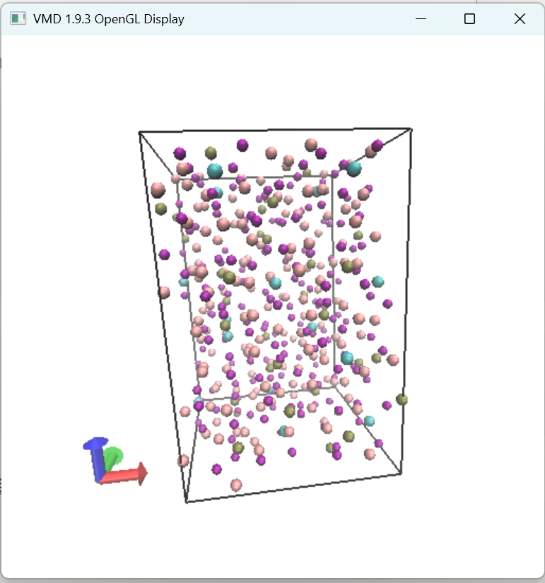

不过这里有个容易踩的坑。PBCTools 的 `wrap` 只是把周期镜像中的原子重新塞回主晶胞，图看着舒服了而已。**用于 MSD 的坐标处理完全是另一回事：需要 unwrap，让扩散轨迹在空间上连续**，否则原子每次"穿越"盒子边界跳回对面，算出来的位移就全乱了。如果载入的轨迹本身已经是 unwrap 的（比如 `mlipx` 输出的 `XDATCAR`），直接用就行；如果是 wrapped 坐标，先跑一遍 `pbc unwrap -all`。

接下来是美化。Li 用 `VDW` 突出球体，Ge/P/S 用 `Licorice` 展示骨架连接，颜色按元素，白色背景，正交投影，关掉坐标轴，这样截图比较干净：

```tcl
			color Display Background white
			package require pbctools
			
			pbc get -now
			pbc box -on -center unitcell -color black -width 2 -style dashed
			pbc wrap -all -sel "all" -center unitcell
			
			axes location Off
display projection Orthographic
display resetview
scale by 1.8
display antialias on
display depthcue off

set repid_li [molinfo top get numreps]
mol addrep top
mol modselect $repid_li top {element Li}
mol modstyle $repid_li top VDW
mol modcolor $repid_li top Name

set repid_other [molinfo top get numreps]
mol addrep top
mol modselect $repid_other top {not element Li}
mol modstyle $repid_other top Licorice
mol modcolor $repid_other top Name
```

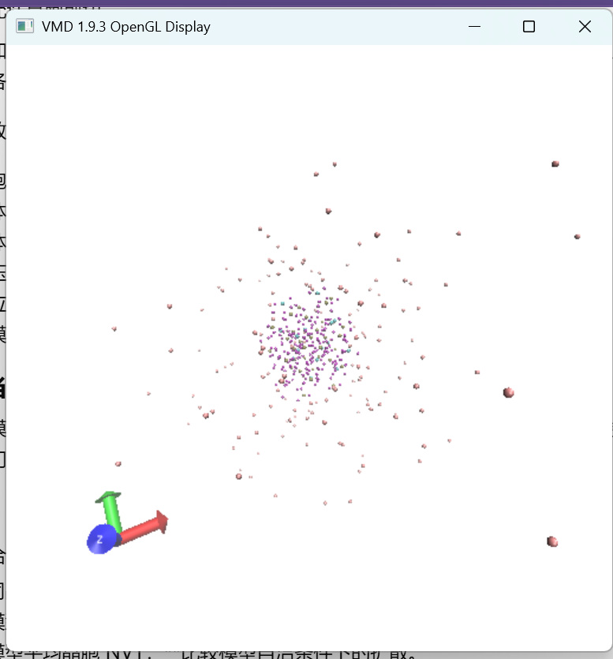

要看 Li 在整段模拟里主要经过哪些区域，可以用 VolMap（`Extensions → Analysis → VolMap Tool`），选 `element Li`，Map type 用 `Occupancy`，对所有帧计算后取 Average，Resolution 从 0.3–0.5 Å 起步，越小分辨率越高但越慢。VMD 会把空间划成许多 voxel，对每一帧判断 Li 是否占据该位置，再对时间取平均，所以得到的是一种 **Li 的时间平均空间占据分布**。计算完成后用 `Isosurface` 表示，同时画两个不同 isovalue，低的做半透明、高的做实心，对比很直观：

```tcl
set molid top

# 清空当前 DX 分子的已有 representation
set n [molinfo $molid get numreps]
for {set i 0} {$i < $n} {incr i} {
    mol delrep 0 $molid
}

# 低等值面
mol addrep $molid
set r0 [expr {[molinfo $molid get numreps] - 1}]
mol modselect $r0 $molid all
mol modstyle $r0 $molid Isosurface 0.3 0 0 0 1
mol modcolor $r0 $molid ColorID 10
mol modmaterial $r0 $molid Transparent

# 高等值面
mol addrep $molid
set r1 [expr {[molinfo $molid get numreps] - 1}]
mol modselect $r1 $molid all
mol modstyle $r1 $molid Isosurface 0.7 0 0 0 1
mol modcolor $r1 $molid ColorID 3
mol modmaterial $r1 $molid AOShiny
```

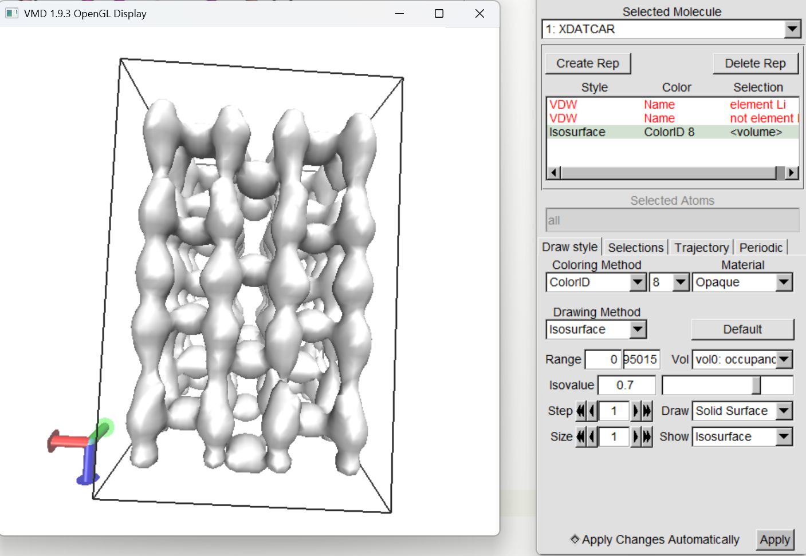

VolMap 很直观，但要记住它回答的是"Li 经常出现在哪里"，而不是直接给出扩散系数。看到通道是一回事，量化扩散有多快是另一回事。三维等值面看通道直观，有时二维切片更容易比较不同区域的占据强弱：继续用同一个 VolMap 数据，新建 representation 用切片显示，颜色方法改为 `BWR`，再在 `Trajectory` 里手动设置 `Color Scale Data Range`。

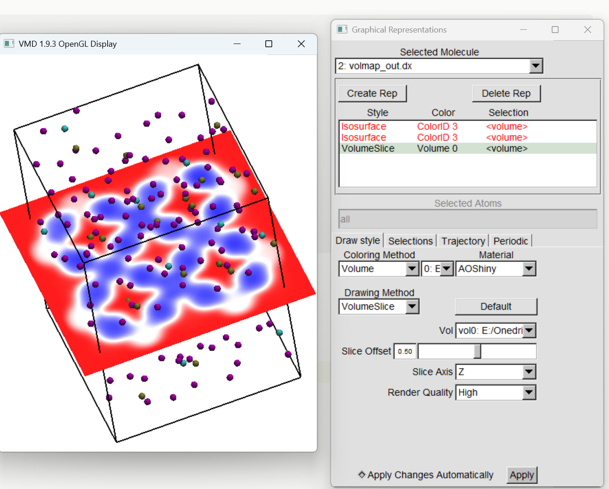

无头（ssh 连接）服务器上想渲染视频的话，先让 VMD 在命令行模式下跑脚本：

```bash
vmd -dispdev text -e render_test.tcl > render_test.log 2>&1 &
```

Tachyon 渲染：

```bash
/path/to/vmd/lib/tachyon_LINUXAMD64 \
  -numthreads 36 \
  -aasamples 4 \
  -trans_vmd \
  -fullshade \
  -format TARGA \
  -res 3600 4800 \
  lgps_scene.dat \
  -o lgps_li_channel.tga
```

图片序列转视频：

```bash
ffmpeg -y \
  -framerate 30 \
  -start_number 0 \
  -i frames_test/frame_%05d.tga \
  -c:v libx264 \
  -preset slow \
  -crf 18 \
  -pix_fmt yuv420p \
  -movflags +faststart \
  LGPS.mp4
```

也可以用 OVITO 渲染，效果不错：

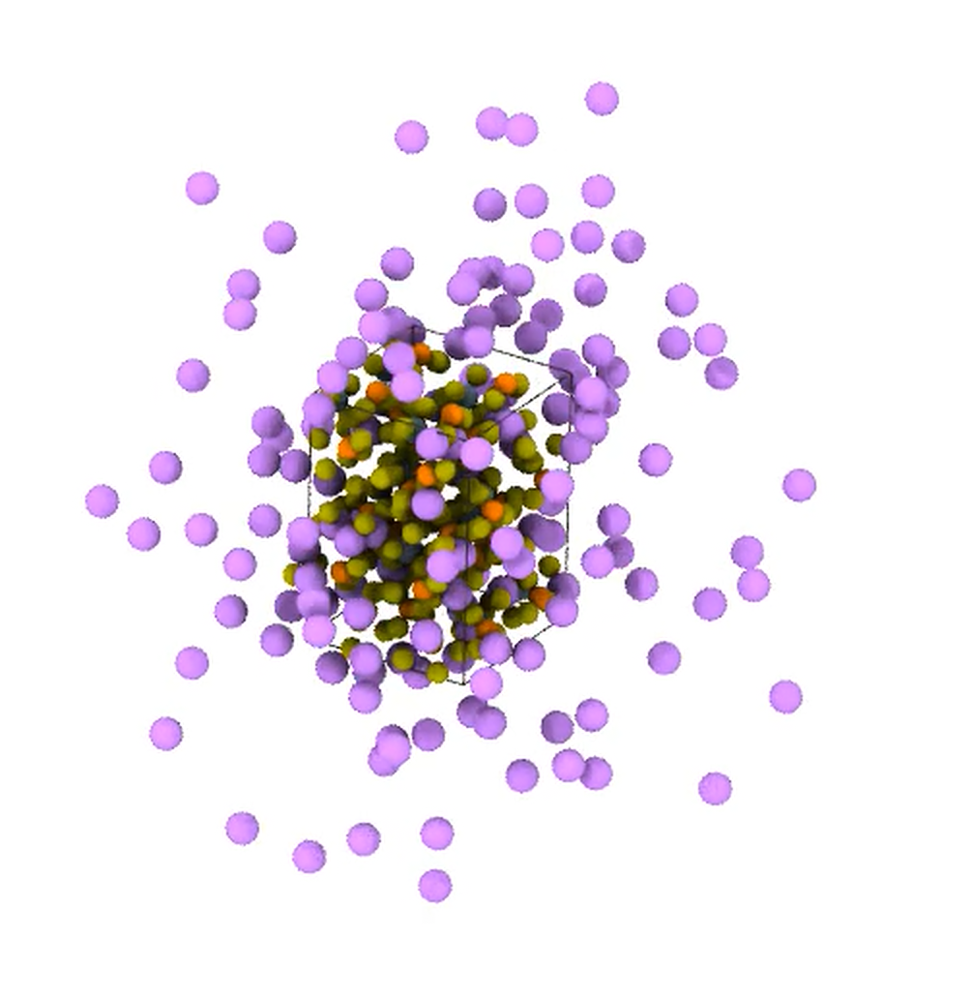

不过看只是准备，真正要做的还是算。输运性质（扩散、黏度、电导率……）描述的是质量、动量、热量或电荷在体系中迁移的快慢。平衡分子动力学（EMD）最方便的地方在于：一条平衡 MD 轨迹，通过不同的后处理方法就能得到多种输运性质，不需要主动施加外场或改变边界条件，那是 NEMD 的路子。当前这套 LGPS 分析主要还是 EMD。

在 Living J. Comp. Mol. Sci. 2019, 1(1), 6324 的框架下，很多输运系数都可以写成 Green–Kubo 形式，即时间关联函数的积分：

$$
\gamma=
\int_0^\infty
\langle \dot{\xi}(t)\dot{\xi}(0)\rangle\,dt.
$$

也可以写成等价的 Einstein 形式，即位移平方随时间增长率的极限：

$$
\gamma=
\lim_{t\to\infty}
\frac{\left\langle[\xi(t)-\xi(0)]^2\right\rangle}{2t}
=
\frac12
\lim_{t\to\infty}
\frac{d}{dt}
\left\langle[\xi(t)-\xi(0)]^2\right\rangle .
$$

两者在理论上完全等价，推导不难（两重积分展开），但在实际数值分析上各有侧重。对于**自扩散系数**（或者叫示踪扩散系数，与之相对的是集体扩散系数），Einstein/MSD 方法最直观，也通常更方便：

$$
D_{\rm tr}
=
\lim_{t\to\infty}
	\frac{\langle |\Delta \mathbf r(t)|^2\rangle}{6t}
$$

Green–Kubo 则从速度自相关函数（VACF）积分：

$$
D_{\rm tr}
=
\frac13\int_0^\infty
\langle \mathbf v(t)\cdot\mathbf v(0)\rangle\,dt.
$$

可以把它们理解成两把测同一个量的尺子：Einstein 看位置走了多远，对应 MSD 的长时间斜率；Green–Kubo 看速度记忆怎么衰减，对应 VACF 的积分。

落实到最直观的 MSD 上，算之前需要先统一几个容易混的词，之前确实把"lag"和"相邻时间原点之间的间隔"搞混过🤣。为了以后不再把自己绕晕，这里统一记号：$t_0$ 是 time origin（时间原点），$\tau$ 是 lag time（从一个时间原点往后看的时间间隔），$\delta t_0$ 是相邻两个 time origins 之间的间隔。multiple-time-origin MSD 写成：

$$
\mathrm{MSD}(\tau)
=
\frac{1}{N}
\left\langle
\sum_{i=1}^{N}
\left|
\mathbf r_i(t_0+\tau)-\mathbf r_i(t_0)
\right|^2
\right\rangle_{t_0}.
$$

所谓"多时间原点"，就是同一个 $\tau$ 不只从 $t_0=0$ 算一次，而是从许多允许的 $t_0$ 都算一遍，再平均。比如想算 $\tau=100$ ps，那么 0.00 → 100.00 ps、0.01 → 100.01 ps、0.02 → 100.02 ps……这些配对都可以贡献样本。这样做的好处是整条轨迹都用得上：==一条 400 ps 的长轨迹即便最终只在 40–200 ps 这样的 lag 区间拟合，也不会"浪费"后面的轨迹，后面的轨迹一直在为较短 lag 提供更多 time origins。==

随着 $\tau$ 变大，可用的 $t_0$ 越来越少。假设总轨迹长度为 $T$，那么能贡献给一个 lag $\tau$ 的起点只来自大约 $0\sim T-\tau$ 的区域：小 lag 有很多 time origins，大 lag 越来越少，接近轨迹总长度时几乎只剩极少数样本。因此 MSD 的长 lag 尾部常常出现弯曲、翘尾或明显噪声，这本身不意味着"扩散突然变快/变慢"，更多时候只是统计质量下降。

当前用的命令是：

```bash
mlipx analyze raw/trajectory.traj msd \
  --mobile Li \
  --axes x,y,z,xy,xyz \
  --drift-reference nonmobile
```

它会计算 Li 在不同方向上的 MSD，并以非移动骨架作为参考去掉整体漂移。各方向的扩散系数分别是 $D_x=\frac12\frac{d\,MSD_x}{dt}$、$D_y=\frac12\frac{d\,MSD_y}{dt}$、$D_z=\frac12\frac{d\,MSD_z}{dt}$，二维平面和三维则分别是 $D_{xy}=\frac14\frac{d\,MSD_{xy}}{dt}$、$D_{xyz}=\frac16\frac{d\,MSD_{xyz}}{dt}$。需要特别注意 $MSD_{xy}=MSD_x+MSD_y$，$MSD_{xyz}=MSD_x+MSD_y+MSD_z$，所以 `xyz` 曲线最高是数学上自然的结果，不能据此说"三维扩散最快"。判断各向异性时真正应该比较的是 $D_x$、$D_y$、$D_z$。当时 UMA 700 K 的结果粗略表现为 $D_z\sim2D_x$、$D_z\sim1.7D_y$，说明 z 方向扩散明显更强。

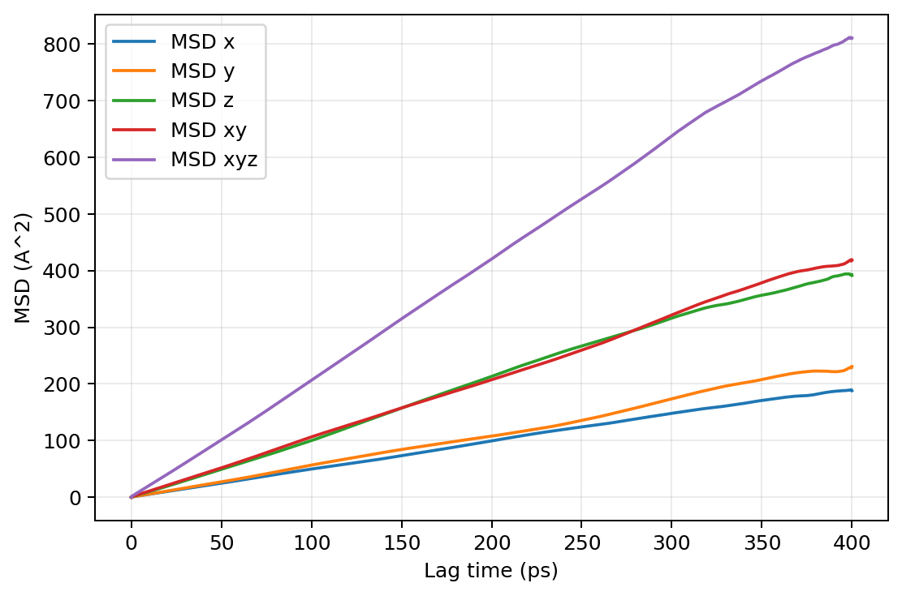

有了 MSD，下一个问题是哪一段才是"正常扩散区"，也就是可以放心用来拟合扩散系数的那段。进入正常扩散后 $\mathrm{MSD}(t)\propto t$，在双对数坐标下定义

$$
\alpha(t)
=
\frac{d\ln MSD(t)}{d\ln t}
$$

应当接近 1。可以粗略理解：$\alpha\approx2$ 是短时间弹道行为，$\alpha\approx1$ 是正常扩散，$\alpha<1$ 是亚扩散或受限运动，最长 lag 处剧烈波动往往只是统计变差。

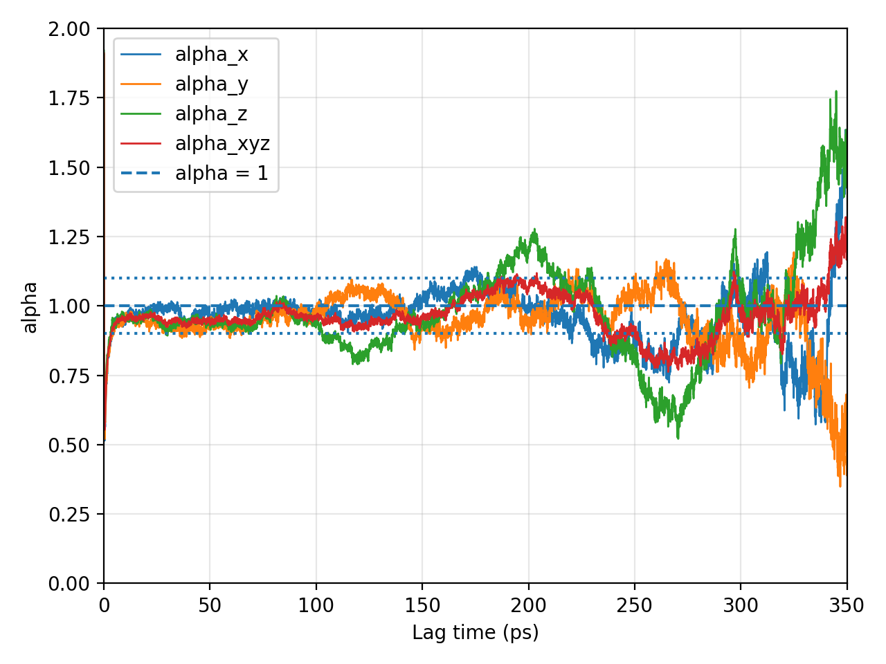

对当时的 UMA 数据，候选正常扩散区大约从几十 ps 开始，到约 200 多 ps；再往后，$\alpha$ 和 MSD 的统计质量都逐渐变差。这里最重要的一点是：没有必要执着于找一个"唯一正确"的边界，更稳妥的做法是在看起来合理的扩散区里移动拟合窗口，看最终 $D$ 是否稳定。

于是就需要一个最朴素的诊断工具：OLS，普通最小二乘法。过程说白了就是，先从 MSD 曲线和 $\alpha(t)$ 判断哪段看起来是正常扩散区，然后在选中的区间里画一条最合适的直线。三维情况下拟合

$$
MSD_{xyz}(t)=6Dt+b,
$$

OLS 给出斜率和截距，从斜率得到 $D=\frac{\text{slope}}{6}$。mlipx 的 `msd --fit-start-ps --fit-stop-ps` 给出的 `D_diagnostic` 就属于这种普通线性拟合：

```bash
mlipx analyze raw/trajectory.traj msd \
  --mobile Li \
  --axes x,y,z,xy,xyz \
  --drift-reference nonmobile \
  --fit-start-ps 40 \
  --fit-stop-ps 200
```


这里有个小插曲值得记下来。最初偷懒，直接用全部时间画出的 MSD-Time 曲线做 OLS，得到的自扩散系数是 $3.564\times10^{-5}\ \rm cm^2/s$，显然不合理：短时间的 ballistic 区和长时间的噪声尾部全被搅进了同一条直线。明确指定 40–200 ps（$\alpha(t)$ 在 1 附近，区间选得稍保守）之后，得到诊断性的 $3.646\times10^{-5}\ \rm cm^2/s$。

OLS 最大的优点是简单、快，很适合给"斜率的点估计"、判断线性区和做敏感性测试。**但它不能简单套教科书 OLS 误差公式，去声称得到了可靠的扩散系数统计不确定度。**一篇方法学文献 [J. Chem. Theory Comput. 2025, 21, 79−87](https://doi.org/10.1021/acs.jctc.4c01249) 详细讲了这件事，后面还会回到它。

有了这个快速工具，第一件要做的事就是检查拟合窗口敏感性。UMA 800 K 测了三个窗口（20–180、40–200、60–220 ps）：

| 拟合区间 | $D$ (m²/s) | $\bar\alpha$ | $R^2$ |
| --- | --- | --- | --- |
| 20–180 ps | $4.0875\times10^{-9}$ | 0.961 | 0.999895 |
| 40–200 ps | $4.0937\times10^{-9}$ | 0.977 | 0.999849 |
| 60–220 ps | $4.1394\times10^{-9}$ | 0.990 | 0.999547 |

三个合理窗口给出的 $D$ 只差约 1%，说明 UMA 800 K 对拟合窗口并不敏感。700 K 也一样稳定：三个窗口分别得到 $3.548$、$3.568$、$3.576\times10^{-9}\ \rm m^2/s$。所以这里得到的不是"40–200 ps 是宇宙唯一真理"，而是一个更重要的结论：

> **只要在合理的 diffusive regime 内移动窗口，UMA 的 $D$ 基本不变。**

后续就把 40–200 ps 作为保守、居中的工作窗口。

不过窗口稳定，并不等于轨迹长度一定足够。这是两个不同的问题，很容易混在一起：fitting-window convergence 问的是同一条完整轨迹换不同 lag 拟合区间，$D$ 会不会变；trajectory-length convergence 问的是当初只跑 100/200/300 ps 的话，$D$ 会不会变。为了检验后者，可以从同一条长轨迹截取不同前缀，重新计算 MSD，比如只取前 100 ps：

```bash
mlipx analyze raw/trajectory.traj msd \
  --mobile Li \
  --axes x,y,z,xy,xyz \
  --drift-reference nonmobile \
  --start-frame 0 \
  --stop-frame 10001 \
  --fit-start-ps 20 \
  --fit-stop-ps 50
```

这里固定 20–50 ps 拟合区间，不是为了报告最终 $D$，而是为了让 100/200/300/400 ps 四种总轨迹长度使用相同的短 lag 区间，尽量只比较"总采样长度"的影响。UMA 700 K 的测试表明：100 ps 明显偏低，200/300/400 ps 已经聚到同一个量级。因此 100 ps 对这套条件来说明显太短，200 ps 可以看成"开始够用"的量级。但这只是初步结论，因为这四段都是**同一条轨迹的 nested prefixes**，不是四条独立重复模拟。真正严谨的 run-to-run 不确定性仍需要 independent replicas，可能成本爆炸🤔。

OLS 的局限也得说一说。它本身没有错，问题在于教科书里 OLS 对"斜率误差"的简单公式有统计前提，而 MSD 数据恰好很容易违反这些前提。

第一件麻烦事是 MSD 点彼此相关。$\mathrm{MSD}(40\ \mathrm{ps})$ 和 $\mathrm{MSD}(42\ \mathrm{ps})$ 都来自同一批粒子、同一条 trajectory，而且共享大量时间区间，它们不是两个互不相关的新实验。看起来有很多 MSD 点，==但其中很多点只是同一条运动历史的"相邻版本"==。把几千个高度相关的数据点当成几千个独立证据，最终很容易对自己的误差棒过于自信。

第二件麻烦事是不同 lag 的方差不一样。长 lag 能用的 time origins 更少，因此 MSD 尾部通常比前面更吵，$\mathrm{Var}[MSD(t)]$ 会随 $t$ 改变，这就是异方差（heteroscedasticity）。序列相关加异方差同时存在，所以"$R^2=0.9999$"之类的数据并不能自动证明扩散系数误差很小。

更认真的做法是 kinisi，一个 Python 包。它的核心并不是发明另一个扩散系数，而是仍然使用 Einstein/MSD 的长时间线性关系，但更认真地处理 MSD 的统计相关性和不确定度。先把几种方法放在一起看：

| 方法 | 解决了什么 | 还剩什么问题 |
| --- | --- | --- |
| OLS（最小二乘法） | 最简单地拟合斜率 | 忽略异方差，也忽略不同 lag 之间的相关性 |
| WLS（加权最小二乘法） | 根据各点方差加权，处理异方差 | 仍忽略 lag 之间的协方差 |
| GLS（广义最小二乘法） | 同时使用完整协方差矩阵 | 理论很好，但完整协方差通常难从有限轨迹直接获得，成本极高 |
| 近似贝叶斯方法 / kinisi | 用解析近似描述 MSD 协方差，并输出 $D$ 的后验分布 | 仍要求用户先找到真正的长时间扩散区 |

线性模型仍然是 $m(t)=6D^*t+c$。不同之处在于，kinisi 把一系列 MSD 值视为一个具有协方差结构的多元随机变量，并对 $D^*$ 和截距做贝叶斯推断，从而得到 $D$ 的后验分布，而不只是一个斜率。方法论文就是前面提到的那篇 [McCluskey et al., JCTC 2025, 21, 79–87](https://doi.org/10.1021/acs.jctc.4c01249)。

这篇方法论文的关键想法是：长时间进入正常扩散区之后，不同体系虽然微观机制不同，但在重新标度后会表现出类似的扩散统计结构。于是可以用长时间自由扩散极限下可解析的 MSD 协方差结构来近似真实材料中的协方差，再利用实际轨迹对其中的方差尺度进行参数化。论文用 c-LLZO 做了真实固态电解质验证：1536 个原子、448 个 Li、700 K、6 ns、NVT，再把长轨迹拆成很多统计等效的有效轨迹进行验证。作者发现，即使对只有约 28 个移动 Li、约 500 ps 的有效轨迹，单轨迹方法得到的不确定度估计也与多轨迹统计的真实分布相当吻合。

这给了我一个很重要的认识：

> **kinisi 的价值不是替代 MSD，而是把"MSD 斜率是多少"推进到"这个斜率到底有多不确定"。**

kinisi 最终会给出 posterior mean、posterior median、posterior standard deviation 和 95% credible interval。这里严格说是 **Bayesian credible interval（后验可信区间）**，不能和频率学派的 confidence interval（置信区间）混成一个词，虽然在很多实际场景下它们的数值区别不大。

到这里终于可以把 mlipx 的两个命令彻底分开😇。`msd` 用来做初步的快速诊断：正确计算 multiple-time-origin MSD，看 x/y/z 各向异性，看 $\alpha(t)$，判断正常扩散区大概在哪里，必要时用 OLS 做拟合窗口敏感性测试。确认好区间之后交给 `transport`，用 kinisi 给 $D$ 和统计不确定度。以 700 K XDATCAR 为例：

```bash
mlipx analyze vasp/XDATCAR transport \
  --mobile Li \
  --charge 1 \
  --drift-reference nonmobile \
  --positions-convention wrapped \
  --frame-interval-fs 10 \
  --temperature-K 700 \
  --fit-start-ps 40 \
  --lag-step-ps 2 \
  --lag-stop-ps 200 \
  --random-seed 0
```

这条命令里几个参数很容易混。`--fit-start-ps 40` 表示从 40 ps 开始，认为进入用于拟合 $D$ 的长时间扩散区；`--lag-stop-ps 200` 表示 kinisi 最大只分析到 lag = 200 ps。所以当前实际用于扩散回归的区间就是 40–200 ps，正对应前面通过 MSD、$\alpha(t)$ 和窗口敏感性得到的"比较稳妥的内部扩散区"。而 `--lag-step-ps 2` 这个参数不是 MD timestep，不是 trajectory 保存间隔，也不是把原轨迹每隔 2 ps 抽一帧。它只是告诉 kinisi：不需要分析每一个 0.01 ps 的 lag，只取 2, 4, 6, …, 200 s 这些 lag 即可，原始完整轨迹和其中可利用的 time origins 仍然保留。为什么要这样做？因为 mlipx 自带的 FFT MSD 可以很快地算完所有 lag，但 kinisi 还需要建立和处理 MSD 的协方差结构，如果把 400 ps / 10 fs 保存间隔对应的约 40000 个 lag 全塞进去，计算会明显更昂贵（实测耗时会显著增加）。何况 MSD 上的点来自同一批 Li、同一条 trajectory，共享大量运动历史，本来就高度相关，稀疏取点是合理的。

实际跑起来是这个样子（800 K，PowerShell 下）：

```PowerShell
(mlipx-workspace) PS D:\mlipx\results\800(Langevin)\uma> mlipx analyze .\raw\trajectory.traj transport --mobile Li --charge 1 --drift-reference nonmobile --positions-convention wrapped --frame-interval-fs 10 --temperature 800  --fit-start-ps 40 --lag-step-ps 2 --lag-stop-ps 200 --random-seed 0
Analysis success: 42284466a1e4
Output: D:\mlipx\results\800(Langevin)\uma\analysis\transport\42284466a1e4
Tracer diffusion:
  D = 4.150673e-09 m^2/s
  posterior SD = 2.366526e-10 m^2/s
  95% credible interval = [3.694937e-09, 4.634322e-09] m^2/s
Fit window:
  40 - 200 ps
Kinisi lag grid:
  custom, nominal step 2 ps, 100 total points
Nernst-Einstein tracer conductivity:
  sigma_NE = 1.950749e+03 mS/cm
  95% credible interval = [1.736561e+03, 2.178057e+03] mS/cm
```

lag grid 到底取多粗合适？UMA 700 K 的测试给出了参考。用 1 ps lag grid 得到 $D_{\rm mean}=3.4429\times10^{-9}\ \mathrm{m^2/s}$，$D_{\rm std}=2.03\times10^{-10}\ \mathrm{m^2/s}$，95% posterior credible interval 为 $[3.033,\ 3.835]\times10^{-9}\ \mathrm{m^2/s}$；换成 2 ps lag grid，得到 $D_{\rm mean}=3.4404\times10^{-9}\ \mathrm{m^2/s}$，$D_{\rm std}=2.09\times10^{-10}\ \mathrm{m^2/s}$，95% posterior credible interval 为 $[3.027,\ 3.845]\times10^{-9}\ \mathrm{m^2/s}$。两种 lag grid 的均值只差约 0.07%，可信区间几乎重合，所以对当前这条轨迹来说，2 ps 的 sparse lag grid 已经足够稳定。

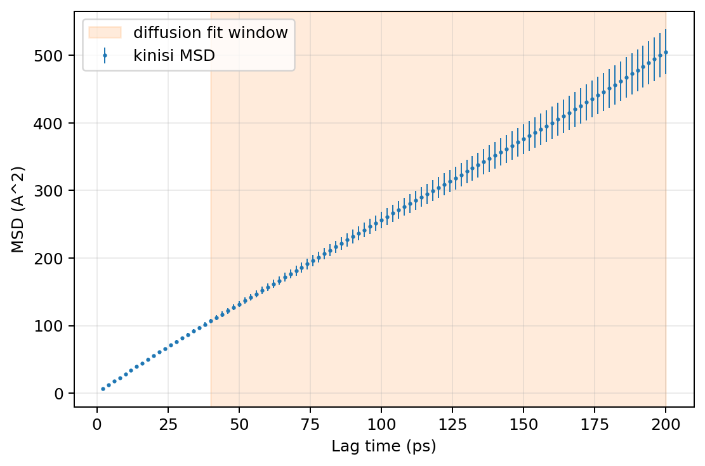

**95% 后验可信区间**下的数据是：Nernst-Einstein 方程（未考虑锂离子间协同作用对迁移的影响）计算出的离子电导率 $\sigma_{\rm NE}=[1736.5605,\ 2178.0566]~\rm{mS/cm}$，平均 $1950.7490~\rm{mS/cm}$；自扩散系数（输出字段 `D_posterior_cm2_s`）$D_{\rm tr}=[3.6949\times10^{-5},\ 4.6343\times10^{-5}]~\rm{cm^2/s}$，平均 $4.1507\times10^{-5}~\rm{cm^2/s}$。将 lag grid 从 2 ps 加密到 0.1 ps，同样 **95% 后验可信区间**下：$\sigma_{\rm NE} = [1729.6879,\ 2168.4867]~\rm{mS/cm}$，平均 $1948.7383~\rm{mS/cm}$；$D_{\rm tr} = [3.6803\times10^{-5},\ 4.6140\times10^{-5}]~\rm{cm^2/s}$，平均 $4.1464\times10^{-5}~\rm{cm^2/s}$。除了徒增计算量和耗时外，并无明显差异。


还有一件让人放心的事：前面 OLS 40–200 ps 得到的 $3.568\times10^{-9}\ \rm m^2/s$ 也落在 kinisi 的可信区间里。也就是说，OLS 的点估计并没有明显"算歪"，只是它自己不擅长告诉我这个数到底有多大的统计不确定性。所以日常使用的套路很清晰：先用 `msd` 看曲线选区间，再用 `transport` 配合适当稀疏的 lag-step 做正式的统计推断。后者给出的核心结果不是"另一种 MSD"，而是在同样的长时间扩散物理图像下，对 $D$ 做更合理的不确定度量化。

---

## 通用势的横向对比

自己训练势的路暂时走不通，就换成现成的通用机器学习势，把 LGPS 交给它们各跑一遍。参与比较的有 UMA（`uma-s-1p2p1.pt`）、MACE（`mace-mh-1`）、DPA（`DPA-3.2-5M.pt`）、GRACE（`GRACE-2L-SMAX-OMAT-large`），统一 800 K 和 700 K、400 ps、1 fs / 400000 步：

| 类型 | 时间 | 步长/步数 | $\sigma_{\rm NE}$ | 平均$\sigma_{\rm NE}$ | 自扩散系数$D_{\rm tr}$ | 平均$D_{\rm tr}$ |
| --- | --- | --- | --- | --- | --- | --- |
| 800K: uma-s-1p2p1.pt | 400 ps | 1fs/400000 | $[1736.561,\ 2178.057]\ \rm{mS/cm}$ | $1950.749\ \rm{mS/cm}$ | $[3.695\times10^{-5},\ 4.634\times10^{-5}]\ \rm{cm^2/s}$ | $4.151\times10^{-5}\ \rm{cm^2/s}$ |
| 800K: mace-mh-1.model | 400 ps | 1fs/400000 | $[905.286,\ 1181.722]\ \rm{mS/cm}$ | $1047.184\ \rm{mS/cm}$ | $[1.926\times10^{-5},\ 2.514\times10^{-5}]\ \rm{cm^2/s}$ | $2.228\times10^{-5}\ \rm{cm^2/s}$ |
| 800K: DPA-3.2-5M.pt | 400 ps | 1fs/400000 | $[843.341,\ 1103.048]\ \rm{mS/cm}$ | $974.350\ \rm{mS/cm}$ | $[1.794\times10^{-5},\ 2.347\times10^{-5}]\ \rm{cm^2/s}$ | $2.073\times10^{-5}\ \rm{cm^2/s}$ |
| 800K: GRACE-2L-SMAX-OMAT-large | 400 ps | 1fs/400000 | $[792.768,\ 1039.329]\ \rm{mS/cm}$ | $915.120\ \rm{mS/cm}$ | $[1.687\times10^{-5},\ 2.211\times10^{-5}]\ \rm{cm^2/s}$ | $1.947\times10^{-5}\ \rm{cm^2/s}$ |
| 700K: uma-s-1p2p1.pt | 400 ps | 1fs/400000 | $[1622.542,\ 2069.195]\ \rm{mS/cm}$ | $1840.189\ \rm{mS/cm}$ | $[3.021\times10^{-5},\ 3.852\times10^{-5}]\ \rm{cm^2/s}$ | $3.426\times10^{-5}\ \rm{cm^2/s}$ |
| 700K: mace-mh-1.model | 400 ps | 1fs/400000 | $[693.133,\ 909.069]\ \rm{mS/cm}$ | $798.965\ \rm{mS/cm}$ | $[1.290\times10^{-5},\ 1.692\times10^{-5}]\ \rm{cm^2/s}$ | $1.487\times10^{-5}\ \rm{cm^2/s}$ |
| 700K: DPA-3.2-5M.pt | 400 ps | 1fs/400000 | $[619.303,\ 831.573]\ \rm{mS/cm}$ | $725.888\ \rm{mS/cm}$ | $[1.153\times10^{-5},\ 1.548\times10^{-5}]\ \rm{cm^2/s}$ | $1.351\times10^{-5}\ \rm{cm^2/s}$ |
| 700K: GRACE-2L-SMAX-OMAT-large | 400 ps | 1fs/400000 | $[577.603,\ 767.053]\ \rm{mS/cm}$ | $672.803\ \rm{mS/cm}$ | $[1.075\times10^{-5},\ 1.428\times10^{-5}]\ \rm{cm^2/s}$ | $1.253\times10^{-5}\ \rm{cm^2/s}$ |

顺便说一下三个缩写的全称：DPA 是 Deep Potential Atomic，MACE 出自 Machine Learning Force Fields 一脉，UMA 是 Universal Models for Atoms。

一眼就能看出来，UMA 明显偏高：800 K 平均电导率接近 2000 mS/cm，而 MACE、DPA、GRACE 都在 900–1050 mS/cm 附近；700 K 下 UMA 也明显高于其他三家。

700 K 下 DPA 的 $\alpha(t)$ 曲线看着有些奇怪，偏离的比较多，所以多取了几个区间计算：


| 类型 | 时间 | 步长/步数 | $\sigma_{\rm NE}$ | 平均$\sigma_{\rm NE}$ | 自扩散系数$D_{\rm tr}$ | 平均$D_{\rm tr}$ |
| --- | --- | --- | --- | --- | --- | --- |
| 700K: DPA-3.2-5M.pt (fit 20–180 ps) | 400 ps | 1fs/400000 | $[673.945,\ 848.684]\ \rm{mS/cm}$ | $759.741\ \rm{mS/cm}$ | $[1.255\times10^{-5},\ 1.580\times10^{-5}]\ \rm{cm^2/s}$ | $1.414\times10^{-5}\ \rm{cm^2/s}$ |
| 700K: DPA-3.2-5M.pt (fit 40–200 ps) | 400 ps | 1fs/400000 | $[619.303,\ 831.573]\ \rm{mS/cm}$ | $725.888\ \rm{mS/cm}$ | $[1.153\times10^{-5},\ 1.548\times10^{-5}]\ \rm{cm^2/s}$ | $1.351\times10^{-5}\ \rm{cm^2/s}$ |
| 700K: DPA-3.2-5M.pt (fit 60–220 ps) | 400 ps | 1fs/400000 | $[569.113,\ 794.303]\ \rm{mS/cm}$ | $684.734\ \rm{mS/cm}$ | $[1.060\times10^{-5},\ 1.479\times10^{-5}]\ \rm{cm^2/s}$ | $1.275\times10^{-5}\ \rm{cm^2/s}$ |

可以看到这时自扩散系数确实对采样比较敏感，窗口越往后移，得到的 $D$ 越小。后来破案了：当时参数设置得太匆忙，`DPA-3.2-5M.pt` 是多头模型，800 K 的时候设定 `Domains_SSE_PBE` 为 head，但是 700 K 忘设定了，极其严重的低级错误😢。用正确的 head 重跑了 700 K，$\alpha(t)$ 图明显好很多，DPA 700 K 的 $D$ 也更接近 MACE 了：

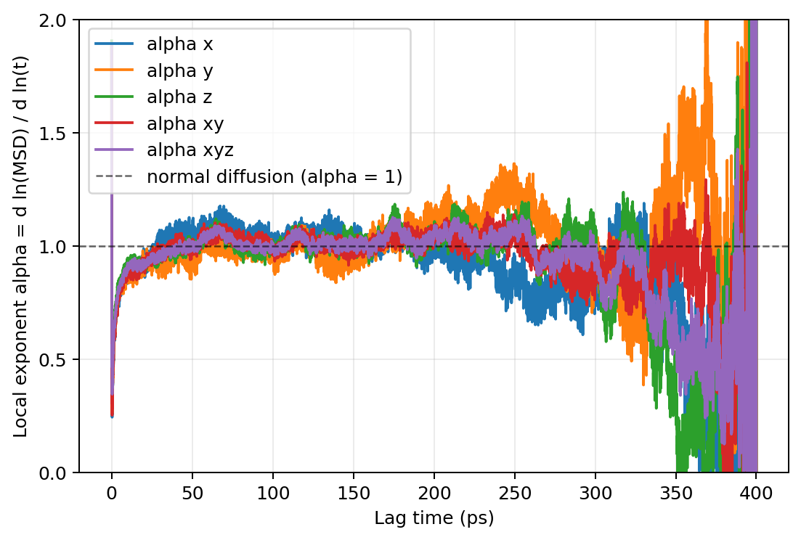

于是 700 K 的总体格局大概是：

```text
              UMA
       3.43 × 10^-5
            │
            │  巨大间隔
            │
      MACE ≈ DPA
1.49 × 10^-5  1.46 × 10^-5
            │
         GRACE
      1.25 × 10^-5
```

UMA 为什么是那个离群的异类？🐱🤔

再看看之前跑的旧数据，也是 NVT 系综、Langevin 热浴，但有些步长是 0.5 fs 的，拟合区间统一使用 20 ps–125 ps：

| 类型 | 时间 | 步长/步数 | $\sigma_{\rm NE}$ | 平均$\sigma_{\rm NE}$ | 自扩散系数$D_{\rm tr}$ | 平均$D_{\rm tr}$ |
| --- | --- | --- | --- | --- | --- | --- |
| 800K: uma-s-1p2p1.pt | 200 ps | 0.5fs/400000 | $[1933.971,\ 2382.741]\ \rm{mS/cm}$ | $2158.112\ \rm{mS/cm}$ | $[4.115\times10^{-5},\ 5.070\times10^{-5}]\ \rm{cm^2/s}$ | $4.592\times10^{-5}\ \rm{cm^2/s}$ |
| 800K: mace-mpa-0-medium.model | 200 ps | 1fs/200000 | $[829.202,\ 1050.936]\ \rm{mS/cm}$ | $941.096\ \rm{mS/cm}$ | $[1.764\times10^{-5},\ 2.236\times10^{-5}]\ \rm{cm^2/s}$ | $2.002\times10^{-5}\ \rm{cm^2/s}$ |
| 800K: DPA-3.2-5M.pt | 200 ps | 0.5fs/400000 | $[838.697,\ 1053.972]\ \rm{mS/cm}$ | $948.438\ \rm{mS/cm}$ | $[1.785\times10^{-5},\ 2.243\times10^{-5}]\ \rm{cm^2/s}$ | $2.018\times10^{-5}\ \rm{cm^2/s}$ |
| 800K: GRACE-2L-SMAX-large | 200 ps | 0.5fs/400000 | $[871.370,\ 1103.249]\ \rm{mS/cm}$ | $984.377\ \rm{mS/cm}$ | $[1.854\times10^{-5},\ 2.347\times10^{-5}]\ \rm{cm^2/s}$ | $2.094\times10^{-5}\ \rm{cm^2/s}$ |

Emmm，看起来 MACE、DPA、GRACE 的结果非常接近，并且与之前 1 fs 步长的数据形成了对比。有几个不太充分的猜测：一是 1 fs 的步长过长了；二是 DPA、GRACE、MACE 能够比较准确地预测离子电导率，而 UMA 出现了问题。但这些都还说不准，需要单独验证。

MACE 这边也尝试了不同版本的基础模型。截至目前，`medium-mpa-0` 在 2026 年已经有固态锂电解质研究直接用它做离子电导率 MD。可用的 MACE 模型列在下面供参考（MACE-MDP 只输出偶极矩和极化率，不用于能量和力，[更多信息](https://chemrxiv.org/doi/full/10.26434/chemrxiv.15000716)；MACE-MH-1 的说明见 [HuggingFace](https://huggingface.co/mace-foundations/mace-mh-1)）：

| MODEL NAME | ELEMENTS COVERED | TRAINING DATASET | LEVEL OF THEORY | TARGET SYSTEM | MODEL SIZE | GITHUB RELEASE | LICENSE |
| --- | --- | --- | --- | --- | --- | --- | --- |
| MACE-MP-0 | 89 | MPTrj | DFT (PBE+U) | Materials | [small](https://github.com/ACEsuit/mace-mp/releases/download/mace_mp_0/2023-12-10-mace-128-L0_energy_epoch-249.model), [medium](https://github.com/ACEsuit/mace-mp/releases/download/mace_mp_0/2023-12-03-mace-128-L1_epoch-199.model), [large](https://github.com/ACEsuit/mace-mp/releases/download/mace_mp_0/2024-01-07-mace-128-L2_epoch-199.model) | >=v0.3.6 | MIT |
| MACE-MPA-0 | 89 | MPTrj + sAlex | DFT (PBE+U) | Materials | [medium-mpa-0](https://github.com/ACEsuit/mace-mp/releases/download/mace_mpa_0/mace-mpa-0-medium.model) | >=v0.3.10 | MIT |
| MACE-OMAT-0 | 89 | OMAT | DFT (PBE+U) VASP 54 | Materials | [medium-omat-0](https://github.com/ACEsuit/mace-mp/releases/download/mace_omat_0/mace-omat-0-medium.model) | >=v0.3.10 | ASL |
| MACE-MATPES-0 | 89 | MATPES | PBE/R2SCAN | Materials | [matpes-pbe](https://github.com/ACEsuit/mace-foundations/releases/download/mace_matpes_0/MACE-matpes-pbe-omat-ft.model), [matpes-r2scan](https://github.com/ACEsuit/mace-foundations/releases/download/mace_matpes_0/MACE-matpes-r2scan-omat-ft.model) | >=v0.3.10 | ASL |
| MACE-OFF23 | 10 | SPICE v1 | DFT (wB97M+D3) | Organic Chemistry | [small-off](https://github.com/ACEsuit/mace-off/blob/main/mace_off23/MACE-OFF23_small.model), [medium-off](https://github.com/ACEsuit/mace-off/blob/main/mace_off23/MACE-OFF23_medium.model), [large-off](https://github.com/ACEsuit/mace-off/blob/main/mace_off23/MACE-OFF23_large.model) | >=v0.3.6 | ASL |
| MACE-MH-1/0 | 89 | OMAT/OMOL/OC20/MATPES | DFT (PBE/R2SCAN/wB97M-VV10) | Materials/Molecules/Surfaces | [mace-mh-1](https://github.com/ACEsuit/mace-foundations/releases/download/mace_mh_1/mace-mh-1.model), [mace-mh-0](https://github.com/ACEsuit/mace-foundations/releases/download/mace_mh_1/mace-mh-0.model) | >=v0.3.14 | ASL |
| MACE-MDP | 10 | SPICE-α | DFT (wB97M-D3(BJ)/def2-TZVPP) | Organic systems | [mace-mdp-model](https://raw.githubusercontent.com/Nilsgoe/MACE-MDP/main/models/MACE-MDP.model) | >=v0.3.16 | [ASL](https://github.com/Nilsgoe/MACE-MDP) |

后来补了 600 K 下四组数据，同样 Langevin 热浴、1 fs 步长、400 ps：

| 类型 | 拟合窗口 | 平均温度 | 步长/步数 | $\sigma_{\rm NE}$ (mS/cm) | 平均 $\sigma_{\rm NE}$ (mS/cm) | $D_{\rm tr}$ (cm²/s) | 平均 $D_{\rm tr}$ (cm²/s) |
| --- | --- | --- | --- | --- | --- | --- | --- |
| 600K: uma-s-1p2p1.pt | 40–200 ps | 600.537 | 400000 | $[452.188,\ 611.565]$ | $530.624$ | $[7.222\times10^{-6},\ 9.768\times10^{-6}]$ | $8.475\times10^{-6}$ |
| 600K: mace-mh-1.model | 40–200 ps | 598.716 | 400000 | $[483.249,\ 657.207]$ | $570.870$ | $[7.695\times10^{-6},\ 1.047\times10^{-5}]$ | $9.090\times10^{-6}$ |
| 600K: DPA-3.2-5M.pt | 40–200 ps | 600.168 | 400000 | $[449.154,\ 600.893]$ | $525.281$ | $[7.170\times10^{-6},\ 9.592\times10^{-6}]$ | $8.385\times10^{-6}$ |
| 600K: GRACE-2L-SMAX-OMAT-large | 40–200 ps | 596.814 | 400000 | $[364.305,\ 487.261]$ | $424.955$ | $[5.783\times10^{-6},\ 7.734\times10^{-6}]$ | $6.745\times10^{-6}$ |

有趣的是，UMA 的结果在 600 K 下看上去"正常"了不少，降下来了，四个模型挤到了同一个量级。但把三个温度连起来看，UMA 的温度依赖出现了一个非常大的拐弯。先排除"600 K 这一个点采样/窗口不稳"的可能：20–180 ps 窗口 $D_{\rm tr}=8.767\times10^{-6}\ \rm cm^2/s$，40–200 ps 窗口 $8.985\times10^{-6}\ \rm cm^2/s$，60–220 ps 窗口 $9.174\times10^{-6}\ \rm cm^2/s$。三个窗口都很稳定，不是采样问题。

把三个温度的数据整理成 Arrhenius 分析：

| 模型 | 三点 apparent $E_a$ | $R^2$ | 600→700 K ($E_a$) | 700→800 K ($E_a$) |
| --- | --- | --- | --- | --- |
| UMA | **0.339 eV** | **0.890** | **0.514 eV** | **0.092 eV** |
| MACE | 0.184 eV | 0.998 | 0.172 eV | 0.204 eV |
| DPA | 0.189 eV | 0.997 | 0.204 eV | 0.167 eV |
| GRACE | 0.217 eV | ~1.000 | 0.217 eV | 0.218 eV |

MACE、DPA、GRACE 三家的 Arrhenius 图都很直，分段活化能和三点拟合也对得上；UMA 的两段斜率却差得太大，0.339 eV 的三点拟合没什么意义。用 600 K 和 800 K 两个端点画一条 Arrhenius 直线，插值预测 700 K，大概 $D_{\rm UMA}^{700, pred}\approx 2.08\times10^{-5}\ \rm cm^2/s$，但实测偏高约 65%。

会不会是 700 K 采样异常？重复跑了两条不同种子的 UMA 700 K 轨迹（顺便一提，在一台 RTX 4090 上跑同一个模型只需要约 6.5 h，显著快于 V100 的约 14.5 h）：

| 标识 | Seed | $D$ (cm²/s) | 95% CrI (cm²/s) | $T_{\rm prod}$ (K) |
| --- | --- | --- | --- | --- |
| original | 1986240779 | $3.4260\times10^{-5}$ | $[3.02\times10^{-5},\ 3.85\times10^{-5}]$ | 698.76 |
| again1 | 1858715308 | $3.3736\times10^{-5}$ | $[2.95\times10^{-5},\ 3.80\times10^{-5}]$ | 697.26 |
| again2 | 1201954440 | $3.0547\times10^{-5}$ | $[2.67\times10^{-5},\ 3.44\times10^{-5}]$ | 699.77 |

UMA 700 K 的高扩散在三个独立 seed 里是可重现的。结论是：`uma-s-1p2p1.pt`（小模型，1.2.1 版本）在 600–800 K 会表现出可重复的、显著偏离单一 Arrhenius 关系的扩散系数。

之前考虑速度和显存，用的是小模型，这次试试 `uma-m-1p1.pt`（1.1 版本 medium）。不过在 V100 上测试时开 turbo 模式会炸显存，只能在 `default + activation_checkpointing` 下计算，粗估 400 ps 需要 >100 h。先在 4090 上跑一下，并对比两个 UMA 模型的变胞优化结果：

| 模型 | V_eq (ų) | ΔV vs DFT V₀ | a (Å) | b (Å) | c (Å) |
| --- | --- | --- | --- | --- | --- |
| UMA-S | 8889.8 | +12.36% | 18.05 | 18.10 | 27.20 |
| UMA-M | 7969.7 | +0.73% | 17.24 | 17.76 | 26.05 |
| MACE | 8007.3 | +1.20% | 17.28 | 17.79 | 26.06 |
| DPA-SSE | 7945.7 | +0.43% | 17.24 | 17.75 | 25.98 |
| GRACE | 7929.3 | +0.22% | 17.21 | 17.75 | 25.97 |

UMA-S 的晶胞偏大了 12%，而 UMA-M 和其他三个模型都在 1% 以内。这大概就是 UMA-S 扩散系数偏高的一部分原因。

遗憾的是在 RTX 4090 24 GB 上开 turbo 依然 OOM：

```
2026-08-18 13:12:50 [ERROR] CUDA out of memory. Tried to allocate 256.00 MiB. 
GPU 0 has a total capacity of 23.52 GiB of which 160.62 MiB is free.
```

UMA-M 跑完 400 ps 估计得 30 h+，暂时搁置。后来给 mlipx 增加了集体离子电导率计算功能，但 400 ps 的自扩散收敛得很好，集体扩散系数却没有收敛，增大到 1000 ps 依然如此，就此作罢。这条线索后面谈 Nernst–Einstein 时还会回来。

---

## 采样与不确定度

MSD 是一条漂亮直线，只能说明在这条轨迹中观察到了近似正常扩散；它并不能证明整个相空间已经被充分采样。这是读 uncertainty / sampling best-practice 文献时最重要的收获之一：

> **证明"采样很好"很难，但发现"采样明显不好"相对容易。**

最基础的零阶检查，是看一些全局量是否还在系统性漂移：势能、温度、体积、密度、结构性指标。如果它们还在持续单向漂移，说明至少不能把整段当作平衡生产数据；如果它们已经围绕稳定均值涨落，也只能说"没有看到明显坏信号"，并不能证明已经遍历了所有重要状态。

一段模拟分为平衡期和生产期，轨迹开头往往带着初始构型和初始速度的记忆，因此通常需要舍弃一段 equilibration，只对后面的 production 数据做平衡态分析。一个比较朴素但重要的检验是：==如果最终观测量对"我从哪里开始算 production"非常敏感，那说明还需要更多采样或更仔细的平衡检查。==一些统计方法会通过寻找"使剩余生产段有效独立样本数最大"的切点来估计平衡时间，但这种方法也不是万能的：如果整个模拟根本没有跨越重要的亚稳态，它仍可能把你困住的最后一个盆地误认为"已经平衡"。

MD 轨迹的相邻帧本来就不是独立样本。相关时间可以粗略理解为"系统要过多久，才基本忘记之前的状态"，总模拟时长除以相关时间，可以给出有效独立样本数的数量级。对普通时间序列，可用自相关函数、块平均等方法估计有效样本数。块平均的思想是把轨迹切成越来越长的块，每块算一个平均值；块足够长以后，不同块之间逐渐去相关，估计的不确定度应该趋向平台。如果块大小变化时误差还一直变，说明块还不够独立。

多时间原点可以让一条 trajectory 的 MSD 更平滑，但**重叠的 time origins 并不是许多条真正独立的模拟**。真正独立的 replica 通常至少要使用不同的初始速度随机种子，最好还考虑不同的平衡初态。它们有两个价值：一是能更直接地看 run-to-run 波动，同样的体系、温度和模型，换一套独立初始条件，最终 $D$ 会不会明显变化；二是可以更自然地构造总体均值和不确定度。这也是为什么"1×400 ps"和"4×100 ps"不能只按总时长直接画等号：每条 replica 本身必须先长到足以采样关键动力学，否则很多条很短的轨迹只是在重复"没有来得及扩散"的状态。当前的 trajectory-prefix 测试表明 100 ps 对 UMA 700 K 明显偏短，200 ps 开始接近稳定，所以未来如果设计 replicas，更合理的起点是先保证每条轨迹本身够长再谈副本数，而不是机械地把总预算切碎。

不确定度量化方面有几个值得一记的工具，来自 Grossfield 等关于采样质量和 uncertainty quantification 的综述。

标准差和标准误不是一回事。样本标准差描述数据本身有多分散，平均值的标准误描述"均值这个估计量"有多不确定。如果样本独立：

$$
s(\bar{x})=\frac{s(x)}{\sqrt{n}}.
$$

但 MD 数据通常相关，所以不能把每一帧都当成独立的 $n$。

自相关可以给出有效样本数。对于平稳时间序列：

$$
N_{\rm ind}
=
\frac{N}
{1+2\sum_j C_j}.
$$

直观上就是问：表面上存了很多帧，但真正相当于多少个独立样本？

Bootstrap 的基本思想是从已有独立样本中有放回抽样，组成许多"合成数据集"，每个数据集重新计算目标量，用得到的经验分布构造区间。对于相关时间序列，不能直接把每帧当独立样本 bootstrap，通常要先处理相关性，例如先分块，再以块为抽样单位。

还有一种"暗不确定度"：如果多条独立模拟各自的内部误差棒都很小，但不同模拟的结果彼此又明显不一致，说明还存在模拟内部误差模型没有解释的 run-to-run 变异。这类差异提醒我：

> **单轨迹内部的 statistical uncertainty 不等于整个项目的全部 uncertainty。**

kinisi 可以给单条轨迹内非常有价值的 $D$ posterior，但 independent replicas 仍然是最终验证 run-to-run reproducibility 的重要手段。

Grossfield 等的综述里还有一段关于构象采样的讨论，用的是蛋白质的例子，不是直接为 LGPS 写的，但思路值得保留。传统的 RMSD-vs-time 只能告诉你体系离某个参考结构有多远，RMSD 平台并不能证明采样充分，因为许多完全不同的构型可能离参考结构具有相似 RMSD。更有信息量的是两两 RMSD 图：把轨迹中的每个快照和其他所有快照比较。如果时间上相隔很远的结构仍然多次回到相似区域，说明体系确实在反复访问已有状态；如果只发生一次不可逆的大转变，则很难证明两个状态的相对占据已经被充分采样。对 LGPS 不一定照搬蛋白质 RMSD 这套指标，值得借鉴的是那句话：

> **好的采样不只是"曲线看起来平了"，还应该能看到重要状态被反复访问。**

---

## 热浴与动力学

热浴对动力学的影响，是后来想得最多、也最容易被忽视的一块。之前做 MD 直接用了 `Langevin`，没仔细考虑过。

对于只关心平均结构、RDF、温度分布等平衡性质的场景，thermostat 的首要任务是给出正确的目标系综。但扩散、VACF、离子电导率属于动力学/输运性质，除了"采样对不对"，还要问一句：thermostat 有没有不自然地改变粒子的时间演化？因此：

$$
\text{正确 canonical sampling}
\neq
\text{完全不受扰动的真实动力学}.
$$

Velocity AutoCorrelation Function（速度自相关函数）可以很直观地理解为：过了一段时间以后，粒子"还记不记得"刚才朝哪里跑？如果 $\mathbf v(t)$ 和 $\mathbf v(0)$ 同方向且相似，相关性为正；如果记忆已经消失，VACF 趋近 0；如果后来反向运动，也可能出现负值。重要的是，VACF 最终衰减到 0 本身完全正常：

==即使 NVE 中没有 thermostat，真实动力学自身也会逐渐失去速度记忆。==

所以不能看到 VACF 归零就说"热浴把动力学破坏了"，真正应该比较的是不同 thermostat 参数下 VACF 的形状、衰减时间以及最终输运系数是否发生系统改变。

**CSVR**（Stochastic Velocity Rescaling）可以粗略理解为对体系总体动能做随机重标：

$$
v_i\rightarrow \alpha v_i.
$$

耦合时间 $\tau$ 可以先朴素理解为 thermostat"管得有多紧"：$\tau$ 小，热浴响应快；$\tau$ 大，热浴干预更松。但 CSVR 并不是简单把瞬时温度死死压在目标值上，它仍然允许 canonical ensemble 应有的能量涨落。当 $\tau$ 很大，相邻时刻的 $\alpha$ 更接近 1，体系更多依赖自身力场演化；当耦合很强时，热浴更频繁地改变总体动能，对真实时间动力学的干扰也可能增加。

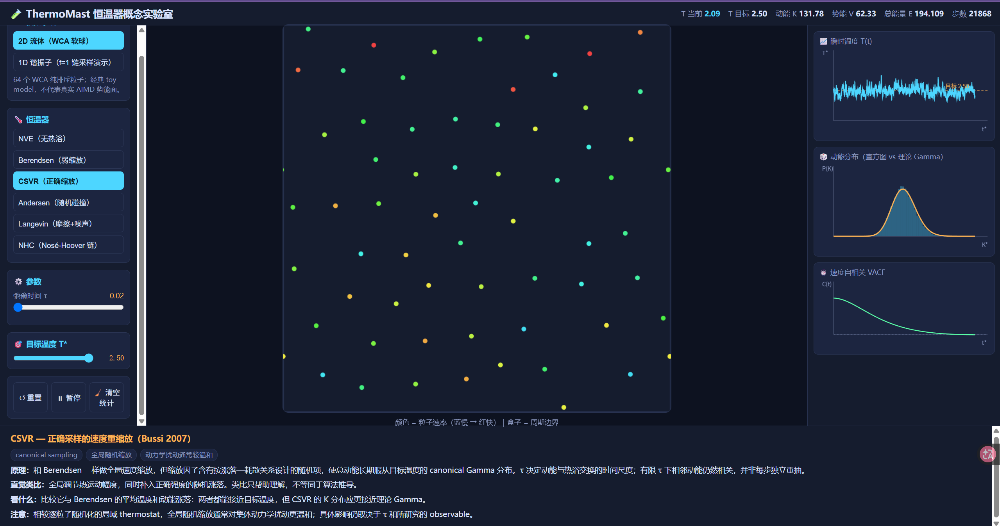

**Andersen thermostat** 会随机选择粒子并重新抽取速度，非常直接地破坏单粒子的速度记忆。它很容易得到正确的 Maxwell–Boltzmann 速度分布，但不适合不加判断地用于需要真实动力学信息的场景。

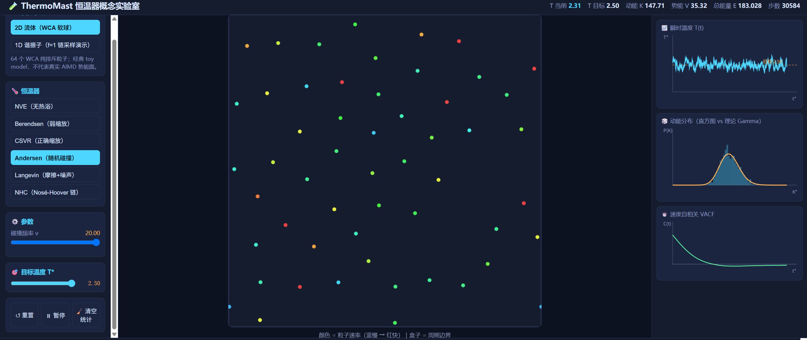

**Langevin thermostat** 同时加入摩擦和随机力。强摩擦可以让动量分布很快热化，但也可能显著阻尼真实运动。需要分清"速度分布已经正确"和"构型空间已经平衡"这两个完全不同的问题。

**Berendsen thermostat** 很擅长快速把平均温度拉向目标值，但它会抑制自然能量涨落，因此不能把它视为严格 canonical sampler。

**Nosé–Hoover / Nosé–Hoover chain（NHC）** 是确定性 thermostat。单个 Nosé–Hoover 变量在某些体系里可能有遍历性问题，NHC 通过增加 thermostat chain 改善采样。这里的耦合时间同样可以粗略理解为热浴响应时间尺度，而链长度主要影响遍历性。

目前形成的朴素认识是：CSVR、Andersen、Langevin 和 NHC 都可以设计成采样正确的 canonical ensemble，但"采样正确"不代表对所有动力学性质都同样温和（尤其是 Andersen 热浴）；耦合越强，越应该检查输运性质的 thermostat sensitivity。

到底如何选择合适的热浴呢？可以参考 Basconi & Shirts, JCTC 2013。他们的体系主要是液体，不是 LGPS，所以数值结论不能直接搬过来，但方法学上的启发很有价值：不同 thermostat 对动力学的破坏程度差别很大，尤其是直接随机重置单粒子速度的方式，在强耦合下容易明显改变扩散系数和黏度；全局 thermostat 对他们研究的体系影响相对温和。对 LGPS 更合理的态度，不是争论哪一个 thermostat 在宇宙中最正确，而是：

> **选一个有理论根据、行为合理的 thermostat，然后对关键输运结果做 sensitivity test。**

Green–Kubo 前面只是提了一句，这里补几句它在工作流里的位置。对于自扩散系数，Einstein/MSD 方法更直观，也更适合当前已有的轨迹；Green–Kubo 需要积分 VACF：

$$
D=
\frac13\int_0^\infty
\langle\mathbf v(t)\cdot\mathbf v(0)\rangle dt.
$$

它的麻烦是 VACF 往往在非常短的时间尺度上快速变化，因此需要保存更高时间分辨率的速度数据，经验建议是至少约每 4–5 fs 保存一次速度。这和 Einstein/MSD 很不一样：MSD 关心长时间斜率，对超高频率保存位置的需求没有那么强。Green–Kubo 的一个核心诊断是积分平台：VACF 积分随积分时间增加逐渐到达平台，平台值就是 $D$；如果积分值长期漂移，说明截断时间或采样还不可靠。要注意"VACF 积分在 100 ps 左右到平台"并不等于"只跑 100 ps trajectory 就够了"，为了让相关函数本身有足够多 time origins 进行平均，总 trajectory 应该明显长于相关时间。所以在当前工作流里，Green–Kubo 更适合作为 Einstein/MSD 结果已经比较稳之后做的 cross-check，而不是现在同时开两套方法把自己搞晕。

---

## 从自扩散到电导率

前面的 MSD 得到的是单粒子运动意义下的**示踪/自扩散系数**：

$$
D_{\rm tr}
=
\lim_{t\to\infty}
\frac{\langle|\Delta\mathbf x|^2\rangle}{6t}.
$$

从自扩散系数到电导率，中间还隔着一层经常被略过的近似。最常见的 Nernst–Einstein 近似把它直接转换为离子电导率：

$$
\sigma_{\rm NE}
=
\frac{CZ_c^2e^2}{k_BT}
D_{\rm tr},
$$

其中 $C$ 是载流子数密度，$Z_c$ 是电荷数。但这个关系假设了不同载流子的运动彼此独立，忽略了它们之间的关联。严格的电荷输运需要考虑集体运动，可以定义电荷扩散系数 $D_\sigma$，使 $\sigma=\frac{CZ_c^2e^2}{k_BT}D_\sigma$。当不同 Li 完全没有相关性时，$D_\sigma=D_{\rm tr}$，Nernst–Einstein 精确成立；一旦存在明显协同或反协同运动，二者就会不同。Haven ratio 常定义为：

$$
H_R=
\frac{D_{\rm tr}}{D_\sigma}
=
\frac{\sigma_{\rm NE}}{\sigma}.
$$

原笔记引用的 LGPS 工作得到过 $D_\sigma\approx2.5D_{\rm tr}$，对应 $H_R\approx0.4$。也就是说在 LGPS 这类快离子导体中，单粒子 MSD 和真正的电荷输运可能并不是一回事，不能默认相关项可以忽略。但 Nernst–Einstein 仍然是常用的近似起点。

集体扩散系数也可以直接从所有载流子的总位移出发：

$$
D_{\rm coll}=\lim_{t\to\infty}\frac{\left\langle\left|\sum_i\Delta\mathbf r_i(t)\right|^2\right\rangle}{6Nt},
$$

与自扩散系数不同，这里是先对所有离子**求和**位移再取模的平方，而不是各自平方再求和，因此它包含了粒子间的位移交叉关联项。mlipx 已经支持集体离子电导率计算，但如前面提到的，400 ps 的自扩散收敛得很好，集体扩散系数并未收敛，增大到 1000 ps 仍然如此，这部分暂时搁置。

还有一个参考系的问题。在 PBC 模拟中，整个体系可能出现数值上的整体漂移，对于 LGPS，更自然的做法是以相对刚性的 Ge/P/S 骨架作为参考，研究 Li 相对于骨架的运动。载流子质心速度修正：

$$
\tilde{\mathbf V}_{\rm Li}
=
\mathbf V_{\rm Li}
-
\frac{1}{N_r}
\sum_{i\in R}\mathbf v_i.
$$

对于 Li self-MSD，mlipx 当前的 `--drift-reference nonmobile` 就是在做同类思想的参考系修正：让 Li 的扩散尽量表达成"相对骨架的迁移"，而不是整个模拟盒子的平移。但要区分两件事：算 self-MSD 时，减掉 non-mobile framework drift 是合理的；算真正 collective charge displacement 时，不能随便减掉 Li 自己的集体质心运动，否则可能把真正的集体输运信号一起删掉。

有限尺寸效应也值得提一句。对于液体，可以通过不同盒子尺寸外推 $D$，或者使用 Yeh–Hummer 类型修正。这部分文献背景主要针对流体的周期性流体力学有限尺寸效应，**不能未经验证直接照搬到 LGPS 固态电解质**。对 LGPS 更稳妥的做法是做 supercell-size convergence，看不同超胞下 $D$、各向异性和协同扩散是否稳定。输出频率方面，Einstein/MSD 关心长时间斜率，不需要为了它保存极高频轨迹；Green–Kubo/VACF 需要更精细的速度时间分辨率。所以"保存多密"要根据分析目标来定，而不是越密越好。

RDF 是和 MSD 并行的另一条线，回答的是不同的问题：MSD 关注 Li 最终走了多远，RDF 关注某类原子周围另一类原子在不同距离出现的概率如何。例如 Li–S RDF：

```bash
mlipx analyze RUN rdf \
  --center Li \
  --neighbor S \
  --rmax 6 \
  --cn-cutoff 3
```

其中 `--cn-cutoff` 不应该机械写死：合理的配位数截断通常应该结合 RDF 第一配位峰之后的第一个谷值来选，并检查不同条件下这个定义是否仍然合理。RDF 属于结构/局域环境分析，可以和 Li site、jump、pathway 等机制分析放在后面单独展开，不要和"怎么算 $D$"混在一起。

---

## 路线图

经过前面这一大圈，我现在更愿意把整个流程压缩成一条主线：

```text
ML-MD trajectory
      │
      ▼
先检查 thermo / 结构 / PBC / 明显跑飞
      │
      ▼
multiple-time-origin MSD
      │
      ├── 看 x/y/z 各向异性
      ├── 看 alpha(t)
      └── 找候选 diffusive regime
      │
      ▼
OLS window-sensitivity
      │
      ▼
trajectory-length convergence
      │
      ▼
kinisi：D_self posterior + statistical uncertainty
      │
      ▼
independent replicas / size convergence
      │
      ▼
Nernst–Einstein conductivity（近似）
      │
      ▼
collective conductivity / D_sigma / Haven ratio
      │
      ▼
Green–Kubo cross-check（若速度数据分辨率足够）
      │
      ▼
多温度 D(T)、sigma(T)
      │
      ▼
Arrhenius / non-Arrhenius analysis
```

这里最重要的是顺序：**先把一个温度、一个模型下的 $D$ 算明白，再往电导率和温度依赖走。**否则很容易出现一种假进展：

> 一口气画了 Arrhenius、电导率、Haven ratio、VACF 一堆图，但连基础的 MSD 拟合区和采样误差都还没搞清楚。

学到这里，公式其实可以暂时忘掉一半，值得留下的是这些判断：

1. MSD 不是越长越好用。短时间有 ballistic/caging，极长 lag 又缺 time origins，真正用于扩散系数的是中间稳定的长时间线性区。
2. $\alpha(t)\approx1$ 是找 diffusive regime 的辅助证据，不是机械裁判，数值导数本身会放大噪声。
3. $R^2$ 很高不等于误差很小。高度相关的 MSD 点完全可以拟合出非常漂亮的直线，却仍然存在不小的统计不确定度。
4. OLS 没有"错"。它适合快速估计斜率和做窗口敏感性，问题在于不能直接把普通 OLS 的 textbook error bar 当成 MSD 扩散系数的可靠不确定度。
5. kinisi 不是另一套物理理论。它仍然建立在 Einstein/MSD 的长时间线性关系上，只是更认真地处理协方差并给出 $D$ 的后验分布。
6. 单条轨迹内部的不确定度不等于整个项目的不确定度，independent replicas 仍然是检验 run-to-run reproducibility 的重要工具。
7. thermostat 是否"采样正确"和是否"对动力学足够温和"是两个问题，做 transport 时必须对这个区别敏感。
8. 示踪扩散和真正电荷扩散不是同一个物理量。Nernst–Einstein 是很重要的近似，但 LGPS 这类快离子导体中不能默认相关项一定可以忽略。

---

这部分笔记背后有几篇真正有用的文章，把它们放回各自的位置，说清楚每篇解决了什么问题。

Maginn et al., *Living J. Comp. Mol. Sci.* 2019, 1, 6324 是"输运性质怎么做"的总纲：Einstein 和 Green–Kubo 是什么，为什么自扩散优先用 MSD，multiple time origins，怎么选拟合区，为什么不能只看一条曲线，以及 trajectory length、replicas、finite-size、uncertainty 等需要检查什么。

Basconi & Shirts, *JCTC* 2013 回答的是 thermostat 对动力学到底会不会产生系统影响。它研究的是液体体系，不是 LGPS，更适合拿来理解原则，而不是直接搬数值结论。

Pranami & Lamm, *JCTC* 2015, 11, 4586–4592 主要回答为什么单条 MD 加 MSD 直线拟合很难给出真正可靠的统计误差。它让我意识到 trajectory length、独立模拟和相关性问题不是锦上添花，而是扩散系数可信度的一部分。

Grossfield et al., *Living J. Comp. Mol. Sci.* 2019 是更通用的 sampling / uncertainty quantification 指南：什么叫平衡，什么叫采样充分，有效独立样本数，自相关，block averaging，bootstrap，independent replicas，以及为什么"没看到问题"不等于"已经证明收敛"。其中大量生物分子例子不需要机械照搬到 LGPS，但统计思路非常值得借鉴。

McCluskey et al., *JCTC* 2025, 21, 79–87 是目前和 kinisi 最直接相关的方法论文。它回答的问题是：MSD 的不同 lag 既相关又异方差，普通 OLS 无法可靠估计斜率的不确定度，那么能不能只用一条轨迹，更高效地估计 $D$ 和 uncertainty？答案就是当前 kinisi 使用的近似 covariance-aware Bayesian regression。这篇和 Maginn 可以看成一前一后：Maginn 告诉我扩散系数分析应该遵守什么原则，McCluskey 进一步解决 MSD 斜率的统计不确定度怎么算。

---

暂时停在这里。DP-GEN 那条线，等有更大的显存再接着跑；这些笔记也先到这里，不再无限扩展。目前已经形成一条足够清楚的主线：

$$
\boxed{
\text{trajectory}
\rightarrow
\text{MSD}
\rightarrow
\text{diffusive regime}
\rightarrow
D_{\rm OLS}\text{（诊断）}
\rightarrow
D_{\rm kinisi}\text{（含统计不确定度）}
}
$$

再往后的 collective conductivity、Haven ratio、Green–Kubo、replicas、size convergence、Arrhenius 等，都应该在这条主线真正稳定以后逐步展开。至少到这里，再看到 `MSD`、`OLS`、`kinisi`、`lag time`、`credible interval` 这些词时，它们不应该再是五个互不相干的新概念，而是同一条分析链上的不同环节。
