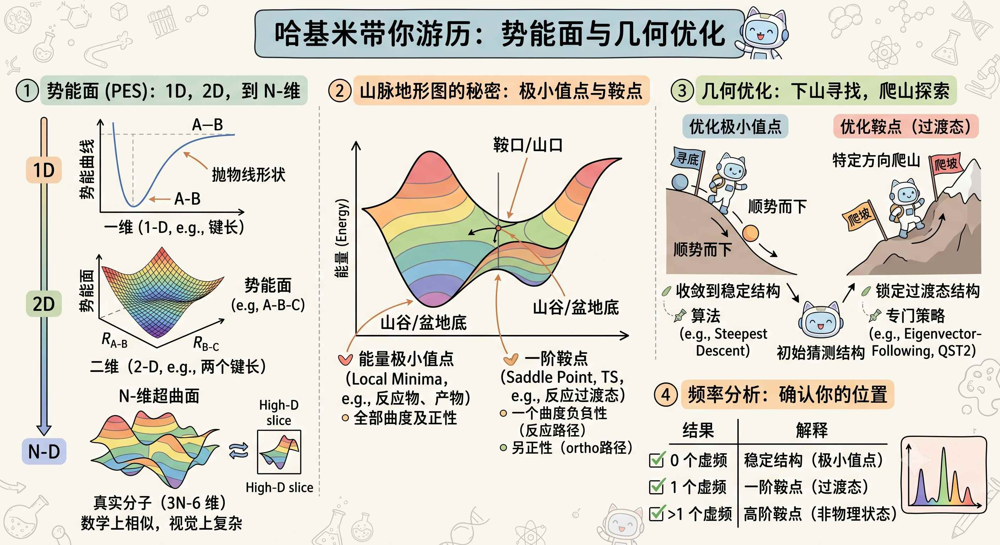
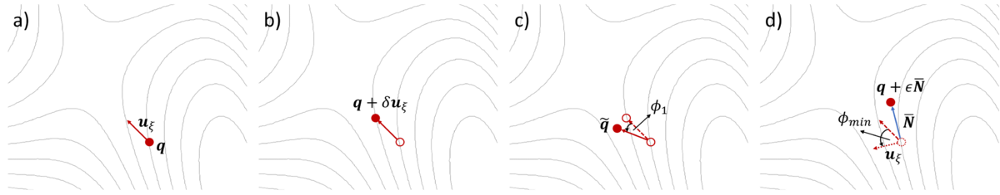
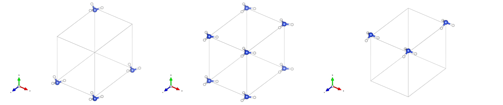
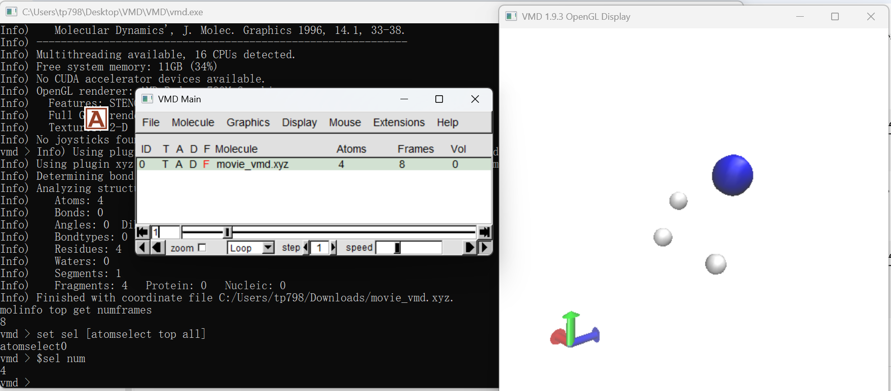

高中化学就已经接触这个概念，vasp wiki对其的解释：
> 过渡态（TS）是指反应物转化为产物过程中出现的高能量、短寿命的中间结构。此时反应的进程达到最大值。换句话说，过渡态是一个亚稳态结构，**对应于高维势能面（PES）上的一个鞍点**

鞍点即两个山谷之间的垭口/山口（Pass），从山谷 A 走向山谷 B，走这个山口是**最高点**；但如果你垂直于这条路往两侧的山峰爬，这里又是**最低点**。对应量子化学里，鞍点处矩阵**有且仅有一个负特征值**（即只有一个虚频）
微积分里也学过，鞍点是驻点的一种（局部极大值点、局部极小值点、鞍点），比如：
- 局部极小值点处一阶导数为0，二阶导数大于0，周围的斜率是单调递增的
- 鞍点处一阶导数为0，二阶导数有正有负，沿两个山峰方向为正，沿两个山谷方向为负

过渡态的结构可以靠有机化学中的Hammond's Postulate预测，能量相似则结构相似。

过渡态的寻找方法有很多，详见卢老师的博文：http://sobereva.com/44。

VASP 中实现了三种静态方法，用于通过静态或谐波方法寻找过渡态（TS）：
- 改进的二聚体方法（IDM）
- 受约束弹性带方法（NEB）
- 以及沿着内禀反应坐标（IRC）追踪


## Improved dimer method

想象一下，在3N-6（不关注分子本身，减掉三个平动自由度和三个转动自由度）的势能面上，有两个距离极近的分子（$2\Delta R$，通常取 $0.005 \sim 0.01 \rm Å$），就像dimer（二聚体），这个二聚体的位置在中点：
```
    分子 R1 ●───────● 分子 R2
             └──┬──┘
              中点 R (Dimer 的位置)
```
二聚体的方向向量为：$\mathbf{N=\dfrac{R_2-R_1}{2\Delta R}}$
传统的找鞍点算法需要计算完整的 Hessian 矩阵（非常昂贵），而 Dimer 方法巧妙地利用这两个点的受力差($F=-\dfrac{dE}{dx}$)，直接估算出 Hessian 矩阵沿着 $\mathbf{N}$ 方向的曲率。

```
       ┌────────────────────────┐
       │   1. 旋转 (Rotation)   │ ──► 寻找曲率最小（最负）的方向 N
       └───────────┬────────────┘
                   │
                   ▼
       ┌────────────────────────┐
       │   2. 平移 (Translation)│ ──► 沿着 N 往上爬，其他方向往下滑
       └───────────┬────────────┘
                   │
                   ▼
           是否收敛到鞍点？
         /                \
      (否)                (是)
        │                  │
        └─── 循环继续 ◄─────┴──► 找到过渡态 (TS)
```


VASP使用了单侧有限差分的方式：https://vasp.at/wiki/Improved_dimer_method#Initial_dimer_axis
```
【经典 Henkelman Dimer 构型】           【VASP Wiki 中的 IDM 算法 (FINDIFF = 1)】
         2ΔR                                      δ
  ●───────●───────●                        ●───────────────●
 R1      中点R     R2                      q            q + δu_ξ
                                      (主计算点)       (向前探针点)
```

VASP中的IDM方法大概是：
IDM 在每个当前位置旋转二聚体轴，寻找势能面对原子协同位移的最负曲率方向（急速上升的方向）。随后把真实力投影到该方向及其垂直子空间：沿最负曲率方向的分量反号，使结构朝一阶鞍点上坡；垂直方向的分量保持不变，使结构在其余自由度中继续降低能量。每次平移后重新寻找最负曲率方向，最终在一个方向为极大、其余方向为极小的位置收敛（对于两座山谷是极大、两座山峰是极小）。

为了获取`Eigenvectors after division by SQRT(mass)`，需要首先进行一次有限差分计算，关键参数：
```INCAR
NSW    = 1
IBRION = 6 !vasp6.6.0版本
NFREE  = 2 !中心差分
POTIM  = 0.02
NWRITE = 3
ISMEAR = 0
```
查看虚频：
```bash
(storm) [storm@vasp-v100 step1]$ grep THz OUTCAR 
   1 f  =  111.915802 THz   703.187726 2PiTHz 3733.109338 cm-1   462.846360 meV
   2 f  =  111.811874 THz   702.534724 2PiTHz 3729.642658 cm-1   462.416547 meV
   3 f  =  105.964212 THz   665.792777 2PiTHz 3534.585637 cm-1   438.232569 meV
   4 f  =   45.843898 THz   288.045704 2PiTHz 1529.187825 cm-1   189.595041 meV
   5 f  =   45.688880 THz   287.071699 2PiTHz 1524.016991 cm-1   188.953940 meV
   6 f  =    6.267955 THz    39.382722 2PiTHz  209.076467 cm-1    25.922167 meV
   7 f  =    5.212160 THz    32.748969 2PiTHz  173.858951 cm-1    21.555753 meV
   8 f  =    4.954527 THz    31.130210 2PiTHz  165.265224 cm-1    20.490267 meV
   9 f  =    0.034301 THz     0.215517 2PiTHz    1.144144 cm-1     0.141856 meV
  10 f/i=    0.005521 THz     0.034689 2PiTHz    0.184161 cm-1     0.022833 meV
  11 f/i=    0.080527 THz     0.505964 2PiTHz    2.686081 cm-1     0.333031 meV
  12 f/i=   23.353479 THz   146.734237 2PiTHz  778.988214 cm-1    96.582186 meV
```
虚频775.65，它可能对应着过渡态，使用它的后三列定义二聚体轴：
```bash
(storm) [storm@vasp-v100 step1]$ grep -A 10 "12 f/i=" OUTCAR 
  12 f/i=   23.353479 THz   146.734237 2PiTHz  778.988214 cm-1    96.582186 meV
             X         Y         Z           dx          dy          dz
      5.127046  0.000000  7.496000     0.000000    0.520019    0.000000  
      0.000000  0.000000  1.008000     0.000000    0.530013    0.000000  
      0.872954  0.000000  7.496000    -0.000000    0.520019   -0.000000  
      0.000000  0.000000  0.000000     0.000000   -0.422193    0.000000  
```
第一步的频率计算会使用中心差分法，对所有允许移动的原子的各个自由度都“微扰推一下”，所以原子坐标会改变，第二步的`POSCAR`应当用第一步的`POSCAR`而不是`CONTCAR`加上dx/dy/dz
`POSCAR`变为：
```POSCAR
ammonia flipping
1.
6 0. 0.
0. 7 0.
1. 0. 8
H N
3 1
cart
       -0.872954        0.000000       -0.504000
        0.000000        0.000000        1.008000
        0.872954        0.000000       -0.504000
        0.000000        0.000000        0.000000
        ! here we define trial unstable direction:
     0.000000    0.520019    0.000000
     0.000000    0.530013    0.000000
    -0.000000    0.520019   -0.000000
     0.000000   -0.422193    0.000000
```
接下来可以进行IDM方法的过渡态计算了，关键输入参数为`IBRION=44`，允许粒子运动。

总的来说，进行了：
1. 一次频率计算；
2. 一次 IDM 优化。

第一次的频率计算是为IDM找一个方向，它会真正构造 Hessian/动力学矩阵，并输出完整的振动模式，第二次的计算不是完整的频率计算，`NSW=100`指的是最多进行 100 个旋转—平移优化步，看下第二步的曲率：
```bash
(storm) [storm@vasp-v100 step2]$ grep curvature OUTCAR
    curvature along the dimer direction:   -4.9466
    curvature along the dimer direction:   -7.3051
    curvature along the dimer direction:   -7.7485
    curvature along the dimer direction:   -7.8341
    curvature along the dimer direction:   -7.8826
    curvature along the dimer direction:   -7.8629
    curvature along the dimer direction:   -7.8314
    curvature along the dimer direction:   -7.8369
    curvature along the dimer direction:   -7.8519
    curvature along the dimer direction:   -7.8498
    curvature along the dimer direction:   -7.8502
    curvature along the dimer direction:   -7.8502
    curvature along the dimer direction:   -7.8496
    curvature along the dimer direction:   -7.8497
    curvature along the dimer direction:   -7.8512
    curvature along the dimer direction:   -7.8513
    curvature along the dimer direction:   -7.8556
```
从第一步开始就是负曲率，说明你从第一次频率计算提取的初始二聚体轴，已经与$\rm NH_3$翻转的不稳定振型有很强的重叠。没有经历一长串正曲率，属于很好的初始猜测，随后曲率先明显变得更负，表明 IDM 在旋转二聚体轴，并逐渐找到更准确的最低曲率方向；同时中心结构也可能在向鞍点移动，最后稳定在约 −7.85。

在第二步之后重复第一步，也就是对`CONTCAR`再次进行频率计算，会出现另外两个80$\rm cm^{-1}$左右的虚频。

```bash
(storm) [storm@vasp-v100 step3]$ grep THz OUTCAR 
   1 f  =  112.980169 THz   709.875341 2PiTHz 3768.612801 cm-1   467.248227 meV
   2 f  =  112.868541 THz   709.173958 2PiTHz 3764.889276 cm-1   466.786569 meV
   3 f  =  106.972040 THz   672.125150 2PiTHz 3568.203175 cm-1   442.400611 meV
   4 f  =   45.601843 THz   286.524833 2PiTHz 1521.113765 cm-1   188.593986 meV
   5 f  =   45.516482 THz   285.988492 2PiTHz 1518.266420 cm-1   188.240960 meV
   6 f  =    1.797702 THz    11.295296 2PiTHz   59.964888 cm-1     7.434695 meV
   7 f  =    0.165804 THz     1.041777 2PiTHz    5.530625 cm-1     0.685710 meV
   8 f  =    0.108567 THz     0.682147 2PiTHz    3.621410 cm-1     0.448997 meV
   9 f/i=    0.006641 THz     0.041725 2PiTHz    0.221510 cm-1     0.027464 meV
  10 f/i=    2.457442 THz    15.440565 2PiTHz   81.971448 cm-1    10.163160 meV
  11 f/i=    2.519856 THz    15.832723 2PiTHz   84.053353 cm-1    10.421283 meV
  12 f/i=   24.053485 THz   151.132505 2PiTHz  802.337905 cm-1    99.477177 meV
```

**在增加截断能、减小步长后，虚频会逐渐趋于0，这一点非常重要，否则会出现比较明显的额外虚频**，但这是理论上不应该的：
- dimer算法本身就是"找一阶鞍点"的构造
- 平面的$\rm D_3h$点群，振动表示被对称性钉死:Γ$\rm _{vib}$ = a1′ + e′+ a2″ + e′。在 D3h 驻点上,只有 a2″(伞形)可能是虚频,stretch/bend 都是实的。也就是说:只要它真是$\rm D_3h$驻点,虚频个数就被群论预先确定为 

wiki给出的示例并没有显式设置`ISMEAR`参数，因此程序默认使用一阶Methfessel-Paxton方法(`ISMEAR=1`)，这值得警惕，手写`INCAR`或者抄wiki参数记得检查。
>**Mind:** Methfessel-Paxton can yield erroneous results for insulators because the partial occupancies can be unphysical.


若VASP编译了VTST代码，也可以改用 VTST 自己Dimer，Dimer 算法需要知道**沿着哪个方向做探针旋转和逆力爬山**。这个方向向量存储在一个名为 **`MODECAR`** 的文件里。用当前的猜想结构做一次单点频率分析（`INCAR` 里设 `IBRION = 6`, `NSW = 1`, `NFREE = 2`），然后提取`dx dy dz`写到`MODECAR`中：
```MODECAR
     0.000000    0.520298   -0.000000  
    -0.000000    0.530089   -0.000000  
     0.000000    0.520298    0.000000  
     0.000000   -0.421409   -0.000000  
```
其实和原生的VASP的IDM方法差不太多😂

输入文件关键参数如下：
```INCAR
SYSTEM = NH3 VTST Dimer

# VTST Dimer
ICHAIN = 2

# Disable VASP ionic optimizer
IBRION = 3
POTIM  = 0

# VTST force-based CG
IOPT   = 2

NSW     = 200
ISIF    = 2
MAXMOVE = 0.10

# Dimer parameters
DdR     = 0.005
DRotMax = 1
DFNMin  = 0.01
DFNMax  = 1.0
```
- `DdR=0.005`：Dimer 两端之间的有限差分尺度；
- `DRotMax=1`：每次平移最多一次旋转步骤；
- `DFNMin/DFNMax`：控制是否继续旋转；
- `EDIFFG=-0.01`：控制 Dimer 中心的最终力收敛。

可以对比发现，`ICHAIN=2`参数≈ `IBRION=44`参数。

为了画出构型翻转的图，我们需要得到翻转前和翻转后的结构，可使用ase软件包生成两个初猜结构，然后几何优化使它们分别收敛到稳定的结构：
```python
import numpy as np
from ase.io import read, write

# 1. 读取过渡态 CONTCAR
atoms = read('CONTCAR')

# 2. 贴入第 12 个虚频的 dx, dy, dz 矢量 (注意看你的 OUTCAR_freq)
# 这里填入你的 4 个原子的 dx dy dz 分量：
e_imag = np.array([
    [0.000001,  0.520019, -0.000000], # N
    [0.000001, -0.530013,  0.000001], # H1
    [0.000000,-0.520019,  0.000001], # H2
    [0.000000,  0.112832,  0.000000]  # H3
])

# 归一化向量 e_imag
e_imag = e_imag / np.linalg.norm(e_imag)

# 3. 设置扰动步长 A (0.05 ~ 0.1 Å)
A = 0.08 

# 4. 生成正向 R+ 并保存
atoms_plus = atoms.copy()
atoms_plus.positions += A * e_imag
write('POSCAR_plus', atoms_plus, format='vasp')

# 5. 生成负向 R- 并保存
atoms_minus = atoms.copy()
atoms_minus.positions -= A * e_imag
write('POSCAR_minus', atoms_minus, format='vasp')

print("已生成 POSCAR_plus 与 POSCAR_minus！")
```
最终成功找到两个初始结构：

不过Dimer方法似乎用得不算多？Dimer 方法虽然不需要终态，但需要：
- 一个足够接近过渡态的初始结构；
- 一个与目标不稳定模有较大重叠的初始二聚体轴。
原始 Dimer 方法的优势正是“不需要知道最终态”，只使用能量和一阶导数寻找鞍点；但它属于局部的 minimum-mode-following 搜索，初始猜测不佳时可能收敛到附近另一个鞍点。

## Nudged elastic bands和Climbing image nudged elastic bands
接下来看看NEB微绕弹性带方法。

它是一种chain-of-states方法，引自卢老师44博文
>这类方法主要好处是只需要提供反应物和产物结构就能得到准确的反应路径和过渡态。首先在二者结构之间以类似LST的方式线性、均匀地插入一批新的结构（使用内坐标更为适宜），一般为5~40个，每个结构就是势能面上的一个点(称为image)，并将相邻的点以某种势函数相连，这样它们在势能面上就如同组成了一条链子。对这些点在某些限制条件下优化后，在势能面上的分布描述的就是MEP，能量最高的结构就是近似的过渡态位置。


对于已知的初态和终态，直接插值做优化，体系很容易直接掉进附近的局部极小值里。

NEB方法的流程大概是：在反应物和生成物之间，均匀插值插入 $M$ 个中间构型（称为 Images / 镜像），并在相邻的 Image 之间用虚拟的“弹簧（Springs）”串联起来，形成一条类似于橡皮筋的“弹性带”。

```
     【势能面山脊 (PES)】
            鞍点 (TS)
              ▲
             / \
            /   \
 (Image 2) ●     ● (Image 3)
          /       \
(Image 1)●         ● (Image 4)
        /           \
  (IS) ●             ● (FS)
 [反应物]           [产物]
   (00)              (05)
```
不过更准确地说，NEB只是负责寻找最小能量路径，并给出过渡态所在的**区域**和**近似势垒**；CI-NEB 才会强制**某一个image**爬到鞍点。
```
初态 A                    终态 B
  ●────○────○────○────○────●
       01   02   03   04
```
假设第$i$个 image 当前受到真实原子力：
$$
\mathbf{F}_i=-\nabla E(\mathbf{R}_i)
$$
NEB 先根据相邻images 判断路径切线$\tau_i$，然后把真实的力分解：
$$
\mathbf{F}_i=\mathbf{F}_{i,⟂}+\mathbf{F}_{i,⟂}^{\rm spring}
$$
- 保留真实力的法向分量​：让 image 往路径两侧的低能方向滑，逐渐靠近 MEP(minimum energy path，最小能量路径)；
- 去掉真实力的切向分量：避免所有 images 顺着能量斜坡滑进初态或终态；
- 只保留弹簧力的平行分量：维持 images 沿路径分布。
即不是把真实力和弹簧力直接相加，而是经过投影，分别只保留需要的方向。最终法向方向的力逐渐收敛为0，所有 images 就落在最小能量路径 MEP。

两个端点结构需要特别注意：
- 晶胞完全相同；
- 元素数量相同；
- 原子顺序完全相同；
- 使用同一套 POTCAR；
- 都已经充分优化；
- 只允许构型翻转，不允许 H 原子编号交换。
VASP 官方特别强调，端点误差会传递到整个路径；原子顺序不一致会导致完全错误的插值路径。
可以使用脚本快速检查：
```python
import numpy as np
from ase.io import read

a = read("POSCAR_initial")
b = read("POSCAR_final")

assert a.get_chemical_symbols() == b.get_chemical_symbols(), \
    "初态和终态的原子顺序不同"

assert np.allclose(a.cell.array, b.cell.array, atol=1e-8), \
    "初态和终态晶胞不同"

assert np.array_equal(a.pbc, b.pbc), \
    "周期性设置不同"

print("原子顺序：", a.get_chemical_symbols())
print("原子数：", len(a))
print("晶胞一致：是")
print("可以生成 NEB images")
```
接下来使用脚本根据两个端点结构文件自动生成中间images：
```bash
(storm) [storm@vasp-v100 NEB]$ nebmake.pl POSCAR_initial POSCAR_final 6
filetype1: vasp5
filetype2: vasp5

OK, ALL SETUP HERE
FOR LATER ANALYSIS, PUT OUTCARs IN FOLDERS 00 and 07 !!! #因此，两个端点结构需要做一次静态自洽计算，但是禁止几何优化
```
接着先可视化初始插值路径，不着急提交任务，其中 `0` 表示使用各目录的 `POSCAR`
```bash
nebmovie.pl 0
```
也可使用脚本生成`.xyz`文件：
```python
from pathlib import Path
from ase.io import read, write

images = []

for i in range(8):
    path = Path(f"{i:02d}") / "POSCAR"

    if not path.is_file():
        raise FileNotFoundError(f"缺少文件：{path}")

    atoms = read(path, format="vasp")
    images.append(atoms)

write("movie_vmd.xyz", images, format="xyz")

print(f"已生成 movie_vmd.xyz")
print(f"原子数：{len(images[0])}")
print(f"帧数：{len(images)}")
print("化学元素：", images[0].get_chemical_symbols())
```
可载入VMD可视化：

只是 **8 个离散 NEB images**，不是连续平滑动画。

接下来在父目录只启动一次 VASP，由 NEB 同时优化 `01–06`。

目录结构如下（父目录下并不需要`POSCAR`）：
```bash
(storm) [storm@vasp-v100 NEB]$ tree
.
├── 00
│   └── POSCAR
├── 01
│   └── POSCAR
├── 02
│   └── POSCAR
├── 03
│   └── POSCAR
├── 04
│   └── POSCAR
├── 05
│   └── POSCAR
├── 06
│   └── POSCAR
├── 07
│   └── POSCAR
├── INCAR
├── KPOINTS
├── POSCAR_final_relaxed
├── POSCAR_initial_relaxed
└── POTCAR

8 directories, 13 files
```
本质是”联动“的几何优化，关键的和VTST相关的参数是：
```INCAR
ICHAIN = 0   #使用NEB/CI-NEB方法，取值为1时使用改进二聚体方法
IMAGES = 6   #六个势能面上的点（images结构）
SPRING = -5  #指定镜像间虚拟弹簧的力常数，设为负数代表开启 VTST 改进的各向异性可变弹簧力，它会根据路径上的能量梯度自动调节弹簧拉力，让镜像在能量变化剧烈（接近峰顶）的区域分布得更密集，防止 Image 在山顶跑稀
LCLIMB = .FALSE.  #不使用CI-NEB
LDNEB  = .FALSE.  #关闭动态/变胞弹性带，不太了解
IBRION = 3        #将离子弛豫控制权“交给 VTST 优化器”的总开关
POTIM  = 0        #关闭内置的离子位置更新算法，不要用原生的步长去移动原子，交给下面的IOPT参数控制
IOPT   = 3        #Quick-Min (QM) 算法，极度稳健

TIMESTEP = 0.10   #VTST优化器内部使用的时间步长，单位飞秒
MAXMOVE  = 0.10   #单次离子步中，允许任何原子移动的最大物理距离上限

NSW    = 150
EDIFFG = -0.02
ISIF   = 2
```

我使用的纯Intel MPI并行，MPI进程数（分配的CPU核心数）需要是images的整数倍，比如这里有6个images需要计算，我应当分配6N个核心。
NEB跑完后运行：
```bash
(storm) [storm@vasp-v100 NEB]$ nebef.pl
   0         0.000000       -19.508000         0.000000 
   1         0.019641       -19.475200         0.032800 
   2         0.016368       -19.377000         0.131000 
   3         0.007777       -19.299300         0.208700 
   4         0.007749       -19.299300         0.208700 
   5         0.016359       -19.377000         0.131000 
   6         0.019688       -19.475200         0.032800 
   7         0.000000       -19.508000         0.000000 
```
其中第二、三、四列分别为最大残余受力、绝对总能量、相对能量，能量和力几乎完美镜像。

看起来3和4都是鞍点？

VTST 官方将 NEB 定义为用于寻找：
- 最小能量路径；
- 鞍点；
但严格地说，普通 NEB 不保证某个 image 就是过渡态。大概的情况就是（具体我还没想明白），一个 image 的有效力是：
$$
\mathbf{F}_i^{\rm NEB}=\mathbf{F}_{i,⟂}+\mathbf{F}_{i,⟂}^{\rm spring}
$$

普通 NEB 收敛时满足的是：$\mathbf{F}_i^{\rm NEB}\approx0$，却不一定满足真正鞍点要求的：$\mathbf{F}_i^{\rm real}\approx0$，最高 image 仍可能在真实势能面上受到沿路径方向的力，只是这部分真实力被 NEB 投影掉了，**真正的过渡态存在于你的采样点之外**，但是无脑的增加采样点也会使得成本急剧上升。

此时可以使用CI-NEB方法改进，选取当前最高能的image，VTST 官方明确说明，收敛后的 climbing image 会位于 **exact saddle point**，具体公式是真看不明白就不写了😂。

对当前的路径，CI-NEB 会从目前两个等高 image 中选择一个，让它走向中间的平面 $\rm NH_3$：
```
普通 NEB：

03 ●────────★────────● 04
              TS

CI-NEB：

其他 image ●──────★ climbing image──────● 其他 image
```
 接着以收敛路径作为CI-NEB的起点：
 ```bash
 for d in 01 02 03 04 05 06; do
    cp "$d/CONTCAR" "$d/POSCAR"
done
 ```
 然后修改`INCAR`中的参数：
 ```INCAR
 LCLIMB = .TRUE.
 ```
计算完毕，再次运行Perl脚本：
```bash
(storm) [storm@vasp-v100 CI-NEB]$ nebef.pl
   0         0.000000       -19.508000         0.000000 
   1         0.012297       -19.487800         0.020200 
   2         0.018656       -19.405100         0.102900 
   3         0.011751       -19.321600         0.186400 
   4         0.000163       -19.288100         0.219900 
   5         0.004040       -19.349000         0.159000 
   6         0.005712       -19.465300         0.042700 
   7         0.000000       -19.508000         0.000000 
```
构型4是唯一最高能image，并且最大残余受力极小，是过渡态结构。


其实，这个简单的体系可以直接使用CI-NEB方法不用普通NEB方法。

最后，对于这样一个简单的体系，可以用对称性直接得出过渡态结构而不必依赖过渡态算法，我也用氨气分子这个体系做过测试，以下是卢老师44博客中的原文：
> 如果已经明确地知道过渡态是什么对称性，而且对称性高于平衡态对称性，且可以确信在这个高对称性下过渡态是能量最低点，则可以强行限制到这个对称性之后进行几何优化，几何优化算法比寻找过渡态算法方法更可靠。比如$\rm F+CH_3F-->FCH_3+F$这个SN2反应，过渡态就是伞形翻转的一刻，恰为高对称性的$\rm D_3h$点群，而反应路径上的其它结构对称性都比它低，所以在D3h点群条件下优化，得到的能量最低点就是过渡态。
如果过渡态对称性不确定，则找过渡态计算的时候不宜设任何对称性，否则若默认保持了平衡态下的对称性，得到的此对称下的过渡态并不是真正的过渡态，容易得到二阶或高阶鞍点。


