学习理论计算方法时，我陆续记了不少零散的知识点：从 Hartree-Fock、后 HF 方法，到 AIM、密度矩阵、ELF/LOL 和静电势。它们看起来各说各话，但背后其实有一条共同的主线——我们如何从单电子近似出发，一步步逼近真实电子结构，并从中读出化学。这篇文章就按这条线索重新整理一遍。

## 从两种“孔”说起：电子相关为什么重要

学习量子化学不久就会遇到两个看起来很形象的概念：**Fermi hole（费米孔）和 Coulomb hole（库仑孔）**。

费米孔来自 Pauli 排斥原理。电子是费米子，多电子波函数需要满足反对称性；同自旋的两个电子不能处在同一个位置附近，因此每个电子周围会“挖”掉一块同自旋电子的概率密度。玻色子则没有这个限制，波函数是对称的，所以它们可以靠得很近。

库仑孔则来自电子之间的瞬时 Coulomb 排斥：一个电子在某个位置时，其他电子会因为库仑力而倾向于离它远一点。这种由瞬时排斥造成的“躲开”效应，就是**动态电子相关**。量子化学里一个核心任务，就是想办法描述原子、分子体系中这种动态相关。

## 从 HF 到后 HF：单电子近似与电子相关

Hartree-Fock（HF）方程是量子化学中计算多电子体系近似波函数和能量的基本方法。它的思路是通过“平均场”近似，把复杂的多电子问题拆成单电子问题：每个电子在其他电子构成的“平均场”中运动，暂时忽略电子之间的瞬时相关性。

多电子波函数用单电子轨道（分子轨道）构成的 Slater 行列式来表示。HF 方程可以写成：

$$
\hat{f}(x_1)\varphi_k(x_1)=\varepsilon_k\varphi_k(x_1)
$$

其中 $\hat{f}(x_1)$ 是 Fock 算符：

$$
\hat{f}(x_1)=\hat{h}(x_1)+\sum_{j=1}^{N/2}(2\hat{J}_j-\hat{K}_j)
$$

这里 $\hat{J}_j$ 是 Coulomb 算符，$\hat{K}_j$ 是交换算符。HF 把其他电子对某个电子的平均作用放进了 Fock 算符里，所以它处理的是“平均场”而不是瞬时相互作用。这也是 HF 的主要局限：它忽略了瞬时电子相关。

一个我印象很深的类比是教室考试：HF 方法就像每个学生只关心自己的试卷（轨道），并假设其他学生的行为是固定的“平均干扰”；而现实里学生之间其实会互相“偷看”，也就是电子相关，但 HF 暂时忽略了这一点。

SCF 是求解 HF 方程的迭代过程，通过不断更新“平均场”直到结果自洽。具体做法是：先猜一组初始轨道（例如用原子轨道的线性组合），由当前轨道构建 Fock 算符，再解 HF 方程得到一组新轨道；然后检查新轨道与旧轨道是否几乎相同，如果收敛就输出能量和波函数，否则用新轨道回到上一步继续迭代。

“自洽”这个名字很形象：最终得到的轨道生成的“平均场”，与当初计算这些轨道时使用的场是一致的，自己圆上了自己。

整体流程可以概括为：

```
[多电子薛定谔方程]
   ↓ 太难解 → 近似
[HF方程]（单电子近似 + 平均场）
   ↓ 需要迭代求解
[SCF计算]
   ↓ 收敛后
[分子轨道和能量] → 用于计算化学性质
```

CI 是一种后 Hartree-Fock 方法，通过把多个电子组态（Slater 行列式）线性组合起来，把 HF 忽略掉的电子相关能补回来一部分。

HF 单行列式近似的问题在于：它忽略了电子瞬时排斥（动态相关），也缺少激发态组态的贡献（静态相关），所以算出来的能量往往偏高。CI 的做法是把波函数写成多个激发组态的叠加：

$$
\Psi_\text{CI} = c_0 \Phi_\text{HF} + \sum_i c_i \Phi_i^\text{single} + \sum_j c_j \Phi_j^\text{double} + \cdots
$$

其中 $\Phi_i^\text{single}$ 是单激发组态（一个电子从占据轨道跃迁到虚轨道），$\Phi_j^\text{double}$ 是双激发组态（两个电子同时跃迁）。双激发组态对相关能的贡献通常最大。

按照包含的激发等级，CI 可以分为：

| 类型 | 包含的激发组态 | 计算成本 | 典型应用 |
| --- | --- | --- | --- |
| CIS | 仅单激发 | 低 | 激发态初步探索 |
| CISD | 单+双激发 | 中等 | 小分子基态相关能修正 |
| CISDT | 单+双+三激发 | 高 | 高精度小体系 |
| FCI | 全组态（所有可能激发） | 天文数字 | 极限精度（如 H₂O 极小基） |

CI 有两个关键问题。一是**计算量爆炸**：FCI 的组态数随电子数和轨道数阶乘增长，只适用于极小体系。二是**大小一致性**：CISD 不满足大小一致性，比如两个远离的 H 原子能量并不严格等于单个 H 原子能量的两倍，需要更高激发或者耦合簇（CC）等方法修正。

从基函数到更高级方法的脉络大致是：

```plaintext
[Gauss基函数]
   ↓ 基组展开
[Hartree-Fock方程] → 单行列式近似
   ↓ 电子相关修正
[组态相互作用(CI)] → 用二次量子化算符组合激发组态
   ↓ 更高精度
[耦合簇(CC)、多参考方法]
```

除了 HF 和 CI，实际计算中还有一大片方法可以选择。我简单总结过 Sob 老师的博文（原文：http://sobereva.com/680 ），仅供参考。

常见的任务类型包括优化极小点、优化过渡态、产生反应路径、振动分析、分子动力学、构象/构型搜索和波函数分析等。不同方法的特点和代价大致如下：

| 计算方法 | 特点 | 局限/注意 |
| --- | --- | --- |
| 分子力场 | 计算耗时极低 | 无法描述化学反应 |
| 机器学习势 | 通过机器学习构造依赖于原子坐标的分子描述符与能量之间的抽象关系 | |
| 密度泛函理论（QM） | 性价比非常高 | 耗时高于分子力场 N 个数量级 |
| Hartree-Fock（QM） | | 完全过时 |
| 后 Hartree-Fock 类（QM） | 额外把动态相关在一定程度上考虑进来 | 耗时高了很多 |
| MCSCF 如 CASSCF（QM） | 弥补 HF 缺乏对静态相关的考虑 | 几乎没有或很少考虑动态相关 |
| 多参考方法如 CASPT2、NEVPT2、MRCI（QM） | 在 MCSCF 基础上进一步把动态相关考虑进来，精度整体很好，普适性很强 | 昂贵 |
| 半经验类方法如 AM1、PM3、PM6（QM） | 对 HF 的简化以巨幅降低耗时，耗时只是 HF 的微小零头 | 精度低，只能用于有限的元素 |
| GFN-xTB（QM） | 相当于纳入了一定 DFT 思想的半经验级别方法，整体精度和可靠性 >= 主流的半经验方法 | |

凡是基于量子理论思想的方法，在实际数值求解中一般都会涉及分子轨道；绝大多数计算程序把分子轨道展开成基函数的线性组合。最常见的基函数有两类：一类是**原子中心基函数**，中心一般位于原子核，例如 Gaussian 等大多数量子化学程序以及 CP2K 等部分第一性原理程序使用的高斯型基函数；另一类是**平面波基函数**，分布覆盖整个被计算的晶胞，大多数以周期性体系为主的第一性原理程序使用。

**基组（basis set）**是对于原子中心基函数而言的概念，例如 6-31G*、def2-TZVP、cc-pVDZ 等。它定义了实际计算时对各种元素原子具体用多少、什么参数的基函数。做 HF、DFT、后 HF、MCSCF、多参考等方法时都需要告诉计算程序用什么基组。基组质量越好，也就是越接近所谓的完备基组极限，方法自身的精度发挥得就越充分，但代价是耗时越高。好方法配烂基组，或者烂方法配好基组，结果都不理想；必须好方法配好基组才能得到较准确的结果。

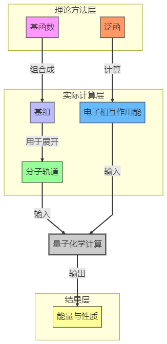

## 电子密度与 AIM：从连续密度到原子和键

AIM（Atoms in Molecules）理论从电子密度出发重新理解“分子中的原子”。电子密度的拓扑结构主要受原子核的吸引力主导，因此每个原子核所在位置都会出现一个显著的局域极大值。这背后有数学保证：从原子核往任何方向走，电子密度都会急剧下降（导数为负），也就是所谓的 Kato 尖点条件。

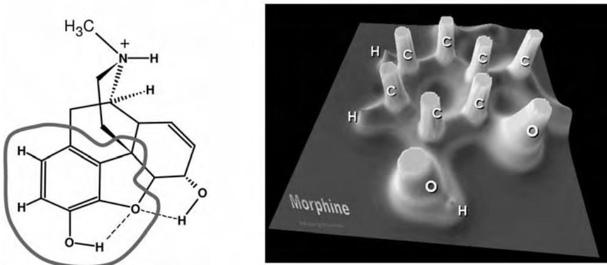

这是吗啡的酚区在芳环平面内的电子密度立体图。碳核和氧核位置处有显著的极大值（图中在 $\rho(\mathbf{r})$ 为 1.0 au 处截断，这是画图时的一种手段；若不截断，C、O 核处的电子密度显著大于 H，z 坐标会高出很多，不美观），氢核位置的峰则小得多。

电子密度中的“临界点”（CP）是空间中密度一阶导数为零的点：

$$
\nabla \rho = \mathbf {i} \frac {d \rho}{d x} + \mathbf {j} \frac {d \rho}{d y} + \mathbf {k} \frac {d \rho}{d z} \rightarrow \left\{\begin{array}{l l}= \vec {\mathbf {0}}&(\text { 在临界点以及无穷远处})\\\text { 通常} \neq \vec {\mathbf {0}}&(\text { 在所有其他点})\end{array}\right.
$$

这里的零向量表示梯度算符 $\nabla$ 中的每一个单独导数均为零，而不是仅它们的和为零。空间中某点处标量函数（如 $\rho(\mathbf{r})$）的梯度是一个向量，方向是 $\rho(\mathbf{r})$ 增长速率最大的方向，大小等于该方向上的增长速率。原子核位置处的极大值构成一类临界点，即核临界点（NCP）。

电子密度梯度模为零的点就是临界点：

$$
\left| \nabla \rho (\mathbf {r}) \right| = \sqrt {\left(\frac {\partial \rho (\mathbf {r})}{\partial x}\right) ^ {2} + \left(\frac {\partial \rho (\mathbf {r})}{\partial y}\right) ^ {2} + \left(\frac {\partial \rho (\mathbf {r})}{\partial z}\right) ^ {2}}
$$

约化密度梯度是电荷密度梯度的一种无量纲形式，常用于 DFT 泛函中，定义为：

$$
\mathrm{RDG} (\mathbf {r}) = \frac {1}{2 (3 \pi^ {2}) ^ {1 / 3}} \frac {| \nabla \rho (\mathbf {r}) |}{\rho (\mathbf {r}) ^ {4 / 3}}
$$

严格说，在量子化学计算中把原子核近似成无体积的点电荷是一种很好的近似，但这会导致势能和电子密度在原子核位置出现尖点，密度在核处的导数没有定义，所以从严格的数学意义讲核位置并不是真正的临界点。不过核极大值在拓扑性质上表现得与临界点类似，通常仍近似当作临界点处理。

临界点可能是极大值点、极小值点或鞍点。要区分它们，需要借助二阶导数，也就是 Hessian 矩阵。在位于 $\mathbf{r}_c$ 处的临界点处，Hessian 矩阵的形式为：

$$
\mathbf {A} (\mathbf {r} _ {c}) = \left( \begin{array}{c c c} \frac {\partial^ {2} \rho}{\partial x ^ {2}} & \frac {\partial^ {2} \rho}{\partial x \partial y} & \frac {\partial^ {2} \rho}{\partial x \partial z} \\ \frac {\partial^ {2} \rho}{\partial y \partial x} & \frac {\partial^ {2} \rho}{\partial y^ {2}} & \frac {\partial^ {2} \rho}{\partial y \partial z} \\ \frac {\partial^ {2} \rho}{\partial z \partial x} & \frac {\partial^ {2} \rho}{\partial z \partial y} & \frac {\partial^ {2} \rho}{\partial z ^ {2}} \end{array} \right) _ {\mathbf{r} = \mathbf{r} _ {c}}.
$$

（这部分推导我一开始看不太懂，就先略过了。）

临界点根据其秩 $(\omega)$ 和符号差 $(\sigma)$ 分类，记作 $(\omega,\sigma)$。秩是临界点处 $\rho$ 的非零曲率数量；符号差可以写成 $n = N_p - N_n$，其中 $N_p$ 是 Hessian 矩阵正本征值数目，$N_n$ 是负本征值数目。在平衡构型下秩几乎恒等于 3；$m<3$ 意味着体系必然处于不稳定构型。常见的几类如下：

| 标志代码 | 曲率分布 | 拓扑图形 | 对应的化学结构 | 符号简称 |
| --- | --- | --- | --- | --- |
| (3,−3) | 3负 0正 | 最高山峰 | 原子核（核临界点） | NCP |
| (3,−1) | 2负 1正 | 山坳/鞍部 | 化学键（键临界点） | BCP |
| (3,+1) | 1负 2正 | 盆地边缘 | 环结构中心（环临界点，如苯环） | RCP |
| (3,+3) | 0负 3正 | 最低谷底 | 笼结构中心（笼临界点，如 C60 内部） | CCP |

具体来说，$(3,-3)$ 是电子密度 Hessian 矩阵三个特征值均为负的局部极大值，也叫吸引子；对于重原子，它的位置几乎与原子核完全一致，因此也称核临界点（NCP）。通常情况下 $(3,-3)$ 的数量与原子数相等，仅在极少数情况下会多于（例如 $\mathrm{Li}_2$）或少于（例如 $\mathrm{KrH}^{+}$）原子数。$(3,-1)$ 在由两个对应特征向量定义的平面内是极大值，在另一个方向上则是极小值，通常出现在相互吸引的原子对之间，因此常称键临界点（BCP）。$(3,+1)$ 是一阶鞍点，常出现在环体系中心，体现空间位阻效应，因此常称环临界点（RCP）。$(3,+3)$ 是局部极小值，常出现在笼状体系中心（例如金字塔形 $\mathrm{P}_4$ 分子），因此常称笼临界点（CCP）。

分子或晶体中可共存的临界点数量和类型遵循严格的拓扑关系：

$$
n _ {\mathrm{NCP}} - n _ {\mathrm{BCP}} + n _ {\mathrm{RCP}} - n _ {\mathrm{CCP}} = \left\{ \begin{array}{l l} 1 & (\text { 孤立分子 }) \\ 0 & (\text { 无限晶体 }) \end{array} \right.
$$

第一个等式称为庞加莱-霍普夫关系（PH），适用于孤立有限体系；第二个等式称为莫尔斯方程，适用于无限周期晶格。给定体系的集合 $\{n_{NCP}, n_{BCP}, n_{RCP}, n_{CCP}\}$ 被称为“特征集”。

违反上式意味着特征集不一致，即可能遗漏了某个临界点，需要继续搜索。但满足该方程并不能证明特征集完备：例如同时漏掉一个 BCP 和一个 RCP，方程仍然成立。不过同时遗漏 BCP 和 RCP 的可能性很小，所以实际应用中通常把满足该式视为特征集一致性和完备性的一个合理证据。

环临界点总是出现在由化学键合原子构成的环内部；当多个环以围出间隙空间的方式连接时，被包围的空间中会出现笼临界点。下图展示了立方烷和 4-甲基-1,12-二氟螺烯的分子图（键径和临界点的集合）。**键径是连接两个化学键合原子的原子核、具有最大电子密度的单条线**。立方烷中，键径排布在立方体的顶点之间，形成六个环，每个面中心各有一个环临界点；这六个环面完全包围了立方体的体积，因此在立方体中心形成一个笼临界点。

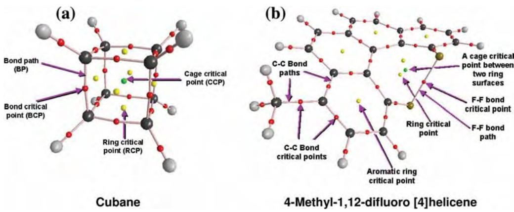

在量子力学建立初期，波函数和电子密度遍布整个分子，分子里只有“整体的电子云”，没有“单个原子”的绝对边界。Bader 引入了零通量面的概念：原子核位置处电子密度的显著极大值产生了丰富的拓扑结构，这种结构把分子空间自然划分为独立的单核区域 $\Omega$，这些区域被识别为分子中的原子。

界定分子中原子的表面是电子密度梯度矢量场的零通量面，也就是说，在任何点上都没有梯度向量 $\nabla\rho(\mathbf{r})$ 穿过该表面。这等价于：

$$
\nabla \rho (\mathbf {r}) \cdot \mathbf {n} (\mathbf {r}) = 0, \quad \text{对于所有属于表面} \ S(\Omega) \ \text{的} \ \mathbf{r}
$$

其中 $\mathbf{r}$ 是位置矢量，$\mathbf{n}(\mathbf{r})$ 是表面 $S(\Omega)$ 的单位法向量。

下图展示了 $\mathrm{BF}_3$ 分子平面内的电子密度及其梯度向量场，对比了把分子空间划分为独立单核“原子盆”的零通量面，以及一个穿过电子密度的任意曲面。左侧是 $\rho(\mathbf{r})$ 的等值线图，数值从原子核向外逐渐降低；右半部分是梯度向量场 $\nabla\rho(\mathbf{r})$，可以清楚看到分子空间被自然地划分为三个氟原子盆和一个中心硼原子盆。

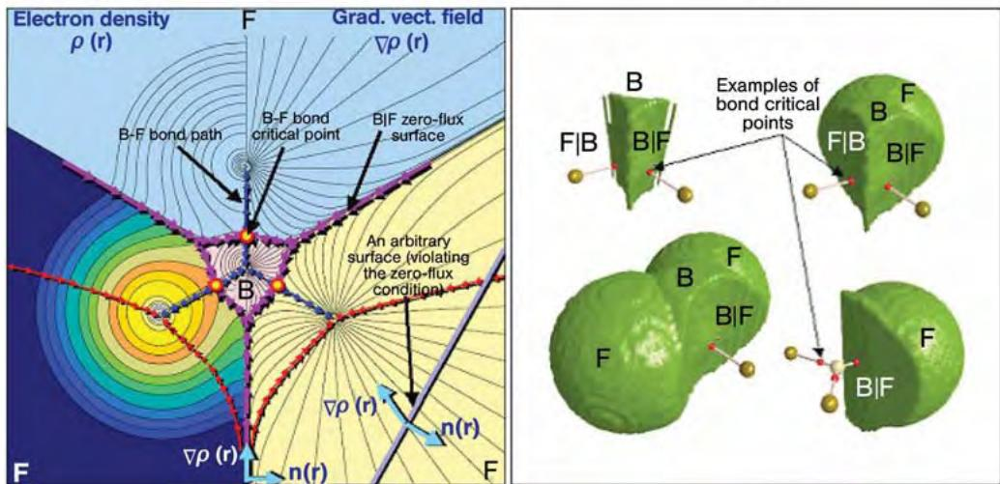

用更数学的话说，所有能汇聚到同一个终点的空间轨迹集合，统称为这个终点的“吸引盆”，简称“盆”。这些盆构成了合适的开放量子系统，因此也被称为“准原子”。准原子可以与分子中的其他准原子成键，也就是共享一个共同的原子间零通量面、一个键临界点和一条键径。非核吸引子及其盆在表征金属键方面有重要意义，也有重要的理论价值。

分子中任意两个成键原子之间存在原子间零通量面的同时，总伴随着另一个关键拓扑特征：在实空间中存在一条连接两原子核的局部最大密度线，称为“键径”（BP）。键径是所有类型化学键——弱相互作用、强相互作用、闭壳层相互作用和开壳层相互作用——的通用标志。键径上电子密度值最低的点（沿键径的极小值）就是键临界点（BCP），键径正是在该点与分隔两个成键原子的零通量面相交。

不过要注意：出现键径/键临界点并不一定意味着真的成键；在空间位阻效应下，核间也可能形成鞍点。

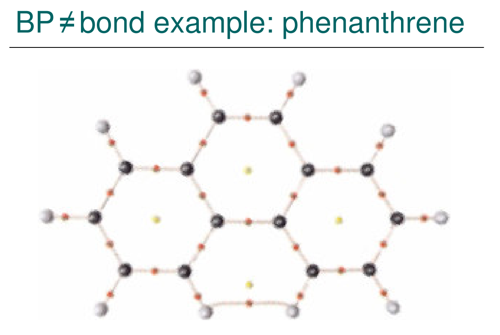

## 轨道、密度矩阵与关联空穴

HF 或 KS 方程解出来的正则分子轨道（Canonical MO，CMO）是 Fock/Kohn-Sham 算符的本征函数。CMO 通常有较强的离域特征，因此缺乏直观的化学键相关性。比如甲烷 $\mathrm{CH}_4$，在普通化学里我们习惯说 C–H 键，但 HF 解出的 CMO 通常遍布全分子，根本没有独立的 C–H 键。

如果对 CMO 做合适的 unitary 变换，可以得到局域化较强的轨道，即 LMO。常用的生成方案有 Boys 局域化、Edmiston-Ruedenberg 局域化（大体系昂贵）、Pipek-Mezey 局域化，以及由 natural bond orbital（NBO）变换而来的 Natural localized molecular orbital（NLMO）。

局域轨道并不是一种实验可直接观测的物理真实，而是为了化学直观引入的“数学工具”。因此选择哪种局域化判据（追求偶极极大，还是追求电荷分布极大），会决定你看到什么样的“化学键形态”。

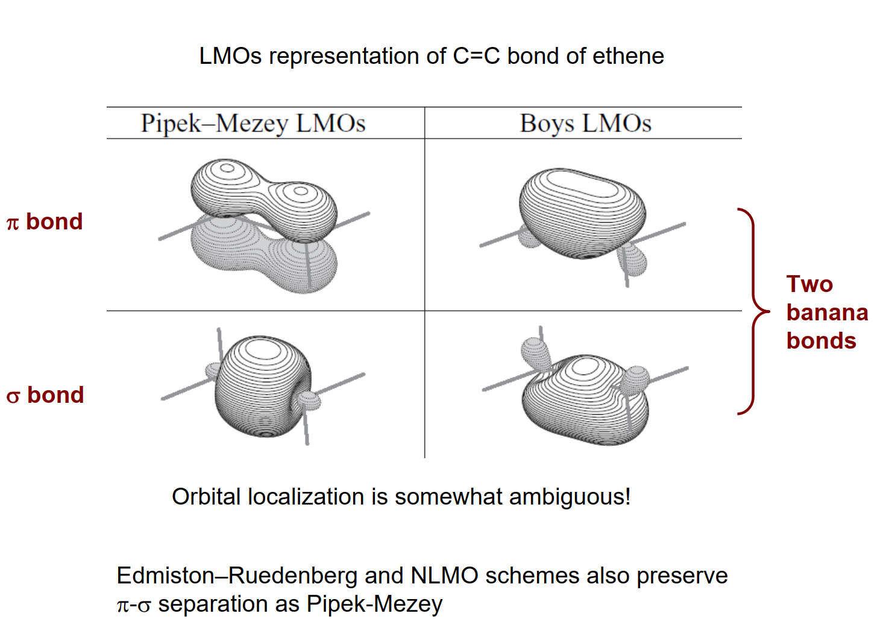

自然键轨道（NBO）与经典化学键更契合，但占据数不总是整数。LMO 和 NBO 都不能如实地展示多中心键；AdNDP 轨道是半局域轨道，可以看作 NBO 的推广，但不仅局限于 2 中心或 3 中心。

NBO 分析中常见的轨道变换关系是：

$$
\rm Original~basis~function \rightarrow NAO \rightarrow NHO \rightarrow NBO \rightarrow NLMO \rightarrow MO
$$

除了轨道视角，从电子密度本身出发也能得到很多信息。根据量子力学的 Born 统计诠释，在时刻 $t$，于 $a$ 到 $b$ 之间找到粒子的概率为：

$$
\int_ {a} ^ {b} | \Psi (\mathbf {r}, t) | ^ {2} d \mathbf {x}
$$

如果只考虑定态、实波函数，粒子出现在 $\mathbf{r}$ 处的概率密度就是：

$$
\rho (\mathbf {r}) = \Psi^ {2} (\mathbf {r})
$$

全空间的总概率必为 1：

$$
\int \rho (\mathbf {r}) d\mathbf{r} = 1
$$

对于 $N$ 电子体系，同时在 $x_{1}$ 处找到粒子 1、在 $x_{2}$ 处找到粒子 2……在 $x_{N}$ 处找到粒子 $N$ 的概率密度为：

$$
\rho (\mathbf {x} _ {1}, \mathbf {x} _ {2} \dots \mathbf {x} _ {N}) = \Psi^ {2} (\mathbf {x} _ {1}, \mathbf {x} _ {2} \dots \mathbf {x} _ {N})
$$

其中 $x$ 是空间-自旋坐标 $\{r, \sigma\}$，归一化条件为：

$$
\int \rho (\mathbf {x} _ {1}, \mathbf {x} _ {2} \dots \mathbf {x} _ {N}) d \mathbf {x} _ {1} d \mathbf {x} _ {2} \dots d \mathbf {x} _ {N} = 1
$$

同时在 $x_{1}$ 和 $x_{2}$ 处找到任意两个电子的概率密度称为对密度：

$$
\pi (\mathbf {x} _ {1}, \mathbf {x} _ {2}) = N (N - 1) \int \Psi^ {2} (\mathbf {x} _ {1}, \mathbf {x} _ {2} \dots \mathbf {x} _ {N}) d \mathbf {x} _ {3} \dots d \mathbf {x} _ {N}
$$

全空间中可找到的电子对总数为：

$$
\int \pi (\mathbf {x} _ {1}, \mathbf {x} _ {2}) d \mathbf {x} _ {1} d \mathbf {x} _ {2} = N (N - 1)
$$

在 $x$ 处找到任意一个电子的概率密度为：

$$
\rho (\mathbf {x}) = \rho (\mathbf {x} _ {1}) = N \int \Psi^ {2} (\mathbf {x} _ {1}, \mathbf {x} _ {2} \dots \mathbf {x} _ {N}) d \mathbf {x} _ {2} \dots d \mathbf {x} _ {N}
$$

全空间中可找到的电子总数为：

$$
\int \rho (\mathbf {x}) d \mathbf {x} = N
$$

通常所说的电子密度是 $\alpha$ 电子和 $\beta$ 电子的密度之和（无自旋密度）：

$$
\rho (\mathbf {r}) = \int \rho (\mathbf {x}) d \sigma = \rho^ {\alpha} (\mathbf {r}) + \rho^ {\beta} (\mathbf {r})
$$

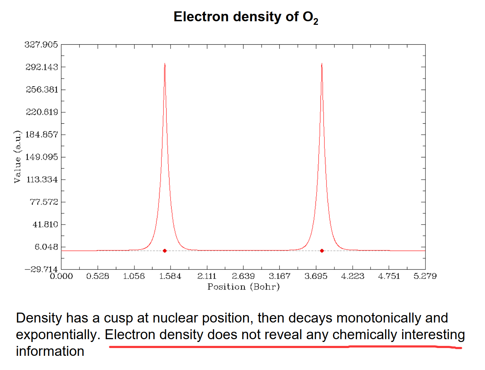

电子密度在原子核位置有一个尖点，随后呈单调指数衰减。单看电子密度本身，并不能直接揭示具有化学意义的信息；所以后面才需要拓扑分析、轨道和各类实空间函数来“读出”化学。

自旋密度定义为：

$$
\rho^ {S} (\mathbf {r}) = \rho^ {\alpha} (\mathbf {r}) - \rho^ {\beta} (\mathbf {r})
$$

对于闭壳层体系，自旋密度处处为零。自旋极化参数函数为：

$$
\zeta (\mathbf {r}) = \frac {\rho^ {\alpha} (\mathbf {r}) - \rho^ {\beta} (\mathbf {r})}{\rho^ {\alpha} (\mathbf {r}) + \rho^ {\beta} (\mathbf {r})}
$$

当 $|\zeta(\mathbf{r})|=0$ 时体系完全非极化，$|\zeta(\mathbf{r})|=1$ 时完全极化。

N 电子波函数 $\Psi(\mathbf{x_1,x_2,\dots,x_N})$ 的维度很高，其中 $\mathbf{x=(r,\sigma)}$ 同时包含空间坐标和自旋坐标。如果只想回答“随便挑一个电子，它出现在空间某点处的情况如何”，那其他 $N-1$ 个电子的具体位置就不必关心，可以把它们积分掉：

$$
\begin{array}{l} \rho (\mathbf {x}; \mathbf {x} ^ {\prime}) = \rho (\mathbf {x} _ {1}; \mathbf {x} _ {1} ^ {\prime}) = \\ N \int \Psi (\mathbf {x} _ {1}, \mathbf {x} _ {2} \dots \mathbf {x} _ {N}) \Psi (\mathbf {x} _ {1} ^ {\prime}, \mathbf {x} _ {2} \dots \mathbf {x} _ {N}) d \mathbf {x} _ {2} \dots d \mathbf {x} _ {N} \end{array}
$$

电子密度可以看成各种“基函数 × 基函数”的组合，再乘上一张系数表 $P$。假设一个分子轨道：

$$
\varphi=0.8\chi_A+0.6\chi_B
$$

其中 $\chi_A$ 是原子 A 上的一个原子轨道，$\chi_B$ 是原子 B 上的一个原子轨道，$\varphi$ 是它们组合出来的分子轨道。这个轨道里有两个电子，于是这两个电子贡献的电子密度为：

$$
\begin{align}
\rho(\mathbf r)&=2 |\varphi(\mathbf r)|^2\\
&=2(0.8\chi_A+0.6\chi_B)^2\\
&=1.28\chi_A^2+0.96\chi_A\chi_B+0.96\chi_B\chi_A+0.72\chi_B^2
\end{align}
$$

密度矩阵把这些系数记录下来：

$$
P=
\begin{pmatrix}
1.28&0.96\\
0.96&0.72
\end{pmatrix}
$$

所以密度矩阵的定义就是：

$$
\rho(\mathbf r)=\sum_{\mu \nu}P_{\mu \nu}\chi_\mu (\mathbf r)\chi_\nu(\mathbf r)
$$

对角元可以粗略理解为“A 自己贡献多少、B 自己贡献多少”，非对角元则可以粗略理解为 A 和 B 两个轨道“混在一起”贡献了多少。

上面的例子用的是原子轨道波函数作为基函数；如果直接拿 MO 当基函数，问题会变得很简单：这个 MO 里有几个电子？答案是两个。假设有 5 个 MO，$\varphi_1,\varphi_2,\varphi_3,\varphi_4,\varphi_5$，前三个占据、后两个空着，那么密度矩阵就是：

$$
P_{\text{MO}}=
\begin{pmatrix}
2&0&0&0&0\\
0&2&0&0&0\\
0&0&2&0&0\\
0&0&0&0&0\\
0&0&0&0&0
\end{pmatrix}
$$

此时 $P$ 是对角矩阵，其值对应轨道占据数。

普通电子密度 $\rho(\mathbf r)$ 的信息还不太够，我们还可以定义一个更完整的“东西” $\rho(\mathbf r,\mathbf r')$，它有两个位置，可以姑且理解为一个更完整的“电子分布信息表”。密度矩阵可以通过基函数展开（希尔伯特空间形式）：

$$
\rho (\mathbf {r}; \mathbf {r} ^ {\prime}) = \sum_ {\mu} \sum_ {\nu} P _ {\mu \nu} \chi_ {\mu} (\mathbf {r}) \chi_ {\nu} (\mathbf {r} ^ {\prime})
$$

一个很直观的类比是房间里两只猫：如果两只猫完全互不影响、各走各的，那么已知猫 1 在沙发上，并不会影响猫 2 在哪里。设 $\rho_{1}(r_{1})$ 表示猫 1 在 $r_{1}$ 的概率密度，$\rho_{2}(r_{2})$ 表示猫 2 在 $r_{2}$ 的概率密度，两件事同时发生的概率就是：

$$
\pi \left( r_{1},r_{2} \right)= \rho_{1} \left( r_{1} \right) \rho_{2} \left( r_{2} \right)
$$

但真实电子不是这样。电子之间至少有两个原因会互相“躲”：一是库仑排斥（库仑关联中的核心内容），二是 Pauli 排斥。所以通常说的交换关联作用可以写成：

$$
XC = X(\mathrm{Pauli~exchange}) + C(\mathrm{Coulomb~correlation})
$$

回过头看，$\pi(r_{1},r_{2})$ 被定义为电子对密度，指在 $r_1$ 找到一个电子、同时在 $r_2$ 找到另一个电子的概率密度。如果两个电子毫无关联，那么：

$$
\pi \left( r_{1},r_{2} \right)= \rho_{1} \left( r_{1} \right) \rho_{2} \left( r_{2} \right)
$$

真实情况要考虑交换相关作用：

$$
\pi=\rho(\mathbf r_1)\rho(\mathbf r_2)+\Gamma_{XC}(\mathbf r_1,\mathbf r_2)
$$

当确定有一个 $\alpha$ 电子在 $r_1$ 时，在 $r_2$ 找到另一个 $\beta$ 电子的概率可以写成条件概率：

$$
\Omega^{\alpha,\beta}(\mathbf r_1,\mathbf r_2)
$$

$$
\Omega^{\sigma_{1}\sigma_{2}}=\frac{ \pi^{\sigma_{1} \sigma_{2}}( r_{1}, r_{2}) }{ \rho^{\sigma_{1}}( r_{1}) }
$$

由此定义交换关联空穴：

$$
h_{XC}(\mathbf r_1, \mathbf r_2)=\Omega(\mathbf r_1, \mathbf r_2)-\rho(\mathbf r_2)
$$

可以理解为：因为一个电子已经在 $r_1$，导致另一个电子在附近出现的概率被“挖下去”了一块。交换关联空穴也可以拆成交换空穴（来自 Pauli 原理）和关联空穴（来自库仑关联）。

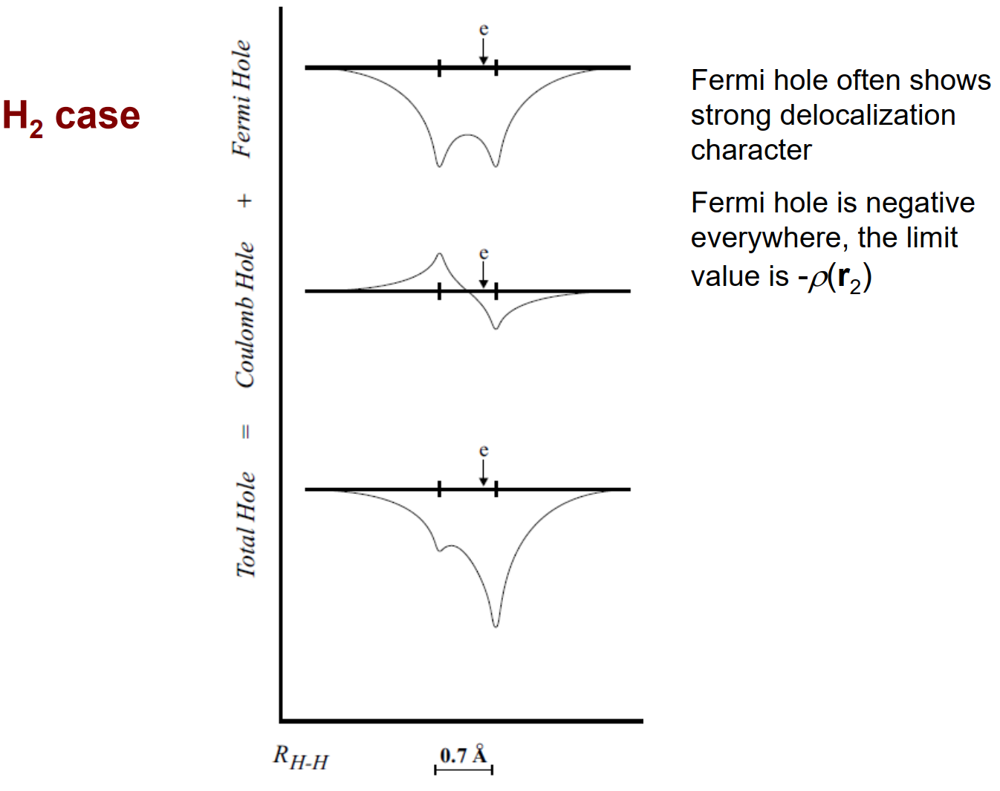


对于氢气分子，因为只有一个 $\alpha$ 电子：

$$
\Omega^{\alpha\alpha}\left( r_{1}, r_{2}\right)=0
$$

所以：

$$
h_{X}^{ \alpha \alpha} \left( r_{1},r_{2} \right)=0- \rho^{ \alpha} \left( r_{2} \right)=- \rho^{ \alpha} \left( r_{2} \right)
$$

也就是说，氢分子的 Fermi hole 图与总电子密度图是对称的。这里研究的是同自旋电子；不同自旋的电子没有交换排斥作用，因此不存在 Fermi hole。

Bader 在 *Atoms in Molecules-A Quantum Theory*（E7.1、E7.2）里有一句话：“电子可以去往其空穴所在之处，若费米空穴是定域的，那么电子也是定域的。”他和 Stephens 在 *J Am Chem Soc*, 97, 7391 (1975) 中也写过：“多电子体系中电子空间定域的量子力学要求是：该电子的费米相关空穴完全被包含在同一空间区域内。”

如果部分电子完全定域（被束缚）在局域空间区域 $\Omega$ 内，则 $\Omega$ 为完全定域区域，此时 $\Omega$ 内的平均电子数必须为整数，即数值确定且无同时涨落：

$$
N _ {\Omega} ^ {\alpha} = \int_ {\Omega} \rho^ {\alpha} (\mathbf {r}) d \mathbf {r}
$$

费米空穴完全被束缚在 $\Omega$ 内（其积分达到理想值）：

$$
\int_ {\Omega} h _ {X} ^ {\alpha \alpha} (\mathbf {r} _ {1}, \mathbf {r} _ {2}) d \mathbf {r} _ {1} d \mathbf {r} _ {2} = - N _ {\Omega} ^ {\alpha}
$$

$\Omega$ 内可找到的电子对数目也为整数，因此数值确定：

$$
\int_ {\Omega} \pi^ {\alpha \alpha} (\mathbf {r} _ {1}, \mathbf {r} _ {2}) d \mathbf {r} _ {1} d \mathbf {r} _ {2} = N _ {\Omega} ^ {\alpha} (N _ {\Omega} ^ {\alpha} - 1)
$$

$\beta$ 电子的情况类似。在完全定域区域中，内部电子不会离域出去，外部电子也无法进入，即不可交换、可区分。分子体系中并不存在完全定域区域，即电子是不可区分的；但确实存在一些定域程度很高（芯区）和相对较高（共价键区、孤对电子区等）的区域。

在高定域区域中，由于费米空穴集中，同自旋电子间的排斥作用较强，而异自旋电子间的排斥作用弱得多，从而导致电子配对。这种配对并非源于任何额外的吸引相互作用。

> 在原子内部壳层、共价键、孤对电子区域电子具有较高的定域性，这也说明域内费米穴较大，相同自旋电子很难接近。注意虽然衡量域的定域程度的指标（定域化指数）也受到库仑穴的影响，但是在研究相同自旋电子对时，库仑穴起到的影响明显小于费米穴，故研究定域性问题时一般可以只考虑费米穴。

离域指数（DI）用于定量衡量两个区域 A 和 B 之间离域（共享）的电子对数目：

$$
\begin{array}{l} \delta^ {\alpha} (A, B) = - 2 \int_ {A} \int_ {B} \Gamma_ {X C} ^ {\alpha , t o t} (\mathbf {r} _ {1}, \mathbf {r} _ {2}) d \mathbf {r} _ {1} d \mathbf {r} _ {2} \\ = - 2 \int_ {A} \int_ {B} \rho^ {\alpha} (\mathbf {r} _ {1}) h _ {X C} ^ {\alpha , t o t} (\mathbf {r} _ {1}, \mathbf {r} _ {2}) d \mathbf {r} _ {1} d \mathbf {r} _ {2} \\ \boxed {\Gamma_ {X C} ^ {\alpha , t o t} = \Gamma_ {X C} ^ {\alpha \alpha} + \Gamma_ {X C} ^ {\alpha \beta}} \end{array}
$$

定域指数（LI）用于定量衡量定域在区域 A 中的电子数目：

$$
\lambda^ {\alpha} (A) = - \int_ {A} \int_ {A} \Gamma_ {X C} ^ {\alpha , t o t} (\mathbf {r} _ {1}, \mathbf {r} _ {2}) d \mathbf {r} _ {1} d \mathbf {r} _ {2} = \delta^ {\alpha} (A, A) / 2
$$

若整个体系仅由区域 A 和 B 组成：

$$
\int \int \Gamma_ {X C} ^ {\alpha , t o t} (\mathbf {r} _ {1}, \mathbf {r} _ {2}) d \mathbf {r} _ {1} d \mathbf {r} _ {2} = \delta^ {\alpha} (A, B) + \lambda^ {\alpha} (A) + \lambda^ {\alpha} (B) = - N ^ {\alpha}
$$

电子在 A 和 B 中的定域程度越高（LI 越高），则电子在 A 和 B 之间的离域能力越弱，即电子共享程度越低（DI 越低）。总电子的定域指数与离域指数为：

$$
\begin{array}{l} \delta (A, B) = \delta^ {\alpha} (A, B) + \delta^ {\beta} (A, B) \\ \lambda (A) = \lambda^ {\alpha} (A) + \lambda^ {\beta} (A) \end{array}
$$

## 实空间分析：ELF、LOL、静电势与键临界点

电子局域化函数（ELF）把费米空穴的分析从六维（两个电子的三维坐标）降到三维，用来衡量给定点周围的平均费米空穴。它的定义是：

$$
\operatorname{ELF} (\mathbf {r}) = \frac {1}{1 + \chi (\mathbf {r}) ^ {2}} \quad 
$$

其中：

$$
\chi (\mathbf {r}) = D (\mathbf {r}) / D _ {0} (\mathbf {r})
$$

$$
D (\mathbf {r}) = \frac {1}{2} \sum_ {i} \eta_ {i} \left| \nabla \varphi_ {i} (\mathbf {r}) \right| ^ {2} - \frac {1}{8} \left[ \frac {\left| \nabla \rho^ {\alpha} (\mathbf {r}) \right| ^ {2}}{\rho^ {\alpha} (\mathbf {r})} + \frac {\left| \nabla \rho^ {\beta} (\mathbf {r}) \right| ^ {2}}{\rho^ {\beta} (\mathbf {r})} \right]
$$

$$
D _ {0} (\mathbf {r}) = \frac {3}{10} \left(6 \pi^ {2}\right) ^ {2 / 3} \left[ \rho^ {\alpha} (\mathbf {r}) ^ {5 / 3} + \rho^ {\beta} (\mathbf {r}) ^ {5 / 3} \right]
$$

公式看起来又是一堆，但关心的其实仍然是：如果我把一个 $\alpha$ 参考电子固定在 $\mathbf{r}$，它周围还能不能很容易出现另一个 $\alpha$ 电子？原始的 ELF 基于 HF 的 parallel-spin pair probability，也就是同自旋电子对概率在短距离附近的局域行为。已知 $\mathbf r_1$，则 $\mathbf r_2=\mathbf r_1+\mathbf{s}$，$\mathbf{s}$ 是第二个电子距离参考电子的一小段位移，维度因此降低。

当 $\mathbf{s}$ 不为零时，可以比较两个体系：如果离开参考电子一点点以后（$\mathbf{s}$ 比较小），另一个同自旋电子还是很难出现，说明参考电子周围有一个比较宽、比较深的 Fermi hole，此时 $D$ 比较小；反过来，如果稍微离开参考电子，另一个同自旋电子马上就能出现，此时 $D$ 比较大。

总之，$D(\mathbf{r})$ 可以粗略想象成 Fermi hole 在参考点附近的“曲率”或“陡峭程度”。更严谨地说，$D(\mathbf{r})$ 与固定参考电子在 $\mathbf{r}$ 后，另一个同自旋电子的球平均条件概率在两电子间距 $s \to 0$ 附近的二阶增长系数成正比。

但单独看 $D$ 很难判断大小：假设 $D=0.1$，在电子密度很高的地方和很低的地方，$D$ 的自然尺度本来就不同。所以需要一个参照物。Becke 和 Edgecombe 采用的是均匀电子气——没有原子、化学键、孤对电子，只是均匀铺开的费米子——它对应的值就是 $D_0(\mathbf{r})$。

于是：

$$
\chi_{\sigma}=\dfrac{D}{D_0}
$$

如果 $\chi<1$，说明该区域的 Fermi hole 比同密度均匀电子气“曲率”更低，需要隔很远才能再次找到自旋相同的另一个电子，这里的电子更定域/局域。ELF 没有直接使用 $D$，而是先拿它跟标准参照物比较：

$$
\operatorname{ELF} (\mathbf {r}) = \frac {1}{1 + \chi_{\sigma} (\mathbf {r}) ^ {2}} \quad 
$$

$D(\mathbf r)$ 越小，则越定域，ELF 数值越大。ELF 的取值在 0~1 之间。

这是 ELF 的原始定义，只考虑了体系只有一种自旋电子存在下的定域性问题，并没有定义体系同时存在 $\alpha$ 和 $\beta$ 电子时的形式。广义的 ELF 为：

$$
\operatorname{ELF} (\mathbf {r}) = \frac {1}{1 + \chi (\mathbf {r}) ^ {2}} \quad 
$$

其中：

$$
\chi=\dfrac{D_{\alpha}+D_{\beta}}{D_{\alpha}^0+D_{\beta}^0}
$$

Savin 把同一个量解释成 Pauli excess kinetic-energy density，因此它可以自然地应用到 KS-DFT（原始定义基于 Hartree-Fock 波函数），形式完全相同。

ELF 本质上是一个定义在实空间上的标量函数。实际计算时，我通常先用 Orca 算出波函数，再转换成 Multiwfn 可读的 molden 文件载入，由 Multiwfn 计算得到格点数据——也就是在一个三维网格上把每个格点的 ELF 值算出来。

对于 2D ELF 图，是在某个平面上取截面，然后画 ELF 值，常见形式有填色图 heatmap、等高线图 contour map，以及填色 + 等高线叠加；总之是在平面上画颜色/等值线。在 Multiwfn 中使用功能 4 进行绘制，类型是 Shaded relief map with projection 图，指定平面，然后选择单位为 Bohr 或 Angstrom，导出为 plane.txt 格点数据，再用 Python 绘图。绘图脚本和结果如下：


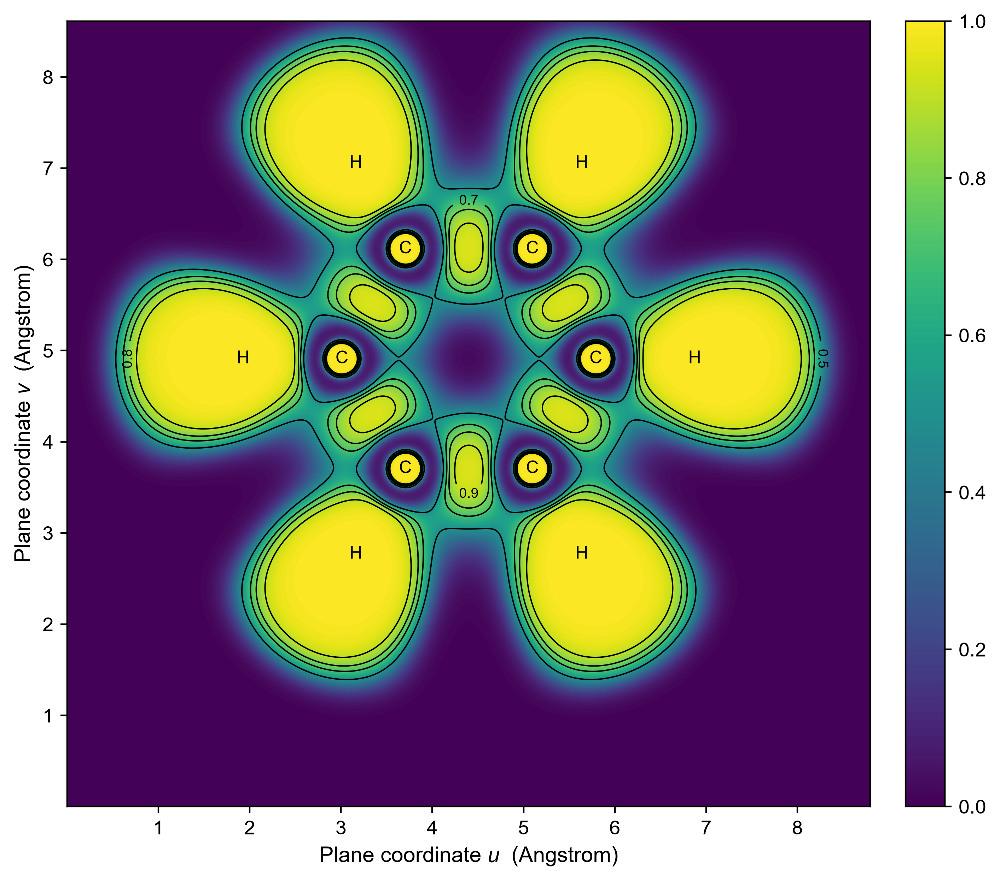

对于 3D ELF 图，是在整个三维空间上根据 ELF 的格点数据画等值面（isosurface），即画 ELF = isosurface value 的空间曲面。使用功能 5 “Output and plot specific property within a spatial region” 计算格点数据，导出为 Gaussian-type cube 数据，载入 VMD 或 ChimeraX 即可。

LOL（Localized orbital locator）函数与 ELF 相似：

$$
\text{LOL}(\mathbf r)=\dfrac{\tau(\mathbf r)}{1+\tau(\mathbf r)}
$$

$$
\tau(\mathbf r)=\dfrac{D_0(\mathbf r)}{\frac{1}{2}\sum_i \eta_i|\nabla \varphi_i \mathbf r|^2}
$$

LOL 的取值也在 0~1 之间，同样使用均匀电子气作为参考动能密度。$\frac{1}{2}\sum_i \eta_i|\nabla \varphi_i \mathbf r|^2$ 是正定动能密度，$\eta_i$ 是轨道占据数。正定动能密度描述轨道在这个位置变化得有多剧烈：轨道梯度越大，轨道空间变化越快，对应的局部正定动能密度越大。

最终判断是：LOL 函数值大于 0.5 表示相对于均匀电子气更定域，等于 0.5 表示均匀电子气参考，小于 0.5 表示更离域。

另一个常用的实空间量是静电势（ESP）。它的定义是：

$$
V _ {tot} (\mathbf {r}) = V _ {nu} (\mathbf {r}) + V _ {ele} (\mathbf {r}) = \sum_ {A} \frac {Z _ {A}}{| \mathbf {r} - \mathbf {R} _ {A} |} - \int \frac {\rho (\mathbf {r} ^ {\prime})}{| \mathbf {r} - \mathbf {r} ^ {\prime} |} d \mathbf {r} ^ {\prime}
$$

它衡量置于位置 $\mathbf{r}$ 处的单位点电荷与目标体系之间的静电相互作用。正值表示当前位置以核电荷的作用为主，负值表示以电子电荷的作用为主。对于孤立原子，ESP 处处为正，例如氩（Ar）原子在无穷远处趋近于 0。原因是原子核近似为一个点电荷，它到探测点 $\mathbf{r}$ 的距离精确等于 $r$；而电子不同，无论探测点在哪里，总有一部分电子在半径之外（即 $r' > r$）。

成键之后，若某处电子密度分布显著富集，就可能出现负静电势（但始终远离原子核），例如 $\pi$ 电子云区域和孤对电子区域。

需要注意符号约定：量子化学里的 ESP 通常是指“放一个试探电荷所感受到的势”，而 VASP/KS 方程里的势，很多时候讨论的是“一个电子在这个电场里的势”。第一性原理程序里常用的“电子所感受到的 Coulomb/Hartree electrostatic potential”，与量子化学 ESP 的符号约定相反。

ELF 和 LOL 本质上是“三维空间标量场”，不需要依赖任何预定义的表面；ESP 在数学上同样遍布全空间，但在实际应用里经常投影到分子表面上。如果把整个三维空间的 ESP 都画出来，并不能清楚得到有效信息：分子外围那些对化学性质至关重要的微弱正负变化（比如孤对电子的负势、缺电子中心的正势）可能被完全淹没在巨大的核势背景中。所以静电势通常在范德华（vdW）表面上研究，分子倾向于以静电势互补的方式相互靠近。

分子电场定义为静电势的负梯度：

$$
E _ {x} (\mathbf {r}) = - \frac {\partial V (\mathbf {r})}{\partial x} \quad E _ {y} (\mathbf {r}) = - \frac {\partial V (\mathbf {r})}{\partial y} \quad E _ {z} (\mathbf {r}) = - \frac {\partial V (\mathbf {r})}{\partial z}
$$

在键临界点分析里，动能密度也是经常遇到的概念。它的定义并非唯一，因为动能的期望值：

$$
\langle \Psi | - \sum_{i}^{N} (1/2) \nabla^{2} | \Psi \rangle
$$

可以通过对不同定义的动能密度积分得到。常见的有哈密顿动能密度：

$$
K (\mathbf {r}) = - \frac {1}{2} \sum_ {i} \eta_ {i} \varphi_ {i} ^ {*} (\mathbf {r}) \nabla^ {2} \varphi_ {i} (\mathbf {r})
$$

和拉格朗日动能密度：

$$
G (\mathbf {r}) = \frac {1}{2} \sum_ {i} \eta_ {i} \left| \nabla \varphi_ {i} (\mathbf {r}) \right| ^ {2}
$$

$K(\mathbf{r})$ 与 $G(\mathbf{r})$ 通过电子密度的拉普拉斯量关联：

$$
(1 / 4) \nabla^ {2} \rho (\mathbf {r}) = G (\mathbf {r}) - K (\mathbf {r})
$$

能量密度可以用于判断相互作用类型，但并非始终可靠。在相互作用的原子之间，原笔记记录的是：$E(\mathbf{r})>0$ 表示势能在能量密度中占主导，从而稳定电子，通常意味着存在共价键；$E(\mathbf{r})<0$ 表示动能在能量密度中占主导，通常意味着闭壳层相互作用。不过这两条与后面的 BCP 表格（典型共价键 $E<0$、弱相互作用/离子键 $E>0$）存在符号上的不一致，需要回查原文确认。

BCP 是对应化学键的代表性点，因此 BCP 处的性质可以在一定程度上表征化学键。常见判据如下：

| 键类型 | ρ（电子密度） | E（能量密度） | ∇² |
| --- | --- | --- | --- |
| 典型共价键 | > 0（通常 > 0.15） | < 0 | < 0（强极性键可能 > 0） |
| 弱相互作用 | ≤ 0.05 | > 0 | > 0 |
| 典型离子键 | > 0（通常 0.03 ~ 0.10） | > 0（常见） | > 0 |
| 强氢键 / 双氢键 | 通常 0.04 ~ 0.12 | < 0 | 不确定 |
| 电荷转移键 / 配位键 | > 0（介于离子键和共价键之间） | < 0（常见） | > 0 |

氢键（H-bond）的 BCP 判据还可以更具体。

**Lipkowski 判据**（针对 X—H···O 体系，X = C, N, O）给出了特定类型氢键 BCP 处电子密度和拉普拉斯量的数值范围（原子单位）：

| 物理量 | 数值范围 (a.u.) |
| :---: | :---: |
| 电子密度 ρ | 0.002 ~ 0.04 |
| 拉普拉斯量 ∇²ρ | 0.02 ~ 0.15 |

**Rozas 判据**不依赖具体数值，而是根据 BCP 处 $E$ 和 $\nabla^2\rho$ 的正负号，把氢键划分为三个强度等级：

| 强度等级 | ∇²ρ 符号 | 能量密度 E 符号 | 备注 |
| :---: | :---: | :---: | :---: |
| 弱 ~ 中等氢键 | > 0 | > 0 | 静电主导，类似闭壳层相互作用 |
| 中等 ~ 强氢键 | > 0 | < 0 | 拉普拉斯仍为正（静电特征），但能量密度已为负（共价成分参与） |
| 很强氢键（LBHB） | < 0 | < 0 | 低势垒氢键，拉普拉斯变负，具有显著的共价键特征 |

关于 $\nabla$ 和 $\nabla^2$，有必要停下来理清：前者是梯度，描述“变化有多快以及向哪个方向变化”；后者是曲率，描述斜率本身变化有多快。比如在核临界点处，向四周任意一个方向看，电子密度都是下降的。

$\nabla^2 \rho$ 是电子密度在三个空间方向上的二阶曲率之和：

$$
\boxed{ \nabla^{2} \rho= \frac{ \partial^{2} \rho}{ \partial x^{2}}+ \frac{ \partial^{2} \rho}{ \partial y^{2}}+ \frac{ \partial^{2} \rho}{ \partial z^{2}}}
$$

想象一个精确的点核 Coulomb 体系。核位置实际上存在 cusp：电子感受到的势能 $V(r)=-Z/r$ 在核处掉向很深的谷，但正因为这是一个很深的势阱，电子被吸到这里，所以电子密度反而在核附近最高：

```
电子势能 V                 电子密度 ρ

      \   /                    /\
       \ /                    /  \
        ↓                    /    \
       核                   核
```

所以从核往外走，电子密度梯度小于 0。但 Gaussian 函数不能严格重现电子–核 cusp，所以用 Gaussian 基组得到的电子密度在核处通常会被平滑掉。关于 Gaussian basis 对核处电子密度和 cusp 的表示问题，本身就是专门研究过的主题。

如果用 Gaussian 基组，核处会变成：

$$
\nabla \rho=0
$$

所以核处在实际计算中看起来是一个临界点。

$\nabla^{2}\rho>0$ 说明中心可能相对周围贫电子，反之则中心可能相对周围富电子。而 $\nabla\rho$ 只能给出密度增长最快的方向，不能给出中心和周围的电子密度关系，这就像大一微积分里二元函数求极值需要看二阶导数一样。

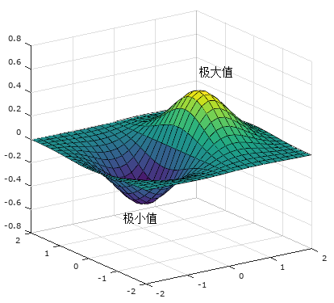

最后，还有一个常被问到的概念：原子电荷。它本身是不可观测的，不被量子力学理论直接定义。量子力学计算出的是连续的电荷密度，但并不清楚要如何把电荷分配给体系中的各个片段。原子电荷的划分有多种方案，包括基于电子轨道的 Mulliken population analysis、Density matrix based normal population analysis，以及其他只基于电荷密度的 Bader analysis、Hirshfeld analysis。不同方案给出的原子电荷可能差异很大，选择哪一种要看具体研究问题。


物理化学


假设将一个样品分成多个小块样品，如果原始样品的某一性质（如质量）的值是所有小块样品该性质值的总和，则该性质称为广度性质（extensiveproperty）。质量和体积都 是广度性质。但是，如果各小块样品的某一性质（如温度） 与原始样品的该性质保持相同值，则该性质称为强度性质 （intensiveproperty）。温度和压力都是强度性质。小块样品与 原始样品的质量密度 $\left( \rho=m/V \right)$ 数值相同，所以质量密度也 是强度性质。所有摩尔性质 $(X_{m}=X/n)$ 都是强度性质，其中  $x$ 和n则都是广度性质。

状态方程的一般形式：
$$
p=f(T,V,n)
$$
它难以写出具体的函数解析式，在特定的情况下，比如理想气体（完美气体）：
$$
pV=nRT
$$


气体动理论，kinetic molecular theory中，假设气体的能量仅仅来源于气体分子的动能，这是一个假设的模型。

动理论模型基于以下三个假设： 
1. 气体由质量为 $m$ 、做无规则无休止运动且服从**经典力学定律**的分子所组成。
2. 相对于分子间碰撞时分子运动的平均距离，分子的直径很小，其大小可忽略不计，类似 为“质点”。
3. 分子间仅通过弹性碰撞发生相互作用。 弹性碰撞（elasticcollision）是指分子总的平动能守恒的碰撞。

单个气体分子速率的分布非常广泛，碰撞则 确保气体分子运动速率不断变化。如果碰撞前分子做快速运动，碰撞后分子可能会加速，速率更快，且只能在下一次碰撞后才能减速。为了计算方均根速率，必须知道任一瞬间具有某一给定速 率的分子分数。速率为 $\upsilon$ 到 $\upsilon+d \upsilon$ 范围内的分子分 数正比于该速率范围的宽度，可写成 $f \left( v \right) dv$ ，其中  $f \left( v \right)$ 称为速率分布（distributionofspeed）。认识 到分子的能量全是动能，并进一步利用玻耳兹曼 分布来描述该能量在分子中的分布，就可以得到 速率分布的表达式。

$$
f \left( \nu \right)=4 \pi \left( \frac{M}{2 \pi RT} \right)^{3/2} \nu^{2}e^{-M \nu^{2}/2RT}
$$
这是Maxwell-Boltzmann速率分布函数，和其他分部函数一样，速率分布函数只有在与所研究速率范围内相乘后才有物理意义。

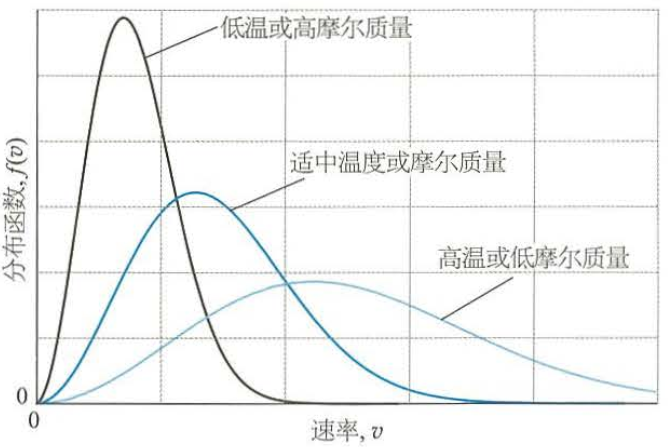

热力学中，系统的总能量称为内能（internal energy） $U$ 。系统的内能是系统中所有构成粒子的全部**动能和势能**之和。系统整体的宏观运动，如系统随地球一起进行的绕日运动也具有动能，但热力学中的内能不包括系统整体的**宏观运动动能**，也就是说，系统的内能只是指系统“内部”的能量。系统从某一始态变化到某一终态，内能就从 $U_{i}$ 变化到 $U_{f}$ ，相应的内 能变化量用 $\Delta U$ 表示： 

$$\Delta U=U_{f}-U_{i}\tag{(2A.1）}$$
可以根据玻耳兹曼分布计算给定温度下系统中原子或分子的每种运动方式具有的平均能量。但是，如果温度很高，则很多能级都被占据，对于这种情况，可用一种更简单的方法得到平均能量，即均分定理（equipartition theorem): 处于热平衡的系统，每个平方项对能量贡献的平均值为 $\frac{1}{2}kT$ ，“平方项贡献”表示的是这部分能量要么与动量的平方。

气体中的原子可以进行三维运动，其平动能为三个平方项 之和： 

$$E_{ \text{平动}}= \frac{1}{2}m \nu_{x}^{2}+ \frac{1}{2}m \nu_{y}^{2}+ \frac{1}{2}m \nu_{z}^{2}$$

 均分定理告诉我们，每个平方项的平均能量为kT，于是平均 动能为 $E_{ \text{平动}}=3 \times \frac{1}{2}kT= \frac{3}{2}kT$ ，摩尔平动能为 $E_{ \text{平动},m}= \frac{3}{2}kT \times N_{A}=$   $\frac{3}{2}RT_{\circ}25^{ \circ}C$ 时， $RT=2.48$ kJ. $mol^{-1}$ ，所以，完美气体摩尔内能 中的平动能为3.72kJ $mol^{-1}$


热力学第一定律的表述为：
> 隔离系统的内能是守恒的

有：
$$
\Delta U=q+w
$$
膨胀功，也即体积功，指的由体积变化所引起的功，包括气体对抗大气压力膨胀过程产生的功，当然有包括压缩过程所产生的功。其他类型的功（如电功）称为非膨胀功 (non-expansion work ）或额外功（additional work），这些非膨胀功或额外功的计算用到的也是类似公式，都是强度因子（如压力）和广度因子 （如体积变化）的乘积。

$$
\begin{array}
{l l l l l}\hline\hline\text{功的类型}&\mathrm{d}w&\text{说明}&\text{单位}^{\circ\circ}\\
\hline\text{膨胀功}&-p_{\mathrm{ex}}\mathrm{d}V&
\begin{array}
{l}p_{ \mathrm{ex}}\\
\mathrm{d}V
\end{array}
&
\begin{array}
{l}\text{外压}\\
\text{体积变化}
\end{array}
&
\begin{array}
{l}\mathrm{Pa}\\
\mathrm{m}^{\mathrm{a}}
\end{array}
\\
\text{表面功}&\gamma\mathrm{d}\sigma&
\begin{array}
{l}\gamma\\
\mathrm{d}\sigma
\end{array}
&
\begin{array}
{l}\text{表面张力}\\
\text{表面积变化}
\end{array}
&
\begin{array}
{l}\mathrm{N}\cdot\mathrm{m}^{ \mathrm{a}}\\
\mathrm{m}^{\mathrm{a}}
\end{array}
\\
\text{弹性功}&f\mathrm{d}l&f&
\begin{array}
{l}\text{弹力}\\
\text{长度变化}
\end{array}
&
\begin{array}
{l}\mathrm{N}
\end{array}
\\
\phi\mathrm{d}\mathsf{Q}&
\begin{array}
{l}\phi\\
\mathrm{d}\mathsf{Q}
\end{array}
&
\begin{array}
{l}\text{电势}\\
\text{电荷量变化}
\end{array}
&
\begin{array}
{l}\mathrm{V}
\end{array}
\\
\text{电功}&\mathsf{Q}\mathrm{d}\phi&
\begin{array}
{l}\mathrm{d}\phi\\
\mathsf{Q}
\end{array}
&
\begin{array}
{l}\text{电势差}\\
\text{流过的电荷量}
\end{array}
&
\begin{array}
{l}\mathsf{C}
\end{array}
\\
\hline\hline
\end{array}
$$
当系统体积发生改变的时候，内能变化并不等于系统-环境间交换的热，整如上文所见，$\Delta U=q+w$，系统-环境间的热量交换等于另一个新的物理量，焓。

在物理化学中，焓H的其中一个价值，就是把恒压条件下反复出现的“内能变化 + 膨胀功”**打包封装成一个状态函数**：
$$
H=U+pV
$$
化学中最常见的条件是等压。等压条件下， 随温度变化曲线在某给定温度下切线的斜率称 为定压热容（heatcapacityatconstantpressure）  $C_{p}$ ，定压热容可以更严谨地表示为 

$$C_{p}= \left( \frac{ \partial H}{ \partial T} \right)_{p}$$
大多数系统是在等压下加热膨胀，在这种情 况下，系统对环境做功，因此膨胀过程中系统吸 收的热量会有一部分又通过做功的方式被还回到 环境中，导致在等压条件下加热时系统温度的升 高值会比等容条件下低一些。吸收同样的热量所 产生的温度升高值较小时，就意味着系统有更大 的热容。因此，大多数情况下，系统的定压热容 都天于其定容热容：

$$C_{p}-C_{V}=nR$$

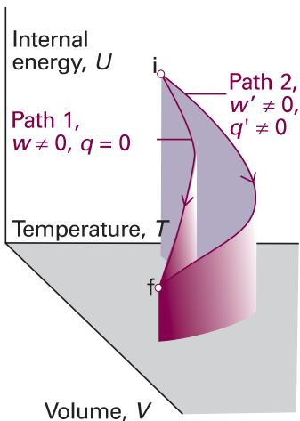

如上图：
$$
\Delta U = \int_ {\mathrm{i}} ^ {\mathrm{f}} \mathrm{d} U\tag{2.38}
$$

$\Delta U$​的值取决于系统的初态和终态，但与它们之间的路径无关。这种积分的路径无关性表明dU是“全微分”。一般来说，全微分是一种无穷小量，对其积分得到的结果与初末态之间的路径无关。

当系统被加热时，以热量形式传递的总能量是路径上每个点所有独立贡献的和：

$$
q=\int_{\rm i,path}^ f đ q
$$
我们不写Δ𝑞​，因为𝑞​不是状态函数​。其次，我们必须指定积分路径，因为𝑞​取决于所选路径（例如，绝热路径的𝑞=0​，而相同两个状态之间的非绝热路径𝑞≠0​）。这种路径依赖性表明đq是不完全微分。一般来说，不完全微分是一种无穷小量，对其积分得到的结果取决于初末态之间的路径。通常会将d𝑞​记为đq​以强调它是不完全微分，需要指定路径。


热力学第一定律引出了内能U的概念。内能是一个状态函数，可帮助我们判断一个变化是否可发生：只有孤立系统内能保持不变的变化才能够发生。用于标识自发变化标志的热力学第二定律，同样可以用另一个状态函数——熵S来表述。

熵的热力学定义为：
$$
\mathrm{d} S = \frac {\mathrm{d} q _ {\text { rev }}}{T}\tag{[3.1]}
$$
原子或分子只能拥有特定的能量，这些能量被称为“能级”。当T>0时，样品中的分子持续受到热搅动，这使得它们分布在可用的能级上。某一个分子在某一瞬间可能处于某个低能态，片刻之后就被激发到高能态。虽然我们无法追踪单个分子的能态，但我们可以讨论能级的布居数，即每个能级上的平均分子数；只要温度保持不变，这些布居数不随时间变化。

在T=0时，只有最低能态被占据。升高温度会将一些分子激发到更高能态，随着温度进一步升高，越来越多的能级变得可及（图3.4）。尽管如此，无论温度如何，低能态的布居数总是多于高能态。唯一的例外是温度无穷大时：此时系统的所有能级的布居数均等。奥地利物理学家Ludwig Boltzmann将这些结论定量总结为玻尔兹曼分布：

$$
N _ {i} = \frac {N \mathrm{e} ^ {- E _ {i} / k T}}{\sum_ {i} \mathrm{e} ^ {- E _ {i} / k T}}
$$
考虑一个由N个分子组成的封闭系统。尽管总能量E是恒定的，但无法确定能量在分子之间是如何分配的。碰撞不仅会导致能量在分子之间不断重新分布，也会在分子不同的运动模式之间不断重新分布。我们描述能量分布最准确的方式，就是给出某个态的布居数，即占据该态的平均分子数，并说明能量为$\varepsilon_{i}$的态平均有$n_{i}$个分子。各态的布居数几乎保持不变，但每次碰撞后，每个态中具体是哪些分子可能会发生变化。


在量子力学中，分子的总能量（E）并不是一个混沌的整体，而是由**不同独立运动形式**的能量之和（平动、转动、振动、电子）构成的。在一定的近似（波恩-奥本海默近似）下，**这些运动之间几乎不耦合**，即它们各自的能级（能量台阶）是相互独立的。配分函数也可以写成乘积形式。

任意组分的配分函数都可以通过以下关系确定该组分对熵的贡献S [McQuarrie, §7-6, Eq. 7.27]：

$$  
S = N k _ {B} + N k _ {B} \ln \left(\frac {q (V , T)}{N}\right) + N k _ {B} T \left(\frac {\partial \ln q}{\partial T}\right) _ {V}  
$$


# 关于点缺陷和杂质

发现了一篇有意思的方法学文献，REVIEWS OF MODERN PHYSICS, VOLUME 86, JANUARY–MARCH 2014。
是关于缺陷和杂志的偏向计算的方法学文献，正好至今也非常困惑就仔细读一读并且记录一下。

首先来熟悉一下n和p的概念:
- n型指电子载流子为电子本身，Fermi能级靠近CBM
- p型指电子载流子为空穴，Fermi能级靠近VBM

这与构成/晶体类型无关，哪怕一个材料是“很离子的晶体”，依然可以讨论 n 型、p 型；哪怕是共价半导体，也一样可以讨论缺陷的离子化和电荷补偿。

像Si中掺入少量P，如果多余的电子容易分布在导带上，那么相应的电子载流子就为电子，对应n型半导体，P被称为donor，施主；相反的例子则是B，它可以从价带攫取电子，留下空穴，B被称为acceptor，受主。

在讨论掺杂及其局限性的时候，通常需要考虑:
- 溶解度
- 本征点缺陷的补偿
- 外来杂志的补偿
- 扩散
- 热力学与相稳定性

电荷态为q的缺陷X的形成能定义为（Zhang and Northrup, 1991; Van de Walle et al., 1993）:
$$
E ^ {f} [ X ^ {q} ] = E _ {\text {tot }} [ X ^ {q} ] - E _ {\text {tot }} [ \text {bulk} ] - \sum_ {i} n _ {i} \mu_ {i} + q E _ {F} + E _ {\text {corr}}.\tag{1}
$$
$E_{\mathrm{tot}}[X^{q}]$是从包含缺陷$X$的超胞计算中得到的总能量，$E_{\mathrm{tot}}[\mathrm{bulk}]$是使用等效超胞的完美晶体的总能量。整数$n_{i}$表示为形成缺陷而添加到超胞中（$n_{i}>0$）或从超胞中移除（$n_{i}<0$）的第$i$类原子（主体原子或杂质原子）的数量，$\mu_{i}$是这些物种相应的化学势。化学势代表与原子进行交换的储库的能量。

